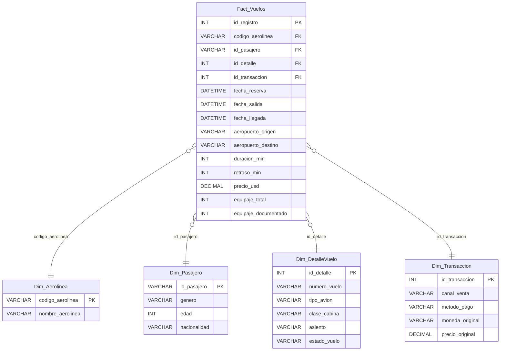

# Práctica 1 - Seminario de Sistemas 2: ETL con Python

## Descripción
Este proyecto implementa un proceso ETL (Extracción, Transformación y Carga) utilizando Python y Pandas, que lee un archivo CSV crudo con registros de vuelos, limpia y transforma los datos, y finalmente los carga en un modelo multidimensional en Microsoft SQL Server.

## Estructura del Proyecto

```text
PRACTICA1/
├── docs/
│   ├── 798_Practica_1_2S2026.pdf      # Instrucciones de la práctica
│   └── dataset_vuelos_crudo.csv       # Archivo de datos fuente
├── docker-compose.yml                 # Configuración del contenedor SQL Server
├── script_db.sql                      # DDL del Modelo Multidimensional
├── etl.py                             # Script de Extracción, Transformación y Carga
├── consultas.sql                      # Consultas analíticas y de validación
└── Instrucciones_Practica1.md         # Documentación de requerimientos
```

## Requisitos y Tecnologías
- **Python 3.10+** (Librerías: `pandas`, `sqlalchemy`, `pyodbc`)
- **Docker** (para ejecutar la instancia de Microsoft SQL Server 2022)
- **DBeaver / SSMS** (para administrar la base de datos)

## Instrucciones de Ejecución

1. **Levantar el servidor SQL Server:**
   Abre una terminal en esta carpeta y ejecuta:
   ```bash
   docker-compose up -d
   ```
2. **Crear la Base de Datos y las Tablas:**
   Conéctate a la base de datos (`localhost:1433`, usuario `sa`, contraseña `Practica1_SS2_2026!`). Crea la base de datos `DW_Vuelos` y ejecuta el script `script_db.sql` para generar las dimensiones y la tabla de hechos.
3. **Ejecutar el ETL:**
   Ejecuta el script en Python para cargar los datos:
   ```bash
   pip install pandas sqlalchemy pyodbc
   python etl.py
   ```
4. **Validación:**
   Abre y ejecuta `consultas.sql` en tu cliente SQL para verificar los indicadores clave y resultados de la carga.

## Modelo Multidimensional (Diagrama Entidad-Relación)

A continuación se muestra el esquema en estrella implementado para este Data Warehouse:



## Resultados de la Validación
- Todos los nulos y errores de formato (como fechas inconsistentes y comas en lugar de puntos decimales) fueron corregidos mediante `pandas`.
- Se mantiene la integridad referencial.
- Las consultas analíticas permiten obtener rápidamente información como destinos frecuentes y desempeño financiero.
