# Práctica 2 - Diseño de Dashboard y KPIs con Power BI

**Universidad de San Carlos de Guatemala,**
**Facultad de Ingeniería**

**Seminario de Sistemas 2**

**Estudiantes:**
- Johan Moisés Cardona Rosales - 202201405
- Estiben Yair Lopez Leveron - 202204578

**Grupo:** SS22S2026_G19

**Fecha de entrega:** 10/09/2026

---

## 1. Descripción general

Este dashboard da continuidad al Data Warehouse construido en la Práctica 1 (`DW_Vuelos`), un modelo dimensional en esquema estrella que almacena 10,000 transacciones de venta de boletos aéreos. El objetivo es transformar esos datos transaccionales en un tablero de control ejecutivo que permita monitorear, de un vistazo, el volumen de vuelos y pasajeros, los ingresos generados, el desempeño operativo (retrasos y cancelaciones) y la composición demográfica/comercial de la operación, apoyando decisiones estratégicas de aerolíneas y áreas comerciales.

Se conectó Power BI Desktop directamente al motor SQL Server de la Práctica 1, reutilizando el modelo multidimensional ya normalizado (una tabla de hechos y cuatro dimensiones), sobre el cual se construyeron 12 medidas DAX, un KPI con semáforo de tres estados y un dashboard interactivo de una sola página ("PRACTICA 2") con 9 visualizaciones de datos y 3 segmentadores.

 **Base de datos relacional** `DW_Vuelos` en Microsoft SQL Server, generada mediante el proceso ETL de la Práctica 1 (ver `PRACTICA1/scripts/etl.py` y `PRACTICA1/db/script_db.sql`).

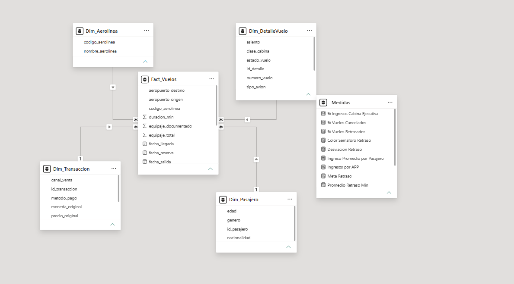

---

## 2. Estructura del modelo tabular

El modelo importado a Power BI conserva el esquema estrella diseñado en la Práctica 1 y agrega una tabla de medidas auxiliar para organizar el DAX.

### 2.1 Tablas del modelo

| Tabla | Tipo (Hecho / Dimensión) | Descripción |
|---|---|---|
| `Fact_Vuelos` | Hecho | Grano = un boleto/vuelo vendido. Contiene las métricas (`duracion_min`, `retraso_min`, `precio_usd`, `equipaje_total`, `equipaje_documentado`), las fechas del evento (`fecha_reserva`, `fecha_salida`, `fecha_llegada`) y los aeropuertos de origen/destino como atributos degenerados. |
| `Dim_Aerolinea` | Dimensión | Catálogo de aerolíneas por código IATA (`codigo_aerolinea`, `nombre_aerolinea`). |
| `Dim_Pasajero` | Dimensión | Datos demográficos del cliente: `genero`, `edad`, `nacionalidad`. |
| `Dim_DetalleVuelo` | Dimensión | Contexto operativo: `numero_vuelo`, `tipo_avion`, `clase_cabina`, `asiento`, `estado_vuelo`. |
| `Dim_Transaccion` | Dimensión | Contexto comercial de la venta: `canal_venta`, `metodo_pago`, `moneda_original`, `precio_original`. |
| `_Medidas` | Tabla de medidas (sin datos) | Tabla auxiliar vacía usada como contenedor organizador de las 12 medidas DAX del modelo. |

### 2.2 Relaciones establecidas

Todas las relaciones son de uno a varios entre `Fact_Vuelos` y cada dimensión, con filtrado cruzado en una sola dirección (dimensión → hecho), tal como quedó definido en el diseño de la Práctica 1:

| Tabla origen | Campo | Tabla destino | Campo | Cardinalidad |
|---|---|---|---|---|
| Fact_Vuelos | codigo_aerolinea | Dim_Aerolinea | codigo_aerolinea | Varios a uno (M:1) |
| Fact_Vuelos | id_detalle | Dim_DetalleVuelo | id_detalle | Varios a uno (M:1) |
| Fact_Vuelos | id_pasajero | Dim_Pasajero | id_pasajero | Varios a uno (M:1) |
| Fact_Vuelos | id_transaccion | Dim_Transaccion | id_transaccion | Varios a uno (M:1) |

### 2.3 Jerarquías definidas

| Jerarquía | Niveles | Tabla |
|---|---|---|
| Jerarquía de fechas (automática de Power BI) | Año > Trimestre > Mes > Día | `Fact_Vuelos[fecha_salida]` y `Fact_Vuelos[fecha_llegada]` (cada columna de fecha genera su propia tabla de fechas oculta) |
| Jerarquía comercial | canal_venta > moneda_original | `Dim_Transaccion` |

La jerarquía de fechas se usa para analizar la tendencia del retraso promedio y del % de vuelos retrasados a través del tiempo (línea de tendencia del KPI y gráfico de líneas por mes), y para el segmentador de fecha de llegada (Año/Mes/Día). La jerarquía comercial permite filtrar por canal de venta y, dentro de él, por la moneda original de la transacción.

---

## 3. Medidas DAX implementadas

Se crearon 12 medidas DAX (4 veces más de las 3 mínimas requeridas), agrupadas en la tabla `_Medidas`:

| # | Medida | Fórmula DAX | Descripción / Propósito |
|---|---|---|---|
| 1 | Total Ingresos USD | `SUM(Fact_Vuelos[precio_usd])` | Ingreso bruto total generado por la venta de boletos. |
| 2 | Total Vuelos | `COUNTROWS(Fact_Vuelos)` | Conteo de boletos/vuelos vendidos (volumen operativo). |
| 3 | Total Pasajeros | `DISTINCTCOUNT(Dim_Pasajero[id_pasajero])` | Número de pasajeros únicos que han comprado un boleto. |
| 4 | Promedio Retraso Min | `AVERAGE(Fact_Vuelos[retraso_min])` | Retraso promedio, en minutos, de los vuelos filtrados. |
| 5 | % Vuelos Retrasados | `DIVIDE(CALCULATE(COUNTROWS(Fact_Vuelos), Fact_Vuelos[retraso_min] > 0), COUNTROWS(Fact_Vuelos), 0)` | Proporción de vuelos que salieron con algún retraso. Es el indicador del KPI principal. |
| 6 | % Vuelos Cancelados | `DIVIDE(CALCULATE([Total Vuelos], Dim_DetalleVuelo[estado_vuelo] = "CANCELLED"), [Total Vuelos])` | Proporción de vuelos cancelados sobre el total. |
| 7 | Meta Retraso | `0.15` | Umbral fijo de referencia (15%) que define el objetivo de tolerancia a vuelos retrasados; se usa como meta del KPI. |
| 8 | Desviación Retraso | `[% Vuelos Retrasados] - [Meta Retraso]` | Diferencia entre el % real de retrasos y la meta; positivo indica que se excede el objetivo. |
| 9 | Color Semáforo Retraso | `IF([% Vuelos Retrasados] <= [Meta Retraso], "Green", IF([% Vuelos Retrasados] <= [Meta Retraso] + 0.05, "Yellow", "Red"))` | Medida de color condicional (semáforo) reutilizada como formato condicional en 5 visualizaciones distintas del dashboard. |
| 10 (avanzada) | Ingreso Promedio por Pasajero | `DIVIDE([Total Ingresos USD], [Total Pasajeros])` | Ticket promedio de ingreso por pasajero único. |
| 11 (avanzada) | Ingresos por APP | `CALCULATE([Total Ingresos USD], Dim_Transaccion[canal_venta] = "APP")` | Ingresos generados específicamente por el canal de venta móvil (APP), para medir la penetración del canal digital. |
| 12 (avanzada) | % Ingresos Cabina Ejecutiva | `DIVIDE(CALCULATE([Total Ingresos USD], Dim_DetalleVuelo[clase_cabina] = "Ejecutiva"), [Total Ingresos USD])` | Participación de la cabina ejecutiva dentro del ingreso total, como indicador de mezcla de producto premium. |

---

## 4. KPI implementado

- **Indicador:** % Vuelos Retrasados (proporción de boletos cuyo `retraso_min` fue mayor a 0).
- **Meta / umbral definido:** 15% (`Meta Retraso = 0.15`).
- **Semáforo / indicador visual** (medida `Color Semáforo Retraso`):
  - Verde: `% Vuelos Retrasados` ≤ 15% (dentro de la meta).
  - Amarillo: `% Vuelos Retrasados` entre 15% y 20% (excede la meta hasta en 5 puntos porcentuales).
  - Rojo: `% Vuelos Retrasados` > 20% (desviación crítica respecto a la meta).
- **Visual KPI:** además del semáforo, se implementó una visualización nativa `KPI` de Power BI con indicador = `% Vuelos Retrasados`, meta = `Meta Retraso` y línea de tendencia por mes de `fecha_salida`; la dirección se configuró como *Negative* (un valor más alto es indeseable, ya que se mide un problema operativo).
- **Interpretación:** un semáforo en verde indica que la operación está cumpliendo el objetivo de puntualidad. En amarillo, aunque no es crítico, alerta a la aerolínea de una tendencia al alza en retrasos que conviene monitorear. En rojo, más de una quinta parte de los vuelos se retrasan, lo que exige una acción correctiva (revisión de rutas, aeronaves o aerolíneas involucradas) porque impacta directamente en la satisfacción del pasajero y en costos operativos.
- La medida `Color Semáforo Retraso` no solo colorea el KPI: se reutilizó como formato condicional en el gráfico de columnas de ingresos, en la dona de estado de vuelo, en el gráfico de líneas de tendencia y en el mapa, de modo que todo el dashboard "respira" el mismo semáforo de puntualidad.

---

## 5. Dashboard y visualizaciones

El dashboard se construyó en una sola página ("PRACTICA 2") con 9 visualizaciones de datos, 1 KPI y 3 segmentadores, todos interconectados por interacción cruzada (`drillFilterOtherVisuals`).

### 5.1 Visualizaciones incluidas

| # | Tipo de visualización | Qué muestra |
|---|---|---|
| 1 | Tarjeta (card) | Total Ingresos USD |
| 2 | Tarjeta (card) | Total Pasajeros |
| 3 | Tarjeta (card) | Promedio Retraso Min |
| 4 | Tarjeta (card) | % Vuelos Cancelados |
| 5 | KPI (con meta y semáforo) | % Vuelos Retrasados vs. Meta Retraso, con tendencia mensual (`fecha_salida`) |
| 6 | Gráfico de columnas | Total Ingresos USD por `nombre_aerolinea`, coloreado con el semáforo de retraso |
| 7 | Gráfico de líneas | Promedio Retraso Min por mes (`fecha_salida`), coloreado con el semáforo de retraso |
| 8 | Gráfico de dona | Total Vuelos por `estado_vuelo` (ON_TIME / DELAYED / CANCELLED), coloreado con el semáforo de retraso |
| 9 | Gráfico de dona | Ingreso Promedio por Pasajero por `género` |
| 10 | Mapa (Azure Map) | Total Ingresos USD por `nacionalidad` del pasajero, en burbujas sobre mapa satelital, coloreado con el semáforo de retraso |

### 5.2 Filtros / segmentadores

- **Fecha:** segmentador sobre la jerarquía de fechas de `fecha_llegada` (Año > Mes > Día), excluye por defecto los valores en blanco.
- **Nombres de aerolíneas:** segmentador tipo dropdown sobre `Dim_Aerolinea[nombre_aerolinea]`.
- **Canal de ventas:** segmentador sobre la jerarquía `canal_venta > moneda_original` de `Dim_Transaccion`, con el valor `'DESCONOCIDO'` excluido por defecto para enfocar el análisis en canales identificados.

Los tres segmentadores afectan a todas las demás visualizaciones de la página, permitiendo, por ejemplo, aislar el comportamiento de ingresos y retrasos de una sola aerolínea en un rango de fechas específico.

### 5.3 Capturas del dashboard

<!-- CAPTURA 1: Vista general del dashboard -->
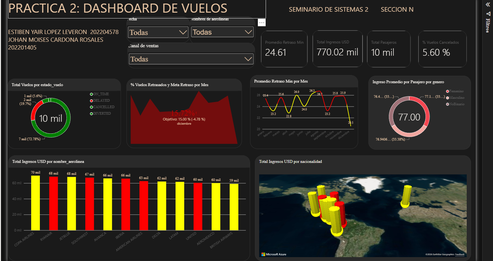

<!-- CAPTURA 2: Detalle de las medidas DAX / panel de medidas -->
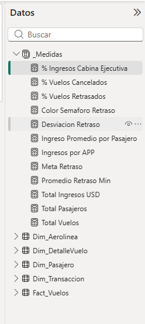

**Medida 1: % Ingresos Cabina Ejecutiva**
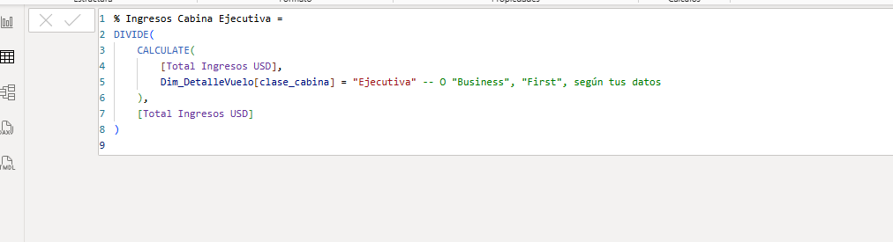

**Medida 2: % Vuelos Cancelados**
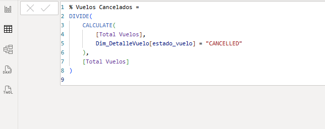

**Medida 3: % Vuelos Retrasados**
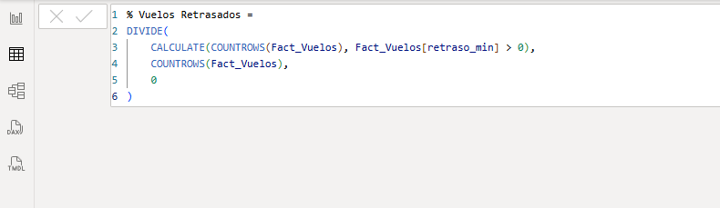

**Medida 4: Color Semáforo Retraso**
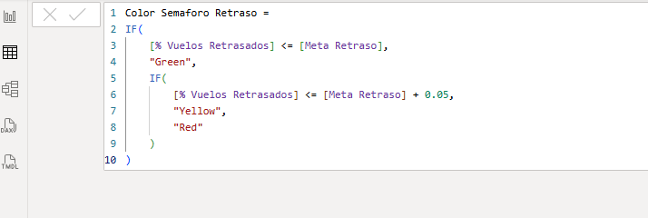

**Medida 5: Desviación Retraso**
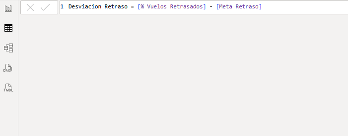

**Medida 6: Ingreso Promedio por Pasajero**
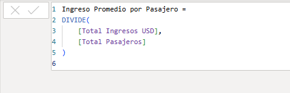

**Medida 7: Ingresos por APP**
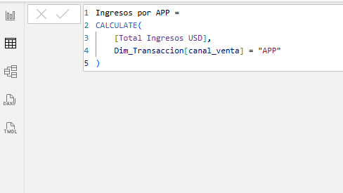

**Medida 8: Meta Retraso**
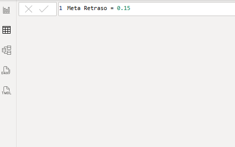

**Medida 9: Promedio Retraso Min**
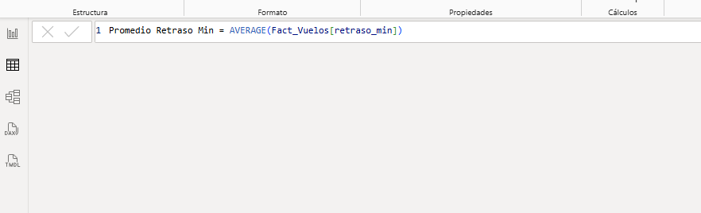

**Medida 10: Total Ingresos USD**
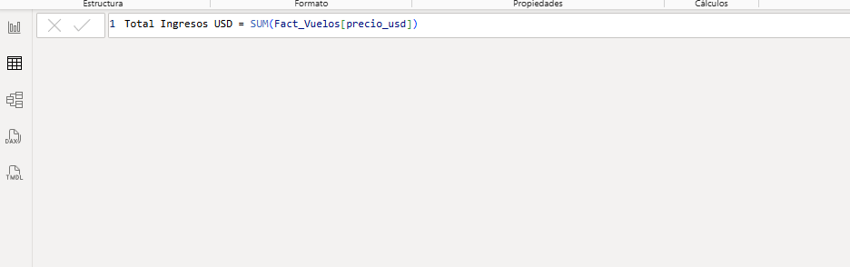

**Medida 11: Total Pasajeros**
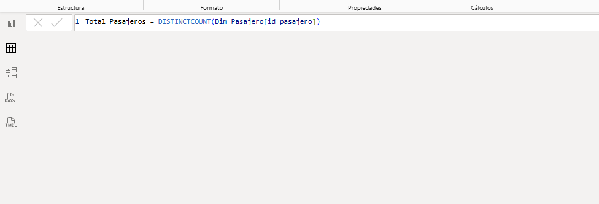

**Medida 12: Total Vuelos**
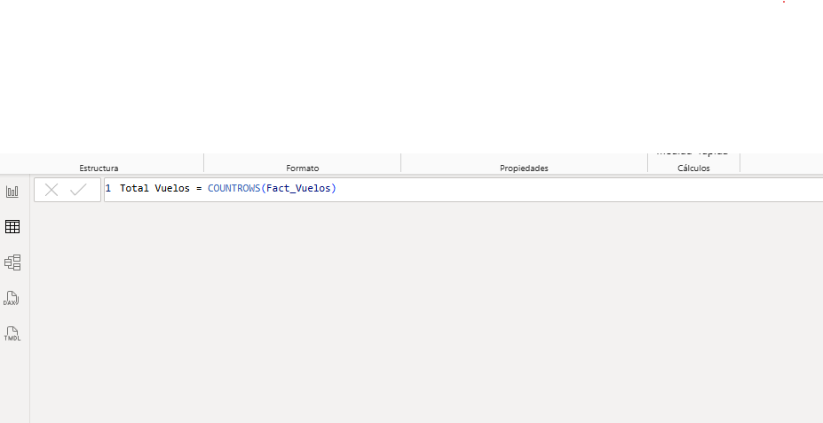

<!-- CAPTURA 3: KPI con semáforo/indicador -->

**KPI con semáforo**
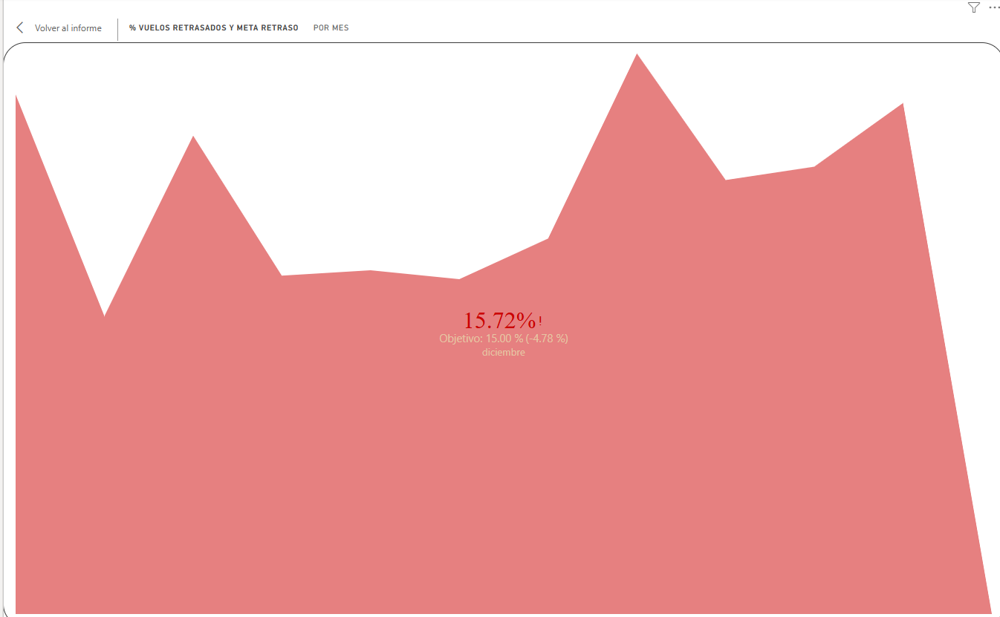

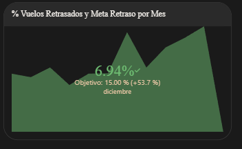

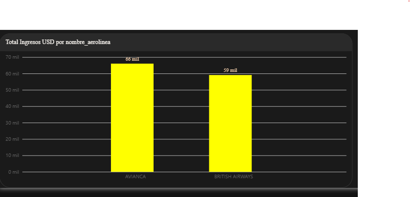

<!-- CAPTURA 4: Filtros/segmentadores en uso -->

**Filtros Aplicados**
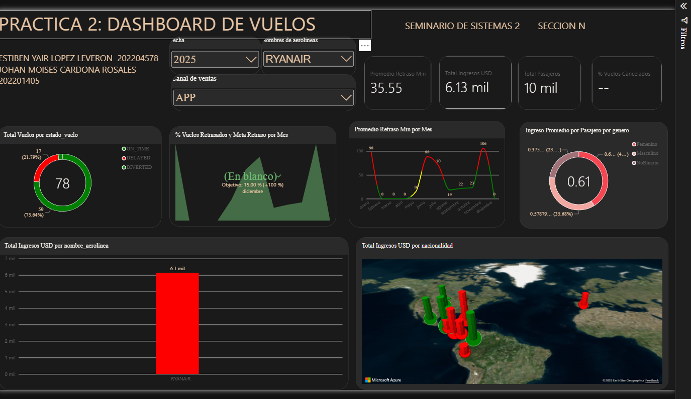

---

## 6. Relevancia estratégica

El conjunto de KPIs e indicadores apoya distintas decisiones dentro de una aerolínea o agencia de viajes:

- **% Vuelos Retrasados y su semáforo** sirven al área de operaciones para monitorear el cumplimiento del SLA de puntualidad (meta de 15%). Un semáforo en rojo dispara una revisión de causas raíz (aeronave, ruta, aerolínea) antes de que el problema erosione la satisfacción del cliente o genere penalizaciones contractuales.
- **Total Ingresos USD e Ingreso Promedio por Pasajero**, desglosados por aerolínea (columnas) y nacionalidad (mapa), ayudan al área comercial a identificar qué aerolíneas y qué mercados geográficos generan más valor, orientando negociaciones y campañas de marketing dirigidas.
- **Ingresos por APP y % Ingresos Cabina Ejecutiva** permiten evaluar la estrategia de canal digital y de mezcla de producto premium, información clave para decisiones de inversión en el canal móvil o en la oferta de cabina ejecutiva.
- **% Vuelos Cancelados** complementa el indicador de retrasos como una segunda vista de la confiabilidad operativa, relevante para la gestión de riesgo y reputación de la aerolínea.
- Los segmentadores de fecha, aerolínea y canal de venta permiten que un mismo dashboard sirva a distintos niveles de la organización (gerencia general viendo el total vs. un gerente de aerolínea o canal viendo su propio corte), sin necesidad de construir reportes separados.

---

## 7. Conclusiones

- Reutilizar el modelo dimensional de la Práctica 1 (esquema estrella con una tabla de hechos y cuatro dimensiones) simplificó considerablemente el modelado en Power BI, ya que las relaciones M:1 y las llaves foráneas ya estaban correctamente definidas desde el diseño ETL.
- Centralizar las medidas en una tabla auxiliar `_Medidas` facilitó mantener el modelo ordenado y reutilizar medidas base (`Total Ingresos USD`, `Total Vuelos`, `Total Pasajeros`) dentro de medidas derivadas más complejas (`Ingreso Promedio por Pasajero`, `Desviación Retraso`, `% Ingresos Cabina Ejecutiva`), aplicando el principio de medidas compuestas de DAX.
- La medida de color `Color Semáforo Retraso` demostró ser muy versátil: al definirse una sola vez, pudo reutilizarse como formato condicional en cinco visualizaciones distintas (KPI, columnas, líneas, dona y mapa), dando consistencia visual a todo el dashboard sin duplicar lógica.
- Una dificultad encontrada fue que el esquema original de la Práctica 1 no incluye una dimensión de fecha explícita (las fechas viven como atributos degenerados en `Fact_Vuelos`); esto se resolvió apoyándose en las tablas de fechas automáticas que genera Power BI para cada columna de tipo fecha, lo cual fue suficiente para construir la jerarquía Año-Trimestre-Mes-Día requerida.
- Como mejora futura, se podría materializar una `Dim_Fecha` explícita en el Data Warehouse de SQL Server (en lugar de depender de las tablas de fecha automáticas de Power BI) y agregar medidas de comparación interanual (YoY) sobre ingresos y retrasos, aprovechando que ya existe la jerarquía temporal necesaria para ese cálculo.
