# Documentación técnica — Proyecto 1

**Implementación de un flujo moderno de datos con Python, Apache Airflow, dbt y PostgreSQL**

| | |
|---|---|
| Curso | Seminario de Sistemas 2 — 2S2026 |
| Universidad | Universidad de San Carlos de Guatemala, Facultad de Ingeniería |
| Grupo | 19 |
| Integrantes | **Estiben Yair Lopez Leveron** — 202204578<br>**Johan Moises Cardona Rosales** — 202201405 |

---

## Índice

- [Descripción general](#descripción-general)
- [Arquitectura](#arquitectura)
- [Fuentes de datos](#fuentes-de-datos)
- [Proceso de extracción y carga (Python)](#proceso-de-extracción-y-carga-python)
- [DAG de Airflow](#dag-de-airflow)
- [Estructura del Data Warehouse en PostgreSQL](#estructura-del-data-warehouse-en-postgresql)
- [Proyecto dbt](#proyecto-dbt)
- [Pruebas de calidad y validación](#pruebas-de-calidad-y-validación)
- [Consultas analíticas](#consultas-analíticas)
- [Justificación del diseño](#justificación-del-diseño)
- [Configuración](#configuración)
- [Manual de implementación](#manual-de-implementación)
- [Estructura del repositorio](#estructura-del-repositorio)
- [Resultados y evidencia de ejecución](#resultados-y-evidencia-de-ejecución)
- [Limitaciones conocidas](#limitaciones-conocidas)

---

## Descripción general

SG-Food es una empresa de distribución y comercialización de productos de diversas marcas y
categorías. Sus reportes dependían directamente de la base transaccional, con procesos manuales,
poca trazabilidad de las transformaciones y sin pruebas de calidad.

Este proyecto implementa un flujo **ELT** reproducible:

1. **Extract & Load (Python):** se copia un snapshot de la base transaccional y un archivo CSV al
   schema `raw` del Data Warehouse.
2. **Transform (dbt):** se limpian e integran los datos en `staging` y se construye un modelo
   estrella en `marts`.
3. **Orquestación (Airflow):** un DAG diario ejecuta carga → `dbt run` → `dbt test` → validación →
   `dbt docs generate`, deteniéndose ante cualquier fallo.

El alcance analítico implementado es **ventas** por producto, cliente, sucursal y tiempo.

---

## Arquitectura

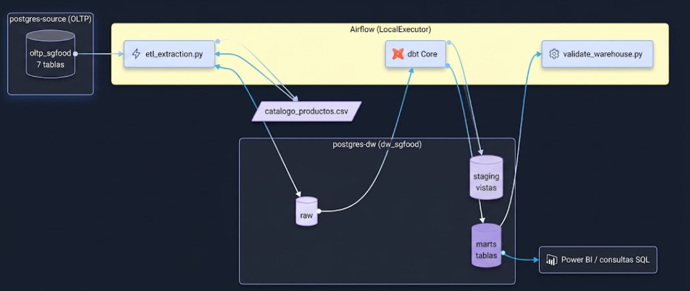

Todos los componentes corren en Docker Compose:

| Servicio | Imagen | Función |
|---|---|---|
| `postgres-source` | postgres:15 | Base transaccional; se inicializa con `data/Data-20260930/sgfood_oltp.sql` |
| `postgres-dw` | postgres:15 | Data Warehouse `dw_sgfood` con schemas `raw`, `staging`, `marts` |
| `postgres-airflow` | postgres:15 | Metadatos de Airflow |
| `airflow-init` | sgfood-airflow:local | Migra la base de Airflow y crea el usuario `admin` |
| `airflow-webserver` | sgfood-airflow:local | Interfaz web en `http://localhost:8081` |
| `airflow-scheduler` | sgfood-airflow:local | Programa y ejecuta las tareas del DAG |

La imagen `sgfood-airflow:local` ([Dockerfile](../Dockerfile)) extiende `apache/airflow:2.10.5-python3.10`
con dbt-core, dbt-postgres y psycopg2, de modo que Airflow ejecuta dbt dentro del mismo contenedor.

---

## Fuentes de datos

### Base de datos transaccional

Archivo [`data/Data-20260930/sgfood_oltp.sql`](../data/Data-20260930/sgfood_oltp.sql), provisto para
el proyecto (datos ficticios). Crea el schema `oltp_sgfood`:

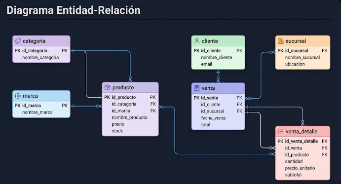

| Tabla | Registros | Contenido |
|---|---:|---|
| sucursal | 6 | Nombre, ciudad, departamento |
| categoria | 8 | Categorías de producto |
| marca | 10 | Marcas |
| producto | 80 | SKU, nombre, categoría, marca, unidad, costo base, precio de lista, activo |
| cliente | 250 | NIT, nombre, tipo, municipio, departamento, fecha de alta |
| venta | 1,200 | Fecha, cliente, sucursal, canal, método de pago, estado |
| venta_detalle | 3,209 | Producto, cantidad, precio unitario, descuento, subtotal |

### Archivo CSV

`catalogo_productos.csv` (id_producto, sku, precio_lista, costo_base). Python lo genera en
`exports/` y luego lo **lee con el módulo `csv`** para cargarlo en `raw.catalogo_csv`.
Ver la limitación en [Limitaciones conocidas](#limitaciones-conocidas).

---

## Proceso de extracción y carga (Python)

### Scripts

| Script | Cuándo se ejecuta | Qué hace |
|---|---|---|
| [`scripts/etl_extraction.py`](../scripts/etl_extraction.py) | Tarea `extract_and_load_raw` del DAG | Extrae las 7 tablas de la fuente y el CSV, y los carga en `raw` |
| [`scripts/validate_warehouse.py`](../scripts/validate_warehouse.py) | Tarea `validate_analytics` del DAG | Aplica PK/FK físicas y concilia conteos e importes entre `raw` y `marts` |
| [`scripts/setup_local.py`](../scripts/setup_local.py) | Una vez, antes del primer `docker compose up` | Genera `.env` con contraseñas aleatorias |
| [`scripts/audit_repository.py`](../scripts/audit_repository.py) | Antes de hacer commit | Verifica que no se versionen credenciales |

### Flujo de `extract_and_load_data()`

1. Abre dos conexiones con `psycopg2`: `SOURCE_*` (fuente) y `DW_*` (warehouse), leídas de variables de entorno.
2. Configura la fuente como `REPEATABLE READ, readonly`: todas las tablas se leen del **mismo snapshot**.
3. Toma `pg_advisory_xact_lock(7982026)` en el destino para impedir dos cargas simultáneas.
4. Para cada tabla (`sucursal`, `categoria`, `marca`, `producto`, `cliente`, `venta`, `venta_detalle`):
   - lee los datos con `SELECT *`;
   - lee los tipos desde `information_schema.columns` y crea `raw.<tabla>` con los mismos tipos
     (falla si encuentra un tipo no soportado);
   - ejecuta `TRUNCATE` e inserta todas las filas (`executemany`) con identificadores y valores parametrizados.
5. Exporta el catálogo de productos a CSV, lo vuelve a leer con `csv.DictReader` y lo inserta en `raw.catalogo_csv`.
6. Verifica que el conteo de cada tabla en destino sea igual al extraído y mayor que cero.
7. Hace `COMMIT` una sola vez. Ante cualquier excepción hace `ROLLBACK`, registra el error y lo
   relanza para que Airflow marque la tarea como fallida y la reintente.

**Limpieza técnica mínima:** se conservan nombres y tipos de la fuente; la limpieza de negocio
(trim, mayúsculas, conversiones) se hace en dbt, como corresponde a un enfoque ELT.

---

## DAG de Airflow

Archivo [`dags/etl_sgfood_dag.py`](../dags/etl_sgfood_dag.py), DAG `sgfood_etl_pipeline`.

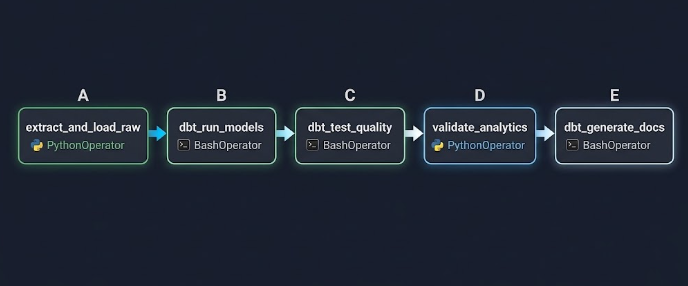

| Tarea | Operador | Acción |
|---|---|---|
| `extract_and_load_raw` | PythonOperator | `extract_and_load_data()` — carga `raw` |
| `dbt_run_models` | BashOperator | `dbt run --profiles-dir .` — construye staging, intermediate y marts |
| `dbt_test_quality` | BashOperator | `dbt test --profiles-dir .` — ejecuta las 46 pruebas |
| `validate_analytics` | PythonOperator | `validate_warehouse()` — PK/FK y conciliación raw ↔ marts |
| `dbt_generate_docs` | BashOperator | `dbt docs generate --profiles-dir .` — documentación automática |

| Parámetro | Valor | Motivo |
|---|---|---|
| `schedule` | `@daily` (00:00 UTC, 18:00 Guatemala) | Ejecución programada |
| `start_date` | 2026-01-01 | |
| `catchup` | `False` | No ejecutar los días pasados desde `start_date` |
| `max_active_runs` | 1 | Evita dos ejecuciones simultáneas |
| `retries` / `retry_delay` | 1 / 1 minuto | Tolerancia a fallos transitorios |
| Pausado al crearse | Sí | Evita cargas antes de revisar el entorno |

**Manejo de errores:** cada tarea depende del éxito de la anterior (`all_success`). Si una prueba
dbt falla, no se ejecuta la validación ni la documentación. Las tareas Python relanzan las
excepciones y la carga se revierte por completo. Los logs quedan en `logs/` y en la interfaz de Airflow.

---

## Estructura del Data Warehouse en PostgreSQL

Base `dw_sgfood`, con tres schemas creados por [`sql/01_init_schemas.sql`](../sql/01_init_schemas.sql):

| Schema | Capa | Contenido | Creado por |
|---|---|---|---|
| `raw` | Aterrizaje | Copia fiel de la fuente y del CSV | Python |
| `staging` | Limpieza e integración | Vistas `stg_*` e `int_*` | dbt |
| `marts` | Analítica | Dimensiones, hecho y agregado | dbt |

### Modelo estrella

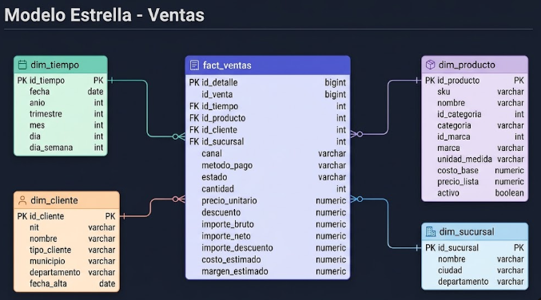

### Tabla de hechos `fact_ventas`

**Grano: una fila por línea de detalle de venta (`id_detalle`).**

| Columna | Tipo | Descripción |
|---|---|---|
| id_detalle | bigint, PK | Identificador del detalle |
| id_venta | bigint | Dimensión degenerada: número de venta |
| id_tiempo | integer, FK | Fecha en formato `YYYYMMDD` |
| id_producto, id_cliente, id_sucursal | integer, FK | Llaves hacia las dimensiones |
| canal, metodo_pago, estado | varchar | Atributos degenerados de la venta |
| cantidad | integer | Unidades vendidas |
| precio_unitario | numeric(12,2) | Precio aplicado |
| descuento | numeric(5,4) | Proporción de descuento (0 a 1) |
| importe_bruto | numeric | `cantidad × precio_unitario` |
| importe_neto | numeric(14,2) | Subtotal de la fuente (con descuento) |
| importe_descuento | numeric | `importe_bruto − importe_neto` |
| costo_estimado | numeric | `cantidad × costo_base` del catálogo actual |
| margen_estimado | numeric | `importe_neto − costo_estimado` |

### Dimensiones

| Dimensión | Llave | Atributos | Origen |
|---|---|---|---|
| `dim_tiempo` | id_tiempo (`YYYYMMDD`) | fecha, anio, trimestre, mes, dia, dia_semana (ISO, 1 = lunes) | Generada con `generate_series` entre la primera y la última venta |
| `dim_producto` | id_producto | sku, nombre, categoría, marca, unidad, costo, precio, activo | `stg_producto` + `stg_categoria` + `stg_marca` |
| `dim_cliente` | id_cliente | nit, nombre, tipo_cliente, municipio, departamento, fecha_alta | `stg_cliente` |
| `dim_sucursal` | id_sucursal | nombre, ciudad, departamento | `stg_sucursal` |

### Agregado `ventas_mensuales`

Una fila por año, mes y sucursal, **solo con ventas `COMPLETADA`**: unidades, número de ventas,
ingreso neto y margen estimado.

### Scripts DDL

| Archivo | Contenido |
|---|---|
| [`sql/01_init_schemas.sql`](../sql/01_init_schemas.sql) | Creación de los schemas `raw`, `staging` y `marts` |
| [`sql/02_modelo_dimensional.sql`](../sql/02_modelo_dimensional.sql) | `CREATE TABLE` de dimensiones y hecho, PK, FK, `NOT NULL` e índices. Se ejecuta después de `dbt run` |

---

## Proyecto dbt

Carpeta [`dbt_sgfood/`](../dbt_sgfood/), perfil `sgfood_profile` (adapter `postgres`).

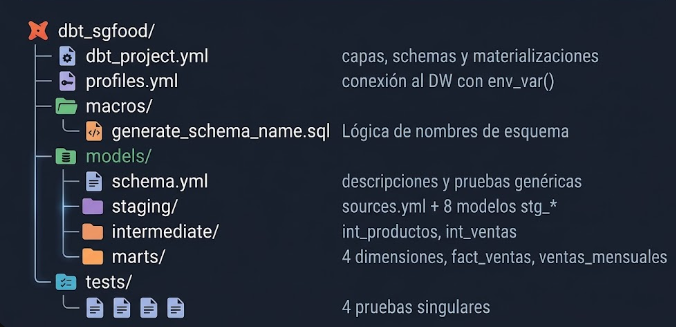

### Capas y materializaciones

| Capa | Schema | Materialización | Modelos |
|---|---|---|---|
| Sources | `raw` | — | 8 tablas declaradas en `sources.yml` (`source('sgfood', ...)`) |
| Staging | `staging` | view | `stg_sucursal`, `stg_categoria`, `stg_marca`, `stg_producto`, `stg_cliente`, `stg_venta`, `stg_venta_detalle`, `stg_catalogo_csv` |
| Intermediate | `staging` | view | `int_productos` (producto + categoría + marca), `int_ventas` (detalle + venta + importes y costo) |
| Marts | `marts` | table | `dim_tiempo`, `dim_producto`, `dim_cliente`, `dim_sucursal`, `fact_ventas`, `ventas_mensuales` |

La macro `generate_schema_name` hace que dbt use exactamente `staging` y `marts` en lugar de
concatenar el schema del perfil (`marts_staging`). `persist_docs` guarda las descripciones como
comentarios en PostgreSQL.

### Transformaciones de staging

- `trim()` en todos los textos.
- `upper()` en SKU, tipo de cliente, canal, método de pago y estado.
- `lower()` en unidad de medida.
- `fecha::date` en ventas.

### Linaje

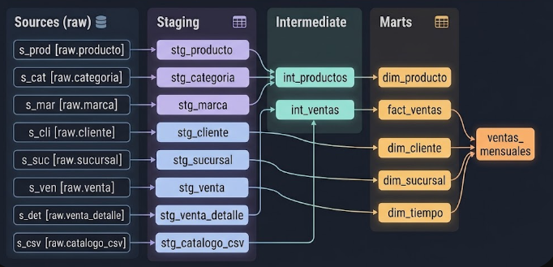

### Documentación automática

La tarea `dbt_generate_docs` produce `dbt_sgfood/target/index.html`, `catalog.json` y
`manifest.json`. Para visualizarla, ver el paso 7 de [Manual de implementación](#manual-de-implementación).

---

## Pruebas de calidad y validación

La validación se hace en tres niveles.

### Pruebas genéricas de dbt (42)

| Prueba | Modelos |
|---|---|
| `unique` + `not_null` sobre la llave | Los 8 staging, los 2 intermediate, las 4 dimensiones y `fact_ventas` |
| `not_null` + `relationships` | `stg_venta_detalle.id_venta → stg_venta`, `stg_venta_detalle.id_producto → stg_producto` |
| `not_null` + `relationships` | `fact_ventas` → `dim_producto`, `dim_cliente`, `dim_sucursal`, `dim_tiempo` |

### Pruebas singulares de dbt (4)

| Archivo | Valida |
|---|---|
| [`reconciliacion_ventas.sql`](../dbt_sgfood/tests/reconciliacion_ventas.sql) | Mismo conteo e importe entre `raw.venta_detalle` y `fact_ventas` |
| [`subtotales_consistentes.sql`](../dbt_sgfood/tests/subtotales_consistentes.sql) | `subtotal ≈ cantidad × precio × (1 − descuento)` y rangos válidos |
| [`estados_validos.sql`](../dbt_sgfood/tests/estados_validos.sql) | Estado ∈ {COMPLETADA, ANULADA, PENDIENTE} |
| [`catalogo_concuerda.sql`](../dbt_sgfood/tests/catalogo_concuerda.sql) | El CSV coincide con los productos de la fuente |

### Validación en Python (`validate_analytics`)

1. Ejecuta `sql/02_modelo_dimensional.sql`: aplica la PK de cada tabla, las 4 FK del hecho e índices.
   PostgreSQL rechazaría la operación si existieran duplicados o huérfanos.
2. Compara el conteo de `raw.venta_detalle` contra `fact_ventas`.
3. Compara el ingreso de ventas `COMPLETADA` en `raw` contra `marts`.
4. Falla la tarea si alguna diferencia existe o si el hecho está vacío.

---

## Consultas analíticas

Archivo [`sql/03_consultas_analiticas.sql`](../sql/03_consultas_analiticas.sql):

| # | Consulta | Propósito |
|---|---|---|
| 1 | Ventas completadas por mes y sucursal | Tendencia y comparación entre sucursales |
| 2 | Top 10 productos por ingreso neto | Productos más rentables, con categoría y marca |
| 3 | Ventas, detalles e importe por estado | Control de anuladas y pendientes |
| 4 | Conteo e importe raw vs. hechos | Reconciliación de la carga |

---

## Justificación del diseño

| Decisión | Alternativa descartada | Justificación |
|---|---|---|
| **ELT** (cargar crudo, transformar en el DW) | ETL en Python | La lógica de negocio queda versionada en SQL, probada y documentada por dbt; `raw` permite reprocesar sin volver a consultar la fuente. |
| **Schemas separados** `raw` / `staging` / `marts` | Un solo schema | Lo pide el enunciado; separa responsabilidades y permisos y deja clara la trazabilidad por capa. |
| **Modelo estrella** | Copo de nieve | Menos joins para el análisis. Categoría y marca se desnormalizan en `dim_producto` porque son pequeñas y estables. |
| **Grano = detalle de venta** | Grano = venta | Permite analizar por producto sin perder información; los totales por venta se obtienen agregando por `id_venta`. |
| **Llaves naturales** de la fuente | Surrogate keys | Los identificadores de la fuente son enteros, estables y únicos; con dimensiones tipo 1 una surrogate key no aporta y complica la conciliación. |
| **Dimensiones tipo 1** | Tipo 2 (historia) | La fuente no registra cambios históricos; cada carga refleja el estado actual. |
| **`dim_tiempo` generada** | Fechas tomadas solo de las ventas | Incluye días sin ventas, necesario para series de tiempo continuas. |
| **Hecho con todos los estados** | Solo COMPLETADA | Conserva trazabilidad de anuladas y pendientes; el agregado y las consultas filtran COMPLETADA para ingresos. |
| **Vistas** en staging/intermediate, **tablas** en marts | Todo tabla | Las vistas no duplican datos y siempre reflejan `raw`; los marts se materializan porque se consultan con frecuencia. |
| **Recarga completa** (TRUNCATE + INSERT) | Carga incremental | El volumen es pequeño (≈5 mil filas); es idempotente y no acumula duplicados. |
| **Snapshot REPEATABLE READ + transacción única** | Carga tabla por tabla | Garantiza consistencia entre tablas y que un fallo no deje `raw` a medias. |
| **PK/FK físicas además de pruebas dbt** | Solo pruebas dbt | La base de datos hace cumplir la integridad referencial, no solo la verifica. |
| **Docker Compose** | Instalación local | Mismo entorno en Windows y Linux, versiones fijadas, un comando para levantar todo. |
| **Credenciales en `.env`** | Valores fijos en código | Parametrización de conexiones (opcional del enunciado) y nada sensible en Git. |

---

## Configuración

### Variables de entorno (`.env`)

Generadas por `scripts/setup_local.py`; el archivo está en `.gitignore`.

| Variable | Uso |
|---|---|
| `SOURCE_PASSWORD` | Contraseña de `postgres-source` |
| `DW_PASSWORD` | Contraseña de `postgres-dw` |
| `AIRFLOW_DB_PASSWORD` | Contraseña de la base de metadatos de Airflow |
| `AIRFLOW_ADMIN_PASSWORD` | Contraseña del usuario `admin` de la interfaz web |
| `AIRFLOW_SECRET_KEY` | Llave secreta del webserver |

Docker Compose define además, para los contenedores de Airflow:

| Variable | Valor |
|---|---|
| `SOURCE_HOST` / `SOURCE_DB` / `SOURCE_USER` | `postgres-source` / `sgfood` / `sgfood_source` |
| `DW_HOST` / `DW_DB` / `DW_USER` | `postgres-dw` / `dw_sgfood` / `sgfood_user` |
| `AIRFLOW__CORE__EXECUTOR` | `LocalExecutor` |

`profiles.yml` de dbt lee las mismas variables con `env_var()`.

### Versiones

| Componente | Versión |
|---|---|
| Python | 3.10 |
| Apache Airflow | 2.10.5 |
| PostgreSQL | 15 |
| dbt-core / dbt-postgres | 1.7.19 |
| psycopg2-binary | 2.9.10 |

### Puertos

| Servicio | Puerto |
|---|---|
| Airflow web | `127.0.0.1:8081` |
| dbt docs (bajo demanda) | `127.0.0.1:8082` |
| Bases PostgreSQL | No se exponen; acceso con `docker compose exec` |

---

## Manual de implementación

### Requisitos previos

- Docker Desktop (o Docker Engine + Compose v2) en ejecución.
- Python 3 (solo para generar `.env`).
- Git.

### Pasos

Todos los comandos se ejecutan desde la carpeta `PROYECTO1/`.

**1. Clonar el repositorio y entrar a la carpeta**

```powershell
git clone https://github.com/YairLeveron45/-SS22S2026_-19 SS22S2026_-19
cd SS22S2026_-19/PROYECTO1
```

**2. Generar credenciales**

```powershell
python scripts/setup_local.py
```

**3. Construir y levantar los servicios** (la primera vez tarda varios minutos)

```powershell
docker compose up -d --build
```

**4. Verificar que el DAG cargó sin errores**

```powershell
docker compose exec airflow-scheduler airflow dags list-import-errors
```

**5. Activar y ejecutar el DAG**

```powershell
docker compose exec airflow-scheduler airflow dags unpause sgfood_etl_pipeline
docker compose exec airflow-scheduler airflow dags trigger sgfood_etl_pipeline
```

O bien abrir `http://localhost:8081`, usuario `admin`, contraseña `AIRFLOW_ADMIN_PASSWORD` de `.env`,
activar `sgfood_etl_pipeline` y pulsar ▶. Las cinco tareas deben terminar en verde.

Para una prueba completa sin esperar al scheduler:

```powershell
docker compose exec airflow-scheduler airflow dags test sgfood_etl_pipeline 2026-10-11
```

**6. Ejecutar las consultas analíticas**

```powershell
Get-Content sql/03_consultas_analiticas.sql -Raw | docker compose exec -T postgres-dw psql -v ON_ERROR_STOP=1 -U sgfood_user -d dw_sgfood
```

**7. Ver la documentación de dbt**

```powershell
docker compose run --rm --no-deps -p 127.0.0.1:8082:8080 airflow-scheduler bash -c "cd /opt/airflow/dbt_sgfood && dbt docs serve --profiles-dir . --port 8080"
```

Abrir `http://localhost:8082`.

**8. Apagar**

```powershell
docker compose down        # conserva los datos
docker compose down -v     # borra también los volúmenes
```

### Solución de problemas

| Síntoma | Causa probable | Solución |
|---|---|---|
| `Generate .env first` | No existe `.env` | Ejecutar el paso 2 |
| Error de autenticación en PostgreSQL | Se cambió `.env` después de crear los volúmenes | `docker compose down -v` y volver a levantar |
| El DAG no aparece | Error de importación | Revisar el paso 4 |
| `dbt_test_quality` en rojo | Una prueba de calidad falló | Ver el log de la tarea en Airflow |

---

## Estructura del repositorio

```
PROYECTO1/
├── Documentacion/            # este documento y evidencias
├── dags/                     # DAG de Airflow
├── data/Data-20260930/       # fuente transaccional (SQL)
├── dbt_sgfood/               # proyecto dbt
├── docs/                     # VALIDACION.md y guía de estudio
├── enunciado/                # PDF del proyecto
├── scripts/                  # extracción, carga, validación y utilidades
├── sql/                      # DDL y consultas analíticas
├── docker-compose.yml
├── Dockerfile
├── requirements.txt
├── .env.example
└── README.md
```

No se versionan: `.env`, `exports/`, `logs/`, `dbt_sgfood/target/`.

---

## Resultados y evidencia de ejecución

Resultados verificados el 11 de octubre de 2026 (detalle en [`docs/VALIDACION.md`](../docs/VALIDACION.md)) y confirmados por la ejecución programada del 14 de octubre de 2026, cuyas capturas se muestran abajo:

| Indicador | Resultado |
|---|---|
| Ejecuciones del DAG (manual, scheduler y programada) | success, las 5 tareas |
| Modelos dbt construidos | 16 (8 staging, 2 intermediate, 6 marts) |
| Pruebas dbt | PASS = 46, WARN = 0, ERROR = 0 |
| Filas en `fact_ventas` | 3,209 (= `raw.venta_detalle`) |
| Filas en `dim_tiempo` | 243 (2026-01-01 a 2026-08-31) |
| Filas en `ventas_mensuales` | 48 |
| Importe total raw = hechos | Q 838,452.07 |
| Ingreso de ventas completadas | Q 780,201.72 |

| Estado | Ventas | Detalles | Importe |
|---|---:|---:|---:|
| COMPLETADA | 1,129 | 3,014 | 780,201.72 |
| ANULADA | 48 | 139 | 41,769.16 |
| PENDIENTE | 23 | 56 | 16,481.19 |

### Evidencias de ejecución en Airflow

Capturas de una ejecución completa del DAG `sgfood_etl_pipeline` en la interfaz de Airflow
(`http://localhost:8081`).

#### Vista Graph del DAG

Las cinco tareas terminan en `success` y respetan el orden de dependencias
`extract_and_load_raw → dbt_run_models → dbt_test_quality → validate_analytics → dbt_generate_docs`.

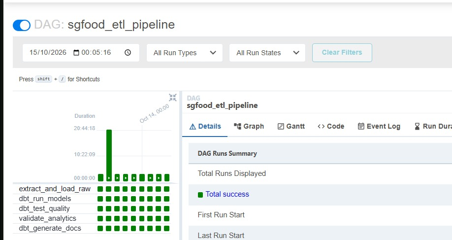

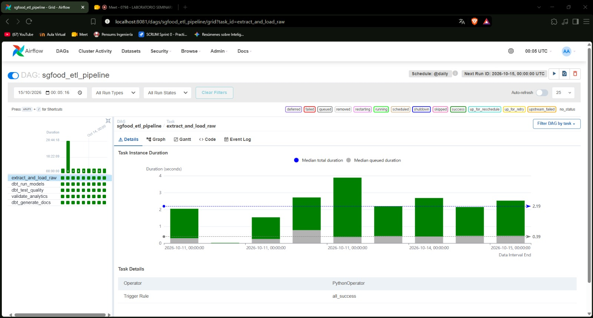

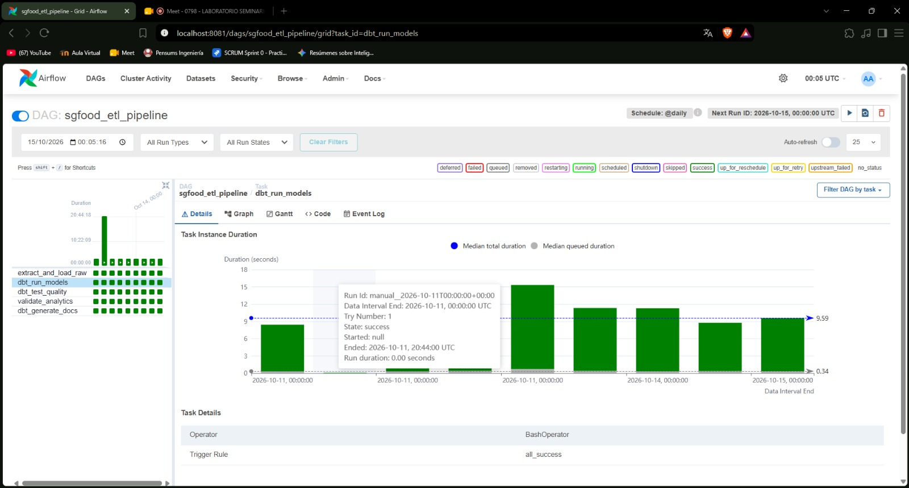

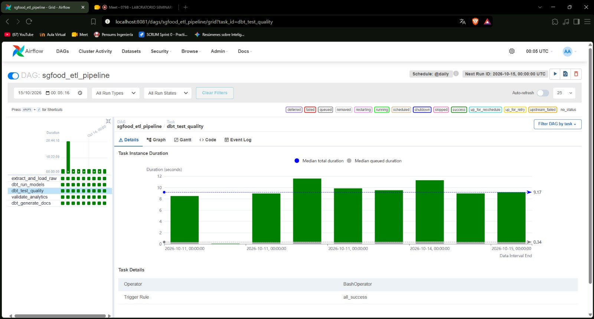

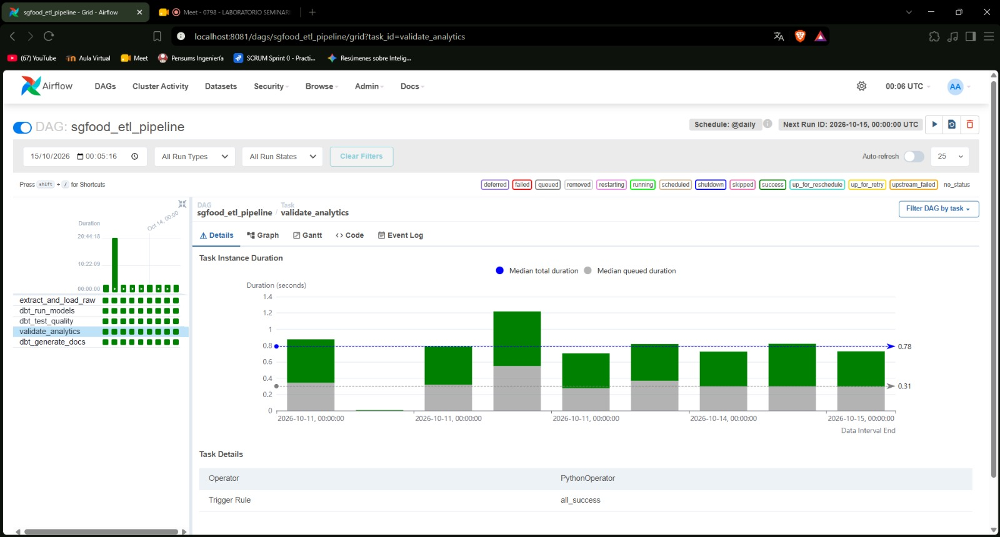

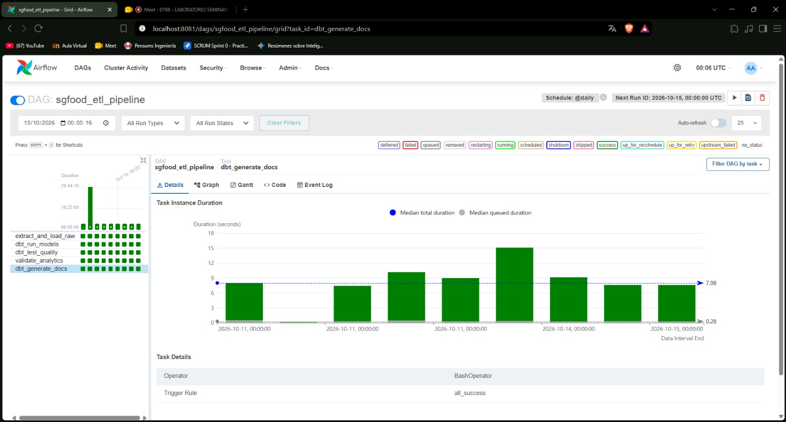


#### Vista Grid del DAG

Historial de ejecuciones: cada columna es una ejecución y cada fila una tarea. La ejecución
completa aparece en verde.

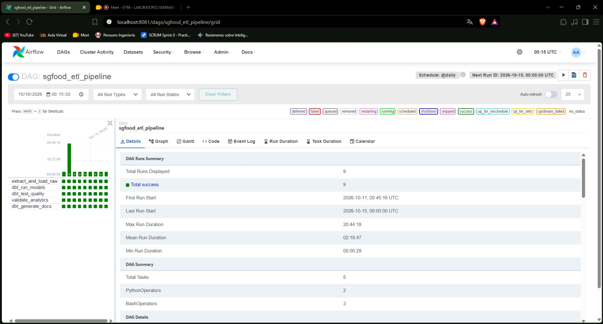

#### Log de extracción y carga

Log de `extract_and_load_raw`. La línea `Carga raw confirmada` muestra los registros cargados en
cada tabla de `raw`, verificados antes del `COMMIT`: 6 sucursales, 8 categorías, 10 marcas,
80 productos, 250 clientes, 1,200 ventas, 3,209 detalles y 80 filas del CSV.

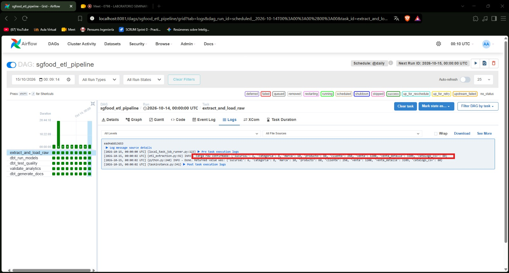

#### Log de pruebas de calidad dbt

Log de `dbt_test_quality`. Las 46 pruebas (42 genéricas y 4 singulares) terminan con
`PASS=46 WARN=0 ERROR=0`.

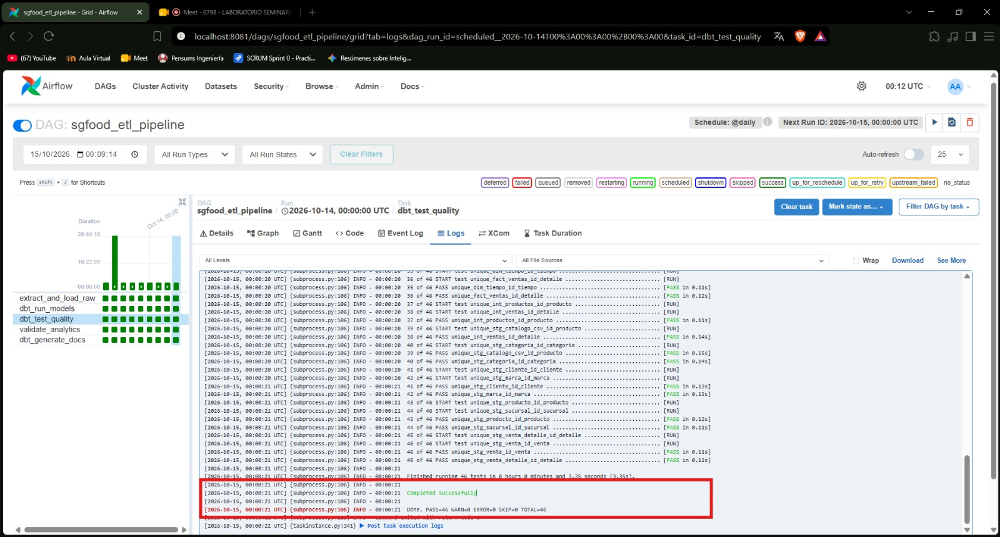

#### Log de validación analítica

Log de `validate_analytics`. Tras aplicar las PK/FK físicas, la línea `Validación aprobada`
confirma que `fact_ventas` tiene los mismos 3,209 detalles que `raw.venta_detalle` y que el
ingreso de ventas completadas coincide entre ambas capas.

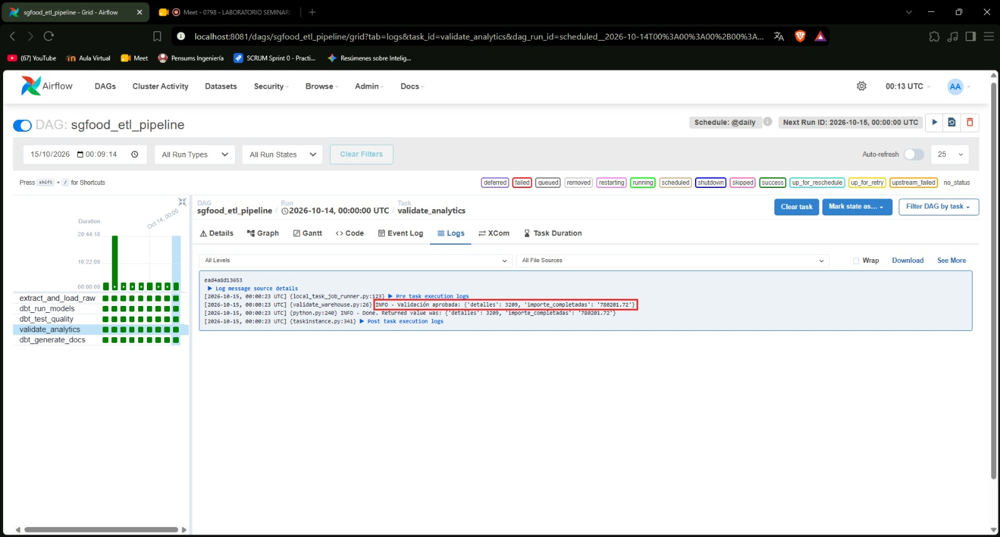

## Limitaciones conocidas

- **CSV derivado:** `catalogo_productos.csv` se genera a partir de la misma base transaccional; no es
  una fuente independiente.
- **Inventarios:** el dataset no contiene existencias, por lo que el alcance implementado es ventas.
- **Costos estimados:** costo y margen usan el `costo_base` actual del catálogo, no el costo histórico.
- **Carga completa:** adecuada para el volumen actual; a mayor escala se haría incremental y por lotes.
- **Publicación dbt por modelo:** si un modelo falla, los ya construidos en esa ejecución no se revierten.

