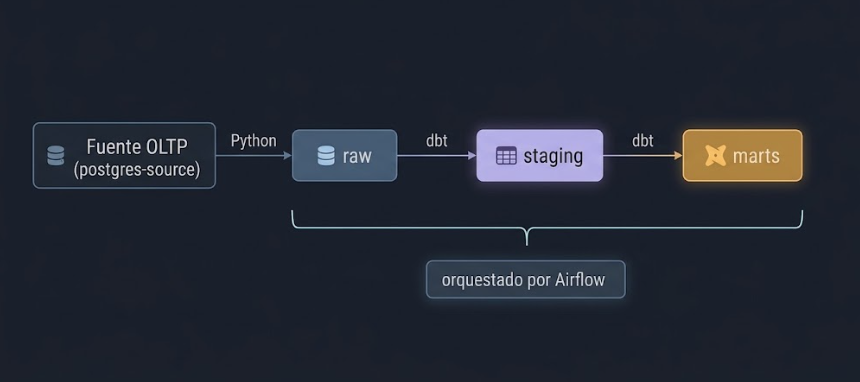

# Parte II. Manual de implementación — SG-Food

**Proyecto 1 — Seminario de Sistemas 2, 2S2026 — Grupo 19**

Integrantes: **Estiben Yair Lopez Leveron** (202204578) · **Johan Moises Cardona Rosales** (202201405)

---

## Índice

- [Introducción al manual](#introducción-al-manual)
- [Requisitos previos](#requisitos-previos)
- [Instalación y configuración](#instalación-y-configuración)
- [Preparación del proyecto](#preparación-del-proyecto)
- [Configuración de conexiones](#configuración-de-conexiones)
- [Inicialización de la base de datos](#inicialización-de-la-base-de-datos)
- [Ejecución de los scripts Python](#ejecución-de-los-scripts-python)
- [Ejecución de Apache Airflow](#ejecución-de-apache-airflow)
- [Ejecución de dbt](#ejecución-de-dbt)
- [Verificación del funcionamiento](#verificación-del-funcionamiento)
- [Solución de problemas comunes](#solución-de-problemas-comunes)

---

## Introducción al manual

Este manual describe cómo instalar, configurar y ejecutar el flujo ELT de SG-Food desde cero,
hasta comprobar que los datos llegan al Data Warehouse y que las pruebas de calidad pasan.

El proyecto se ejecuta con **Docker Compose**. Python, PostgreSQL, Apache Airflow y dbt Core
**no se instalan en la computadora**: corren dentro de contenedores con versiones fijas, lo que
garantiza el mismo resultado en Windows y en Linux. En la computadora solo se necesitan Docker,
Git y Python 3 (este último únicamente para generar las credenciales).

El flujo completo es:




---

## Requisitos previos

### Software necesario

| Software | Para qué se usa | Descarga |
|---|---|---|
| Docker Desktop (Windows/macOS) o Docker Engine + Compose v2 (Linux) | Ejecutar todos los servicios | https://www.docker.com/products/docker-desktop |
| Git | Clonar el repositorio | https://git-scm.com/downloads |
| Python 3.8 o superior | Ejecutar `scripts/setup_local.py` (genera `.env`) | https://www.python.org/downloads |
| Navegador web | Interfaz de Airflow y documentación de dbt | — |

### Versiones utilizadas

Estas versiones están fijadas en el proyecto; Docker las descarga automáticamente.

| Componente | Versión | Definida en |
|---|---|---|
| Python (contenedores) | 3.10 | `Dockerfile` |
| Apache Airflow | 2.10.5 | `Dockerfile` |
| PostgreSQL | 15 | `docker-compose.yml` |
| dbt-core | 1.7.19 | `requirements.txt` |
| dbt-postgres | 1.7.19 | `requirements.txt` |
| psycopg2-binary | 2.9.10 | `requirements.txt` |

### Requisitos del entorno

| Recurso | Recomendado |
|---|---|
| Sistema operativo | Windows 10/11 con WSL 2, Linux o macOS |
| Memoria RAM asignada a Docker | 4 GB mínimo, 8 GB recomendado |
| Espacio en disco libre | ~5 GB para imágenes y volúmenes |
| Puertos libres | `8081` (Airflow) y `8082` (dbt docs) |
| Internet | Solo en la primera construcción, para descargar imágenes y paquetes |

---

## Instalación y configuración

### Python

Python se usa **dentro** del contenedor de Airflow (versión 3.10, incluida en la imagen
`apache/airflow:2.10.5-python3.10`). En la computadora solo se necesita para generar `.env`.

Verificar la instalación local:

```powershell
python --version
```

> En Linux/macOS puede llamarse `python3`.

### PostgreSQL

No se instala localmente. `docker-compose.yml` levanta tres servidores PostgreSQL 15:

| Servicio | Base de datos | Usuario | Función |
|---|---|---|---|
| `postgres-source` | `sgfood` | `sgfood_source` | Fuente transaccional |
| `postgres-dw` | `dw_sgfood` | `sgfood_user` | Data Warehouse |
| `postgres-airflow` | `airflow` | `airflow` | Metadatos de Airflow |

Por seguridad no publican puertos hacia la computadora; se accede con `docker compose exec`.

### Apache Airflow

Se construye una imagen propia, `sgfood-airflow:local`, a partir del [Dockerfile](../Dockerfile):

```dockerfile
FROM apache/airflow:2.10.5-python3.10
COPY requirements.txt /requirements.txt
RUN pip install --no-cache-dir "apache-airflow==2.10.5" -r /requirements.txt
```

Fijar `apache-airflow==2.10.5` en el `pip install` impide que dbt actualice o rompa Airflow.
La misma imagen la usan `airflow-init`, `airflow-webserver` y `airflow-scheduler`, con
`LocalExecutor`.

### dbt Core y adaptador de PostgreSQL

dbt-core y dbt-postgres se instalan dentro de la imagen de Airflow desde
[requirements.txt](../requirements.txt). Así, las tareas del DAG ejecutan `dbt` directamente.

Comprobar la instalación (después de [Preparación del proyecto](#preparación-del-proyecto)):

```powershell
docker compose exec airflow-scheduler dbt --version
```

Debe mostrar `Core: 1.7.19` y el plugin `postgres: 1.7.19`.

### Verificar Docker

```powershell
docker --version
docker compose version
docker info
```

`docker info` debe responder sin errores; si falla, Docker Desktop no está iniciado.

---

## Preparación del proyecto

### Clonar o descargar el repositorio

```powershell
git clone https://github.com/YairLeveron45/-SS22S2026_-19 SS22S2026_-19
cd SS22S2026_-19/PROYECTO1
```

> El segundo argumento de `git clone` define el nombre de la carpeta local (`SS22S2026_-19`).

Alternativa: descargar el ZIP desde GitHub (**Code → Download ZIP**), descomprimirlo y abrir una
terminal en la carpeta `PROYECTO1`.

### Estructura de carpetas

```
PROYECTO1/
├── dags/
│   └── etl_sgfood_dag.py          # DAG de Airflow
├── data/Data-20260930/
│   └── sgfood_oltp.sql            # fuente transaccional
├── dbt_sgfood/                    # proyecto dbt
│   ├── dbt_project.yml
│   ├── profiles.yml
│   ├── macros/
│   ├── models/{staging,intermediate,marts}/
│   └── tests/
├── scripts/
│   ├── etl_extraction.py          # extracción y carga
│   ├── validate_warehouse.py      # validación y PK/FK
│   ├── setup_local.py             # genera .env
│   └── audit_repository.py        # revisa secretos antes de commit
├── sql/
│   ├── 01_init_schemas.sql        # schemas raw, staging, marts
│   ├── 02_modelo_dimensional.sql  # DDL del modelo estrella
│   └── 03_consultas_analiticas.sql
├── Documentacion/                 # documentación técnica y este manual
├── docker-compose.yml
├── Dockerfile
├── requirements.txt
└── .env.example
```

Al ejecutar el proyecto se crean además `exports/`, `logs/` y `dbt_sgfood/target/`
(no se versionan).

### Instalación de dependencias

Las dependencias se instalan al construir la imagen. Este paso descarga PostgreSQL y Airflow,
instala dbt y levanta todos los servicios. La primera vez tarda varios minutos.

> Ejecutar primero [Variables y credenciales](#variables-y-credenciales) (generar `.env`); sin él, Docker Compose se detiene con el mensaje
> `Generate .env first`.

```powershell
docker compose up -d --build
```

Comprobar el estado:

```powershell
docker compose ps
```

Resultado esperado:

| Servicio | Estado |
|---|---|
| postgres-source, postgres-dw, postgres-airflow | `running (healthy)` |
| airflow-init | `exited (0)` — terminó correctamente |
| airflow-webserver | `running (healthy)` |
| airflow-scheduler | `running` |

---

## Configuración de conexiones

### Conexión a PostgreSQL

Los contenedores se comunican por la red interna de Docker usando el nombre del servicio como host:

| Conexión | Host | Puerto | Base | Usuario | Contraseña |
|---|---|---|---|---|---|
| Fuente (`SOURCE_*`) | `postgres-source` | 5432 | `sgfood` | `sgfood_source` | `SOURCE_PASSWORD` |
| Warehouse (`DW_*`) | `postgres-dw` | 5432 | `dw_sgfood` | `sgfood_user` | `DW_PASSWORD` |
| Metadatos Airflow | `postgres-airflow` | 5432 | `airflow` | `airflow` | `AIRFLOW_DB_PASSWORD` |

### Variables y credenciales

Generar el archivo `.env` con contraseñas aleatorias:

```powershell
python scripts/setup_local.py
```

Salida esperada: `Credenciales generadas en .env, ignorado por Git.`
Si `.env` ya existe, el script no lo sobrescribe.

| Variable | Uso |
|---|---|
| `SOURCE_PASSWORD` | Base fuente |
| `DW_PASSWORD` | Data Warehouse |
| `AIRFLOW_DB_PASSWORD` | Base de metadatos de Airflow |
| `AIRFLOW_ADMIN_PASSWORD` | Usuario `admin` de la interfaz web |
| `AIRFLOW_SECRET_KEY` | Llave del webserver |

Sin Python, se puede copiar `.env.example` a `.env` y escribir un valor largo y aleatorio en cada variable.

> **Importante:** PostgreSQL guarda la contraseña al crear su volumen. Si se cambia `.env`
> después, las conexiones fallarán. Ver [Solución de problemas comunes](#solución-de-problemas-comunes).

`.env` está en `.gitignore` y **nunca debe subirse al repositorio**. Antes de hacer commit:

```powershell
python scripts/audit_repository.py
```

### Configuración de dbt y Airflow

**Airflow:** `docker-compose.yml` inyecta las variables `SOURCE_*` y `DW_*` en los contenedores.
Los scripts Python las leen con `os.environ`; no se usan Connections de la interfaz de Airflow.
Otros parámetros relevantes:

| Variable | Valor | Efecto |
|---|---|---|
| `AIRFLOW__CORE__EXECUTOR` | `LocalExecutor` | Ejecuta tareas en el scheduler |
| `AIRFLOW__CORE__LOAD_EXAMPLES` | `false` | Oculta los DAG de ejemplo |
| `AIRFLOW__CORE__DAGS_ARE_PAUSED_AT_CREATION` | `true` | El DAG inicia pausado |

Carpetas montadas en los contenedores:

| Carpeta local | Ruta en el contenedor |
|---|---|
| `dags/` | `/opt/airflow/dags` |
| `scripts/` | `/opt/airflow/scripts` |
| `sql/` | `/opt/airflow/sql` |
| `data/` | `/opt/airflow/data` |
| `dbt_sgfood/` | `/opt/airflow/dbt_sgfood` |
| `exports/` | `/opt/airflow/exports` |
| `logs/` | `/opt/airflow/logs` |

**dbt:** [profiles.yml](../dbt_sgfood/profiles.yml) toma la conexión de las mismas variables:

```yaml
sgfood_profile:
  target: dev
  outputs:
    dev:
      type: postgres
      host: "{{ env_var('DW_HOST') }}"
      port: 5432
      user: "{{ env_var('DW_USER') }}"
      password: "{{ env_var('DW_PASSWORD') }}"
      dbname: "{{ env_var('DW_DB') }}"
      schema: marts
      threads: 2
```

Por eso todos los comandos dbt usan `--profiles-dir .` desde `/opt/airflow/dbt_sgfood`.

---

## Inicialización de la base de datos

### Creación de la base de datos

Las bases se crean automáticamente la **primera vez** que se levanta cada volumen, a partir de
`POSTGRES_DB` en `docker-compose.yml`:

- `postgres-source` → base `sgfood`
- `postgres-dw` → base `dw_sgfood`
- `postgres-airflow` → base `airflow` (Airflow crea sus tablas con `airflow-init`)

### Creación de schemas y tablas

| Objeto | Cómo se crea | Cuándo |
|---|---|---|
| Schemas `raw`, `staging`, `marts` | [`sql/01_init_schemas.sql`](../sql/01_init_schemas.sql), montado en `/docker-entrypoint-initdb.d/` | Al crear el volumen del DW |
| Tablas `raw.*` | `etl_extraction.py`, con los tipos de la fuente | En cada carga |
| Vistas `staging.*` | `dbt run` | En cada ejecución del DAG |
| Tablas `marts.*` | `dbt run` | En cada ejecución del DAG |
| PK, FK e índices de `marts` | [`sql/02_modelo_dimensional.sql`](../sql/02_modelo_dimensional.sql), ejecutado por `validate_warehouse.py` | Después de `dbt test` |

Verificar los schemas:

```powershell
docker compose exec postgres-dw psql -U sgfood_user -d dw_sgfood -c "\dn"
```

Deben aparecer `raw`, `staging` y `marts`.

### Preparación de las fuentes de datos

**Base transaccional:** `data/Data-20260930/sgfood_oltp.sql` se monta como
`/docker-entrypoint-initdb.d/01_source.sql` en `postgres-source` y se importa automáticamente al
crear el volumen. Crea el schema `oltp_sgfood` con 7 tablas y sus datos.

Verificar:

```powershell
docker compose exec postgres-source psql -U sgfood_source -d sgfood -c "SELECT 'venta' t, count(*) FROM oltp_sgfood.venta UNION ALL SELECT 'venta_detalle', count(*) FROM oltp_sgfood.venta_detalle"
```

Resultado esperado: `venta = 1200`, `venta_detalle = 3209`.

**Archivo CSV:** no requiere preparación. `etl_extraction.py` genera
`exports/catalogo_productos.csv` en cada carga y lo lee hacia `raw.catalogo_csv`.

> Los scripts de `docker-entrypoint-initdb.d` solo corren con el volumen vacío. Para reimportar la
> fuente o recrear los schemas, eliminar los volúmenes con `docker compose down -v`
> (borra todos los datos).

---

## Ejecución de los scripts Python

En operación normal Airflow ejecuta los scripts. Esta sección explica cómo correrlos manualmente
para probar cada fase por separado. Se ejecutan dentro del contenedor del scheduler, que ya tiene
las variables de conexión.

### Comandos de ejecución

| Script | Comando |
|---|---|
| Extracción y carga | `docker compose exec airflow-scheduler python /opt/airflow/scripts/etl_extraction.py` |
| Validación (requiere `dbt run` previo) | `docker compose exec airflow-scheduler python /opt/airflow/scripts/validate_warehouse.py` |
| Generar credenciales (local) | `python scripts/setup_local.py` |
| Auditoría antes de commit (local) | `python scripts/audit_repository.py` |

### Extracción y carga de datos

```powershell
docker compose exec airflow-scheduler python /opt/airflow/scripts/etl_extraction.py
```

El script:

1. Se conecta a la fuente en modo `REPEATABLE READ` de solo lectura.
2. Copia las 7 tablas de `oltp_sgfood` a `raw` (TRUNCATE + INSERT).
3. Genera y carga el CSV en `raw.catalogo_csv`.
4. Comprueba los conteos y confirma todo en una sola transacción.

Salida esperada (última línea):

```
INFO:etl_extraction:Carga raw confirmada: {'sucursal': 6, 'categoria': 8, 'marca': 10, 'producto': 80, 'cliente': 250, 'venta': 1200, 'venta_detalle': 3209, 'catalogo_csv': 80}
```

Si ocurre un error, la carga se revierte por completo y el script termina con la excepción.

Verificar en el DW:

```powershell
docker compose exec postgres-dw psql -U sgfood_user -d dw_sgfood -c "\dt raw.*"
```

---

## Ejecución de Apache Airflow

### Inicio de Airflow

Airflow inicia con `docker compose up -d --build` ([Instalación de dependencias](#instalación-de-dependencias)).
El servicio `airflow-init` migra la base de metadatos y crea el usuario `admin`; después arrancan
el webserver y el scheduler.

Acceder a la interfaz:

- URL: **http://localhost:8081**
- Usuario: `admin`
- Contraseña: valor de `AIRFLOW_ADMIN_PASSWORD` en `.env`

### Carga y ejecución del DAG

Airflow lee automáticamente `dags/etl_sgfood_dag.py`. Comprobar que no hay errores de importación:

```powershell
docker compose exec airflow-scheduler airflow dags list-import-errors
```

Respuesta esperada: `No data found`.

El DAG `sgfood_etl_pipeline` se crea **pausado**. Para ejecutarlo:

**Opción A — interfaz web**

1. En **DAGs**, buscar `sgfood_etl_pipeline`.
2. Activar el interruptor de la izquierda (unpause).
3. Pulsar ▶ **Trigger DAG**.

**Opción B — línea de comandos**

```powershell
docker compose exec airflow-scheduler airflow dags unpause sgfood_etl_pipeline
docker compose exec airflow-scheduler airflow dags trigger sgfood_etl_pipeline
```

**Opción C — prueba completa en primer plano** (no requiere scheduler ni unpause; muestra los logs en la terminal)

```powershell
docker compose exec airflow-scheduler airflow dags test sgfood_etl_pipeline 2026-10-11
```

Una vez activo, el DAG se ejecuta automáticamente todos los días a las 00:00 UTC (18:00 hora de Guatemala).

### Verificación de las tareas

En la interfaz, abrir el DAG → vista **Graph**. Las cinco tareas deben terminar en verde (`success`):

```
extract_and_load_raw → dbt_run_models → dbt_test_quality → validate_analytics → dbt_generate_docs
```

| Tarea | Qué comprobar en su log (clic en la tarea → **Logs**) |
|---|---|
| `extract_and_load_raw` | `Carga raw confirmada: {...}` |
| `dbt_run_models` | `Completed successfully` y `PASS=16` |
| `dbt_test_quality` | `PASS=46 WARN=0 ERROR=0` |
| `validate_analytics` | `Validación aprobada: {'detalles': 3209, ...}` |
| `dbt_generate_docs` | `Catalog written to .../target/catalog.json` |

Por línea de comandos:

```powershell
docker compose exec airflow-scheduler airflow dags list-runs -d sgfood_etl_pipeline
```

Si una tarea falla, las siguientes quedan en `upstream_failed` y la tarea fallida se reintenta una vez tras un minuto.

---

## Ejecución de dbt

Estos comandos permiten ejecutar dbt manualmente, fuera del DAG. Todos se corren dentro del
contenedor, en `/opt/airflow/dbt_sgfood`. Para simplificar, se puede abrir una terminal en él:

```powershell
docker compose exec airflow-scheduler bash
cd /opt/airflow/dbt_sgfood
```

> `dbt run` requiere que `raw` ya esté cargado, ya sea por el DAG o ejecutando antes `etl_extraction.py`.

### Verificación de la conexión

```bash
dbt debug --profiles-dir .
```

Debe terminar con `All checks passed!` (incluye `Connection test: OK connection ok`).

### Ejecución de modelos

```bash
dbt run --profiles-dir .
```

Construye 16 modelos: 8 vistas de staging, 2 vistas intermediate y 6 tablas en marts.

Ejecutar solo una capa o un modelo:

```bash
dbt run --profiles-dir . --select staging
dbt run --profiles-dir . --select marts
dbt run --profiles-dir . --select fact_ventas
dbt run --profiles-dir . --select +fact_ventas   # el modelo y todo lo que necesita
```

### Ejecución de pruebas

```bash
dbt test --profiles-dir .
```

Resultado esperado: `PASS=46 WARN=0 ERROR=0 SKIP=0` (42 pruebas genéricas y 4 singulares).

Probar un modelo específico:

```bash
dbt test --profiles-dir . --select fact_ventas
```

Alternativamente, `dbt build --profiles-dir .` ejecuta modelos y pruebas en orden de dependencias.

### Generación de documentación

```bash
dbt docs generate --profiles-dir .
```

Para visualizarla, salir del contenedor (`exit`) y ejecutar desde `PROYECTO1/`:

```powershell
docker compose run --rm --no-deps -p 127.0.0.1:8082:8080 airflow-scheduler bash -c "cd /opt/airflow/dbt_sgfood && dbt docs serve --profiles-dir . --port 8080"
```

Abrir **http://localhost:8082**. El botón de grafo (abajo a la derecha) muestra el linaje
`source → staging → intermediate → marts`. Detener con `Ctrl + C`.

---

## Verificación del funcionamiento

### Consultas SQL

Ejecutar el archivo de consultas analíticas completo.

**PowerShell:**

```powershell
Get-Content sql/03_consultas_analiticas.sql -Raw | docker compose exec -T postgres-dw psql -v ON_ERROR_STOP=1 -U sgfood_user -d dw_sgfood
```

**bash / cmd:**

```bash
docker compose exec -T postgres-dw psql -v ON_ERROR_STOP=1 -U sgfood_user -d dw_sgfood < sql/03_consultas_analiticas.sql
```

Para consultas interactivas:

```powershell
docker compose exec postgres-dw psql -U sgfood_user -d dw_sgfood
```

```sql
\dt marts.*
SELECT count(*) FROM marts.fact_ventas;
\q
```

### Comprobación de resultados

Valores esperados con el dataset entregado:

| Comprobación | Valor esperado |
|---|---|
| Filas en `raw.venta_detalle` | 3,209 |
| Filas en `marts.fact_ventas` | 3,209 |
| Filas en `marts.dim_producto` / `dim_cliente` / `dim_sucursal` | 80 / 250 / 6 |
| Filas en `marts.dim_tiempo` | 243 (2026-01-01 a 2026-08-31) |
| Filas en `marts.ventas_mensuales` | 48 |
| Importe total raw = hechos | 838,452.07 |
| Ingreso de ventas COMPLETADA | 780,201.72 |

Consulta rápida de conciliación:

```sql
SELECT (SELECT count(*) FROM raw.venta_detalle)     AS raw_detalles,
       (SELECT count(*) FROM marts.fact_ventas)     AS fact_detalles,
       (SELECT sum(subtotal) FROM raw.venta_detalle) AS raw_importe,
       (SELECT sum(importe_neto) FROM marts.fact_ventas) AS fact_importe;
```

Ambos pares de columnas deben coincidir.

Comprobar las llaves físicas aplicadas por `validate_analytics`:

```sql
SELECT conname, contype FROM pg_constraint
WHERE conrelid = 'marts.fact_ventas'::regclass;
```

Debe listar una PK y las FK `fk_producto`, `fk_cliente`, `fk_sucursal` y `fk_tiempo`.

### Evidencias de ejecución

Las capturas de la ejecución en Airflow (vistas Graph y Grid, y logs de carga, pruebas dbt y
validación) están en [Resultados y evidencia de ejecución](DOCUMENTACION_TECNICA.md#resultados-y-evidencia-de-ejecución)
de la documentación técnica.

El registro detallado de la última verificación está en [`docs/VALIDACION.md`](../docs/VALIDACION.md).

---

## Solución de problemas comunes

| Síntoma | Causa probable | Solución |
|---|---|---|
| `required variable ... is missing a value: Generate .env first` | No existe `.env` | `python scripts/setup_local.py` |
| `Cannot connect to the Docker daemon` / `docker info` falla | Docker Desktop no está iniciado | Abrir Docker Desktop y esperar a que indique *running* |
| `password authentication failed` | Se modificó `.env` después de crear los volúmenes | Restaurar el `.env` original, o `docker compose down -v` y volver a levantar (borra datos) |
| `Bind for 127.0.0.1:8081 failed: port is already allocated` | Otro programa usa el puerto | Cerrar ese programa o cambiar `8081` en `docker-compose.yml` |
| `airflow-init` termina con código distinto de 0 | Falló la migración o la base no estaba lista | `docker compose logs airflow-init`, luego `docker compose up -d` |
| No se puede iniciar sesión en Airflow | Contraseña incorrecta | Usar `AIRFLOW_ADMIN_PASSWORD` de `.env` |
| El DAG no aparece en la interfaz | Error de importación o el scheduler aún no lo leyó | `airflow dags list-import-errors`; esperar ~30 s y recargar |
| El DAG no se ejecuta al hacer trigger | El DAG está pausado | Activar el interruptor o `airflow dags unpause sgfood_etl_pipeline` |
| `extract_and_load_raw` falla con `relation "oltp_sgfood..." does not exist` | La fuente no se importó (volumen creado antes) | `docker compose down -v` y `docker compose up -d --build` |
| `extract_and_load_raw` falla con `Conteo inválido` | Tabla vacía o carga incompleta | Revisar que la fuente tenga datos |
| `dbt_run_models` falla con `relation "raw..." does not exist` | `raw` no está cargado | Ejecutar primero la carga |
| `dbt debug` falla en la conexión | Variables `DW_*` no disponibles | Ejecutar dbt dentro de `airflow-scheduler`, no en la computadora local |
| `dbt_test_quality` en rojo | Una prueba de calidad falló | Ver el log de la tarea; ejecutar `dbt test --select <modelo>` para aislarla |
| `validate_analytics` falla con `Conteos o importes distintos` | `marts` desactualizado respecto a `raw` | Volver a ejecutar el DAG completo |
| El operador `<` no funciona en PowerShell | PowerShell no admite redirección de entrada | Usar la variante con `Get-Content ... \|` |
| Linux: `Permission denied` en `logs/`, `exports/` o `dbt_sgfood/target` | Airflow corre como UID 50000 y las carpetas son de root | `mkdir -p logs exports && sudo chown -R 50000:0 logs exports dbt_sgfood` |
| La primera construcción tarda mucho o falla al descargar | Conexión lenta o interrumpida | Repetir `docker compose up -d --build` |

### Comandos útiles

```powershell
docker compose ps                              # estado de los servicios
docker compose logs -f airflow-scheduler       # logs en vivo del scheduler
docker compose restart airflow-scheduler       # reiniciar un servicio
docker compose down                            # detener conservando datos
docker compose down -v                         # detener y borrar todos los datos
docker compose up -d --build                   # reconstruir tras cambiar requirements.txt o Dockerfile
```
