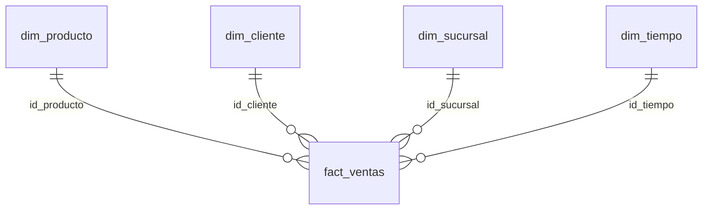

# SG-Food: flujo ELT de ventas

Para comprender el código paso a paso, lee la [guía de estudio](docs/GUIA_DE_ESTUDIO.md).

Integrantes:

- **Estiben Yair Lopez Leveron** — 202204578.
- **Johan Moises Cardona Rosales** — 202201405.

## Arquitectura y alcance

PostgreSQL transaccional → Python → PostgreSQL raw → dbt staging/intermediate → dbt marts.
Airflow coordina diariamente: extracción y carga → dbt run → dbt test → validación analítica y claves → dbt docs generate.

La fuente es `data/Data-20260930/sgfood_oltp.sql`, provista para el proyecto, con datos ficticios.
Contiene sucursales, categorías, marcas, productos, clientes, ventas y detalles.
El SQL se importa exclusivamente al inicializar el volumen de la fuente. Python consulta esta base,
exporta su catálogo a `exports/catalogo_productos.csv` y lee ese CSV hacia `raw.catalogo_csv`.
El CSV es **derivado de la misma fuente**, no representa una fuente independiente.
Si el curso exige un archivo externo proporcionado por separado, todavía se necesita ese archivo.
No hay datos de inventario en el dataset; el proyecto implementa ventas y no inventa existencias.

## Ejecutar en Windows o Linux

Desde esta carpeta, con Docker funcionando y Python 3 instalado:

```powershell
python scripts/setup_local.py
docker compose up -d --build
docker compose exec airflow-scheduler airflow dags list-import-errors
docker compose exec airflow-scheduler airflow dags unpause sgfood_etl_pipeline
docker compose exec airflow-scheduler airflow dags trigger sgfood_etl_pipeline
```

Esperar a que Airflow y sus bases estén listos antes de ejecutar los comandos del scheduler.
La primera descarga/construcción puede tardar varios minutos.
Abrir http://localhost:8081, usuario `admin`. La contraseña está en la variable
`AIRFLOW_ADMIN_PASSWORD` del archivo **local** `.env`.
Seleccionar el DAG y comprobar que sus cinco tareas terminan en verde.
El DAG se crea pausado para evitar cargas antes de revisar el entorno.

Prueba manual de extremo a extremo, sin esperar al scheduler:

```powershell
docker compose exec airflow-scheduler airflow dags test sgfood_etl_pipeline 2026-10-11
```

Consultar resultados:

```powershell
docker compose exec -T postgres-dw psql -U sgfood_user -d dw_sgfood -f /dev/stdin < sql/03_consultas_analiticas.sql
```

El comando anterior usa redirección POSIX/cmd. En PowerShell usar:

```powershell
Get-Content sql/03_consultas_analiticas.sql -Raw | docker compose exec -T postgres-dw psql -v ON_ERROR_STOP=1 -U sgfood_user -d dw_sgfood
```

Apagar conservando datos con `docker compose down`. Los volúmenes persisten.
Cambiar `.env` después de inicializar PostgreSQL no modifica la contraseña ya almacenada.
La fuente se carga una vez; para actualizarla, importar conscientemente el nuevo SQL en la
base fuente. El SQL entregado elimina y recrea su esquema, por lo que esa importación es destructiva.

## Modelo dimensional

Grano de `fact_ventas`: **una fila por id_detalle**, no una fila por venta.
Dimensiones tipo 1, con identificadores naturales estables del dataset; cada carga refleja el estado actual.



`dim_producto` integra categoría y marca. `dim_tiempo` cubre todos los días entre la primera
y última venta. Hechos conserva COMPLETADA, ANULADA y PENDIENTE para trazabilidad.
`ventas_mensuales` contabiliza exclusivamente COMPLETADA.
Importe bruto = cantidad × precio unitario; neto = subtotal de origen.
Costo y margen son **estimados** con costo_base del catálogo actual, no costos históricos.

Schemas: `raw` para snapshots; `staging` para vistas de limpieza e integración;
`marts` para dimensiones, hechos y agregado mensual.
La macro de schemas fija esos nombres en este entorno único.
Las materializaciones son vistas en staging/intermediate y tablas en marts.

## Calidad y reproducibilidad

La carga Python usa un snapshot consistente REPEATABLE READ y una transacción de destino:
un fallo revierte toda la carga raw. Un bloqueo transaccional evita cargas simultáneas.
Es una recarga completa adecuada para este dataset académico, no una carga incremental.
La publicación de modelos dbt ocurre por modelo; un fallo no revierte todos los marts como grupo.
Airflow limita el DAG a una ejecución activa, registra resultados y reintenta una vez.

Pruebas dbt: unicidad, no nulos, relaciones, estados permitidos,
subtotales calculados, catálogo CSV contra origen y reconciliación de conteos/importes.
La validación Python compara detalles e ingresos completados y aplica PK/FK físicas
mediante `sql/02_modelo_dimensional.sql`.
Las consultas de validación y análisis están en `sql/03_consultas_analiticas.sql`.

La documentación dbt generada queda en `dbt_sgfood/target/index.html`,
`catalog.json` y `manifest.json` (ignorados por Git). Para servirla localmente:

```powershell
docker compose run --rm --no-deps -p 127.0.0.1:8082:8080 airflow-scheduler bash -c "cd /opt/airflow/dbt_sgfood && dbt docs serve --profiles-dir . --port 8080"
```

Abrir http://localhost:8082. Los artefactos de dbt pueden contener datos de conexión
o compilación: se mantienen locales.

## Estructura y dependencias

- `data/`: SQL entregado; los CSV derivados quedan fuera de esta carpeta.
- `scripts/`: generación de credenciales, extracción/carga y validación.
- `dags/`: orquestación del pipeline.
- `dbt_sgfood/models/`: staging, intermediate y marts; pruebas y descripciones.
- `dbt_sgfood/tests/`: controles SQL de negocio.
- `sql/`: schemas, DDL dimensional y consultas analíticas.
- `docs/`: evidencia resumida de verificación.
- `exports/`, `logs/`, `target/`: resultados locales no versionados.

Versiones fijadas: Python 3.10 en Docker, Airflow 2.10.5, PostgreSQL 15,
dbt-core/dbt-postgres 1.7.19 y psycopg2-binary 2.9.10.
Los procesos Airflow comparten la imagen personalizada con dbt.
Las bases no publican puertos al host; el acceso local se realiza mediante `docker compose exec`.

## Credenciales y Git

`setup_local.py` crea contraseñas aleatorias sin imprimirlas.
`.env`, exports, logs y artefactos dbt están excluidos de Git y del contexto Docker.
`.env.example` contiene únicamente nombres de variables vacíos.
No agregar credenciales, capturas de .env, volcados privados ni salidas de
`docker compose config` al repositorio.

Antes de versionar, ejecutar `python scripts/audit_repository.py`: verifica que
`.env` esté ignorado, busca sus valores en archivos candidatos de Git y detecta
algunos patrones de tokens y claves privadas sin imprimir credenciales.

Configuración de schemas contrastada con la [documentación oficial de dbt](https://docs.getdbt.com/reference/resource-configs/schema).
Inicialización y ejecución local basadas en la [documentación de Airflow](https://airflow.apache.org/docs/apache-airflow/2.10.5/howto/docker-compose/index.html).
