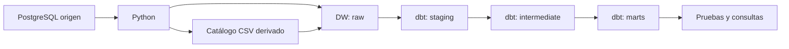
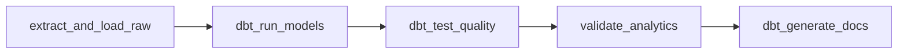

# Guía para entender y explicar SG-Food

Lee esta guía junto al código, en el orden indicado. Para instalar y ejecutar,
consulta [el README](../README.md); para resultados verificados, consulta
[la evidencia](VALIDACION.md). Aquí el objetivo es comprender el funcionamiento.

## 1. Qué problema resolvemos

SG-Food registra productos, clientes y ventas en una base transaccional.
Esa base está orientada a registrar operaciones. Nosotros copiamos sus datos a
otra base preparada para análisis: el Data Warehouse o DW.

Ejemplo: una venta registra un cliente, sucursal, fecha y varios productos.
El análisis necesita cruzar muchas ventas para responder cuánto vende cada
sucursal por mes o qué productos producen más ingresos.

El flujo es ELT: **extraer, cargar y transformar**. Python extrae y carga;
dbt transforma dentro de PostgreSQL. Airflow organiza cuándo y en qué orden
ocurre cada paso. Docker proporciona los servicios necesarios para ejecutarlos.



Airflow coordina este recorrido; no guarda las ventas en su base de metadatos.
Su base registra tareas, ejecuciones, usuarios y estados del pipeline.

## 2. Qué servicios levanta Docker

Abre `docker-compose.yml` y busca cada servicio:

| Servicio | Función |
|---|---|
| postgres-source | Base original, inicializada desde el SQL entregado. |
| postgres-dw | Base destino: raw, staging y marts. |
| postgres-airflow | Metadatos de Airflow, independientes de los datos de ventas. |
| airflow-init | Prepara Airflow y crea el administrador; luego termina. |
| airflow-webserver | Interfaz que consultas en localhost:8081. |
| airflow-scheduler | Programa tareas y las ejecuta mediante LocalExecutor. |

Un **contenedor** es una instancia ejecutándose; una **imagen** es su plantilla.
El Dockerfile añade dbt a la imagen de Airflow. Los tres servicios Airflow usan
la misma imagen para disponer de las mismas dependencias.

Un **volumen** mantiene archivos o datos fuera de la vida del contenedor.
Por eso `docker compose down` conserva las bases. El SQL de inicialización de
PostgreSQL solo se importa cuando su volumen de datos está vacío.

Dentro de Docker, los servicios se comunican por nombres como `postgres-dw`.
`localhost` dentro de un contenedor apunta a ese mismo contenedor.

## 3. Credenciales: setup_local.py

Este archivo es auxiliar de instalación; no procesa ventas ni pertenece al DAG.

1. Localiza la carpeta PROYECTO1 usando la ubicación del propio script.
2. Si `.env` existe, lo conserva.
3. Si falta, genera cinco valores aleatorios con `secrets.token_hex(24)`.
4. Escribe las variables sin mostrar sus valores en consola.

| Variable | Uso |
|---|---|
| SOURCE_PASSWORD | Contraseña de la base original. |
| DW_PASSWORD | Contraseña del Data Warehouse. |
| AIRFLOW_DB_PASSWORD | Contraseña de los metadatos de Airflow. |
| AIRFLOW_ADMIN_PASSWORD | Contraseña para iniciar sesión como admin. |
| AIRFLOW_SECRET_KEY | Clave del servidor web de Airflow. |

Compose lee `.env` y pasa valores al entorno de los contenedores.
Python utiliza `os.environ`; dbt utiliza `env_var()` en `profiles.yml`.
Ejecutar un script directamente en Windows no carga automáticamente `.env`.
Las contraseñas locales y los resultados generados permanecen fuera de Git.

## 4. Extracción y carga: etl_extraction.py

Primero lee `TABLES`: lista las siete tablas que se copian.
Después lee `connect(prefix)`: con SOURCE conecta al origen; con DW, al destino.
Una **conexión** representa una sesión con PostgreSQL; un **cursor** ejecuta
sentencias SQL y permite obtener sus resultados.

Sigue `extract_and_load_data()` por bloques:

1. Abre las dos conexiones y prepara la carpeta exports.
2. Configura una lectura consistente de origen con REPEATABLE READ: todas las
   tablas se consultan con el mismo snapshot durante esa transacción.
3. Solicita un bloqueo en destino, compartido por cargadores que usan la misma
   clave, para evitar que sus recargas se intercalen.
4. Para cada tabla, obtiene filas y metadatos de columnas; crea su tabla raw si
   falta, vacía su contenido y vuelve a insertar los datos actuales.
5. Exporta productos a CSV y lee ese archivo hacia `raw.catalogo_csv`.
6. Comprueba conteos y confirma la transacción con `commit()`.
7. Ante un fallo, ejecuta `rollback()`, propaga el error y cierra conexiones.

**Por qué vaciar antes de insertar:** si se agregaran siempre las mismas filas,
una segunda ejecución duplicaría datos. Esta estrategia es una recarga completa.
Los TRUNCATE e INSERT de raw forman una transacción: se confirman juntos o se
revierten. El archivo CSV en disco queda fuera de esa transacción.

`sql.Identifier` construye nombres de tablas/columnas y los placeholders `%s`
separan valores de la sentencia SQL. Los tipos dinámicos se limitan a una lista
permitida. `fetchall()` carga las filas en memoria, apropiado para este dataset;
con millones de filas habría que extraer y cargar por lotes.

El catálogo CSV se deriva del SQL recibido. No es un dataset externo independiente.
No se extraen inventarios porque la fuente no contiene existencias.

## 5. Transformación: el proyecto dbt

dbt organiza SELECT de SQL como modelos y construye sus dependencias.
Cada archivo SQL de `models/` describe un modelo. Su materialización determina
si el resultado se guarda como tabla o se consulta como vista.

| Concepto | Ejemplo del proyecto |
|---|---|
| source | `source('sgfood', 'venta')` identifica una tabla raw cargada por Python. |
| ref | `ref('stg_venta')` identifica otro modelo y establece una dependencia. |
| staging | Limpia espacios y uniforma textos, como el estado de una venta. |
| intermediate | Une ventas con detalles o productos con categoría y marca. |
| marts | Construye dimensiones, hechos y ventas mensuales. |
| materialización | Vistas en staging/intermediate; tablas en marts. |

Las expresiones `{{ ... }}` son plantillas que dbt convierte a SQL antes de
ejecutarlo. `dbt_project.yml` configura el proyecto; `profiles.yml` indica la
conexión; `sources.yml` declara las fuentes; `schema.yml` describe modelos y pruebas.
La macro `generate_schema_name.sql` fija los schemas staging y marts.
La capa intermediate vive en el schema staging, aunque tiene su propia carpeta.

Lee estos modelos en secuencia para seguir una venta:

1. `stg_venta.sql`: fecha, cliente, sucursal, canal, pago y estado.
2. `stg_venta_detalle.sql`: producto, cantidad, precio, descuento y subtotal.
3. `int_ventas.sql`: une ambos y calcula medidas.
4. `fact_ventas.sql`: organiza claves de dimensiones y medidas del detalle.
5. `ventas_mensuales.sql`: agrupa ingresos completados por mes y sucursal.

## 6. Modelo estrella: qué representa cada fila

El **grano** es el significado de una fila. En `fact_ventas` es un detalle de
venta identificado por `id_detalle`. Si una venta contiene tres productos,
hay tres filas con el mismo `id_venta` y distintos `id_detalle`.

Las dimensiones aportan contexto; los hechos guardan medidas y referencias.

| Tabla | Qué representa |
|---|---|
| dim_producto | Producto con categoría, marca y datos del catálogo. |
| dim_cliente | Cliente y atributos comerciales/geográficos. |
| dim_sucursal | Sucursal y ubicación. |
| dim_tiempo | Un día, con año, mes, trimestre y día de semana. |
| fact_ventas | Un producto dentro de una venta y sus medidas. |

**PK** es la clave primaria: identifica una fila sin duplicados ni nulos.
**FK** es una clave foránea: exige que exista la dimensión referenciada.
El DDL dimensional aplica esas restricciones después de construir los modelos.
Las dimensiones son tipo 1: reflejan el estado actual, sin conservar versiones
históricas de atributos.

Ejemplo didáctico, no un registro extra del dataset: cantidad 2, precio 50 y
descuento 0.10 producen bruto 100 y neto 90. Si costo_base es 30, costo estimado
es 60 y margen estimado es 30. El neto del proyecto procede del subtotal original;
una prueba comprueba que concuerde con el cálculo de cantidad, precio y descuento.

Costos y márgenes son estimados con el catálogo actual, no costos históricos.
Los hechos conservan COMPLETADA, ANULADA y PENDIENTE. El reporte mensual cuenta
solo COMPLETADA. Para contar ventas se usa `count(distinct id_venta)`; `count(*)`
en hechos cuenta detalles.

## 7. Pruebas y validate_warehouse.py

`dbt run` construye los modelos; `dbt test` comprueba su calidad.

| Prueba | Qué problema detecta |
|---|---|
| unique | Identificadores repetidos. |
| not_null | Claves sin valor. |
| relationships | Referencias a registros inexistentes. |
| subtotales_consistentes | Importes que no concuerdan con cantidad/precio/descuento. |
| catalogo_concuerda | Diferencias entre catálogo SQL y CSV. |
| reconciliacion_ventas | Pérdida de detalles o diferencias en sus importes totales. |
| estados_validos | Estados fuera de los permitidos. |

Las pruebas SQL de `tests/` devuelven las filas problemáticas: cero filas significa
que la condición revisada pasó. Las pruebas detectan problemas; no corrigen datos.

Después, `validate_warehouse()` aplica PK/FK reales mediante el DDL y compara:
conteo de detalles raw frente a hechos, e ingresos de ventas COMPLETADA en ambas
capas. Si no coinciden, lanza `ValueError` y Airflow marca la tarea como fallida.
El contexto transaccional revierte la aplicación de claves si falla la validación.

La recarga raw es una transacción completa. dbt construye cada modelo por separado:
un fallo no revierte todo el conjunto de marts. No hay publicación atómica de
todas las capas; conviene consultar resultados cuando el DAG termina con éxito.

## 8. Orquestación: etl_sgfood_dag.py

Un DAG es un grafo de tareas con dependencias y sin ciclos.
Este archivo define qué ejecutar; el scheduler decide cuándo ejecutarlo.



`PythonOperator` llama una función y `BashOperator` ejecuta un comando.
`load >> run` significa que run depende del éxito de load; no pasa sus datos como
argumentos. Las tareas comparten resultados principalmente por PostgreSQL.

`catchup=False` evita ejecutar todos los días atrasados desde start_date;
`max_active_runs=1` limita ejecuciones simultáneas; `retries=1` permite un reintento
tras un minuto. El horario diario usa UTC en esta configuración.

Si dbt detecta un subtotal incorrecto, falla la tarea de pruebas. Con las reglas
predeterminadas, la validación y documentación posteriores no se ejecutan con éxito.
La interfaz permite identificar en qué paso ocurrió el problema y consultar su log.

`dbt docs generate` produce un catálogo y documentación del proyecto; no crea
un dashboard de ventas. Las consultas analíticas están en el archivo SQL correspondiente.

## 9. Auditoría: audit_repository.py

Este script se ejecuta antes de versionar; tampoco pertenece al DAG.
Consulta Git para obtener archivos versionados y nuevos no ignorados de PROYECTO1.
Busca valores actuales de `.env` y algunos patrones de claves/tokens. Si encuentra
algo, muestra solamente nombres de archivos y termina con código de error.
También comprueba que `.env` esté ignorado y no figure entre archivos versionados.
Su alcance es limitado: no detecta todas las clases de secretos ni revisa el historial
completo de Git. No debe interpretarse como garantía absoluta.

## 10. Cómo practicar la demostración

Desde PROYECTO1, con los servicios iniciados:

```powershell
docker compose ps
docker compose exec airflow-scheduler airflow dags list-import-errors
```

Abre Airflow y ejecuta el DAG. Espera sus cinco tareas en verde. Después compara
el conteo de origen copiado y el modelo final:

```powershell
docker compose exec postgres-dw psql -U sgfood_user -d dw_sgfood -c "SELECT (SELECT count(*) FROM raw.venta_detalle) AS raw_detalles, (SELECT count(*) FROM marts.fact_ventas) AS fact_detalles;"
```

Ejecuta las consultas preparadas para analizar ingresos:

```powershell
Get-Content sql/03_consultas_analiticas.sql -Raw | docker compose exec -T postgres-dw psql -v ON_ERROR_STOP=1 -U sgfood_user -d dw_sgfood
```

Estos comandos leen resultados; no muestran contraseñas. También puedes leer
las pruebas aprobadas en los logs de la tarea `dbt_test_quality` en Airflow.

## 11. Preguntas para comprobar que lo entendiste

Intenta responder sin mirar y después revisa los apartados indicados:

- ¿Por qué hay dos bases de negocio y una base adicional de Airflow? Apartados 1 y 2.
- ¿Por qué la segunda carga no duplica ventas? Apartado 4.
- ¿Qué hace Python y qué hace dbt? Apartados 4 y 5.
- ¿Qué diferencia existe entre source y ref? Apartado 5.
- ¿Por qué 1,200 ventas pueden producir 3,209 filas de hechos? Apartado 6.
- ¿Por qué el reporte mensual excluye ventas anuladas? Apartado 6.
- ¿Qué sucede si falla una prueba? Apartados 7 y 8.
- ¿Por qué el archivo .env se conserva y no se publica? Apartados 3 y 9.

Para presentar el proyecto puedes decir: «Extraemos ventas de una base
transaccional con Python, cargamos una copia raw en PostgreSQL y usamos dbt para
construir un modelo estrella. Airflow automatiza el orden de ejecución y las
pruebas. Validamos que no se pierdan detalles ni cambien los importes y consultamos
los modelos finales para analizar ventas por producto, sucursal y tiempo».

Recuerda explicar los límites: CSV derivado del SQL, ausencia de inventarios y
márgenes estimados con costos actuales. La aceptación del CSV como entregable
debe confirmarse con el curso.
