# Proyecto 2: Procesamiento y análisis exploratorio de datos masivos en BigQuery

**NYC Yellow Taxi Trips 2022 · BigQuery · BigQuery ML · Data Studio (Looker Studio)**

**Para la calificación:** abrir la [guía de presentación](docs/GUIA_CALIFICACION.md).
Relaciona cada punto de la rúbrica con qué explicar, qué script abrir y qué evidencia mostrar.
Para consultar el estado de los respaldos, abrir el [inventario de evidencias](evidencias/README.md).

| | |
|---|---|
| Curso | Seminario de Sistemas 2, 2S2026 |
| Universidad | Universidad de San Carlos de Guatemala, Facultad de Ingeniería |
| Grupo | 19 |
| Integrantes | **Estiben Yair Lopez Leveron** — 202204578<br>**Johan Moises Cardona Rosales** — 202201405 |
| Dataset | `bigquery-public-data.new_york_taxi_trips.tlc_yellow_trips_2022` |
| Proyecto GCP | `ss2-proyecto2-512805`, dataset `nyc_taxi_2022` (multi-región US) |
| Informe visual | <https://datastudio.google.com/u/0/reporting/7e3040a1-201a-4595-bf1e-fa6a5c6af4a0/page/yY7BG> |

---

## Índice

1. [Resumen](#1-resumen)
2. [Dataset](#2-dataset)
3. [Arquitectura](#3-arquitectura)
4. [Ejecución](#4-ejecución)
5. [Transformaciones](#5-transformaciones)
6. [Optimización: partición y clustering](#6-optimización-partición-y-clustering)
7. [Análisis exploratorio y hallazgos](#7-análisis-exploratorio-y-hallazgos)
8. [Modelos de BigQuery ML](#8-modelos-de-bigquery-ml)
9. [Informe visual](#9-informe-visual)
10. [Estructura del repositorio](#10-estructura-del-repositorio)
11. [Uso de recursos y costos](#11-uso-de-recursos-y-costos)
12. [Limitaciones](#12-limitaciones)
13. [Referencias](#13-referencias)
14. [Conclusiones](#14-conclusiones)
15. [Correspondencia con el enunciado y la rúbrica](#15-correspondencia-con-el-enunciado-y-la-rúbrica)
16. [Estado de entrega y evidencias pendientes](#16-estado-de-entrega-y-evidencias-pendientes)

---

## 1. Resumen

**Alcance de la revisión documental.** Se revisaron los scripts SQL y de BigQuery ML,
las guías y los entregables exigidos en las secciones 3.4 y 9 del
[enunciado](enunciado/798_Proyecto_2_2S2026.pdf). Las cifras de volumen, rendimiento, métricas,
iteraciones y predicciones de este documento ya estaban registradas en el README del proyecto;
se conservan como resultados reportados. La revisión inicial no ejecutó consultas ni entrenó
modelos en GCP. El 27 de octubre se ejecutaron el control de calidad y, posteriormente, los cinco
controles documentales con autorización del usuario. Sus resultados y consumos
constan en las secciones 16.3 y 16.4. Posteriormente se abrió el informe compartido sin iniciar sesión y se capturaron
sus cuatro páginas. También se incorporaron capturas de la consola de BigQuery obtenidas
el 27 de octubre de 2026 y los controles documentales exportados en 16.4. El
[inventario conciliado](evidencias/README.md) distingue los puntos cubiertos por capturas
combinadas de los resultados específicos que aún no tienen respaldo adjunto. El estado de entrega se detalla en la
[sección 16](#16-estado-de-entrega-y-evidencias-pendientes).

El proyecto trabaja con los viajes de taxi amarillo de Nueva York publicados en BigQuery para
2022. En cinco pasos:

1. Se validan el volumen, la estructura y la calidad del dataset público. La validación
   encontró que **no incluye diciembre** y que tiene **tres fallas de captura** en la fuente.
2. Se construye una tabla derivada limpia de **35.3 millones de viajes** (enero–noviembre), con
   **partición mensual** y **clustering por zonas**. Frente a una copia sin optimizar con los
   mismos datos, reduce los bytes procesados entre **83 % y 99 %**.
3. Se analizan patrones temporales, categóricos, geográficos y económicos con SQL (consultas
   E1–E20).
4. Se entrenan y comparan **9 modelos en BigQuery ML** para dos problemas:
   - **Pronóstico de demanda horaria por borough (regresión).** El modelo elegido, de árboles
     *boosted*, reduce el error un 37 % frente a un pronóstico ingenuo en el pronóstico rodante
     de noviembre.
   - **Probabilidad de que un viaje con tarjeta termine sin propina (clasificación).** Dos de
     los 9 modelos existen solo para demostrar el efecto de la fuga de datos.
5. Se comunican los resultados en un informe de Data Studio.

## 2. Dataset

### 2.1 Origen y volumen

Son los registros de viajes de la NYC Taxi & Limousine Commission (TLC). Cada fila es un viaje de
taxi amarillo registrado por el taxímetro.

| Medida | Valor | Fuente |
|---|---|---|
| Registros en la tabla pública de 2022 | **36,256,539** | `sql/01` bloque 2 |
| Tamaño lógico | 6.97 GB | `sql/01` bloque 1 |
| Partición o clustering en la tabla pública | Ninguno: cada consulta recorre las columnas completas | `sql/01` bloque 3 |
| Período con datos | 1 de enero a 30 de noviembre de 2022 | `sql/01` bloque 7 |
| Registros tras la limpieza | **35,332,160** (97.45 %) | `sql/02` bloque 7 |

El enunciado menciona más de 100 millones de registros, pero esa cifra no corresponde a la tabla
de 2022, que tiene 36.3 millones. Igual supera ampliamente el mínimo de 1 millón que exige el
proyecto.

**Diciembre no existe en la tabla pública.** Hay entre 2.4 y 3.7 millones de viajes por mes de
enero a noviembre, pero solo 57 con fecha de diciembre. La tabla se actualizó por última vez el
26 de enero de 2023 y nunca recibió ese mes. Por eso el análisis cubre enero–noviembre y
noviembre funciona como mes de prueba de los modelos.

### 2.2 Campos utilizados

Tipos verificados con `INFORMATION_SCHEMA.COLUMNS`; significados según el diccionario de datos de
la TLC.

| Campo | Tipo en origen | Significado |
|---|---|---|
| `vendor_id` | STRING | Proveedor del taxímetro: 1 = Creative Mobile Technologies, 2 = VeriFone (además, 5 y 6 con muy pocos viajes). |
| `pickup_datetime`, `dropoff_datetime` | TIMESTAMP | Inicio y fin del viaje (hora local de Nueva York). |
| `passenger_count` | INT64 | Pasajeros, según lo que ingresa el conductor. |
| `trip_distance` | NUMERIC | Millas medidas por el taxímetro. |
| `rate_code` | STRING | Tarifa: 1 estándar, 2 JFK (fija), 3 Newark, 4 Nassau/Westchester, 5 negociada, 6 grupal, 99 desconocida. Viene como texto con decimales (`'1.0'`). |
| `payment_type` | STRING | 1 tarjeta, 2 efectivo, 3 sin cargo, 4 disputa, 5 desconocido, 0 sin código (1.24 M viajes). |
| `fare_amount` | NUMERIC | Tarifa por tiempo y distancia. |
| `tip_amount` | NUMERIC | Propina. Solo se registra en pagos con tarjeta. |
| `tolls_amount` | NUMERIC | Peajes. |
| `total_amount` | NUMERIC | Total cobrado, sin propinas en efectivo. |
| `pickup_location_id`, `dropoff_location_id` | STRING | Zona TLC de origen y destino. |

Los recargos (`extra`, `mta_tax`, `imp_surcharge`, `airport_fee`) no se usan por separado;
quedan incluidos en `total_amount`.

### 2.3 Zonas

La tabla `bigquery-public-data.new_york_taxi_trips.taxi_zone_geom` trae 260 de las 263 zonas TLC:
las zonas 57, 104 y 105 vienen fusionadas con los polígonos de las zonas 56 y 103. La tabla
`zonas` (`sql/00`) hace tres cosas:

- agrupa los polígonos de cada zona con `ST_UNION_AGG`, para que un JOIN no duplique viajes;
- agrega las zonas 57, 104 y 105 con su nombre y borough oficiales;
- agrega los códigos 264 (zona desconocida) y 265 (fuera de NYC).

El resultado son 265 zonas, una fila por ID.

### 2.4 Calidad de datos

Resultado de `sql/01` (bloques 5 y 9) y tratamiento aplicado en `sql/02`. Un mismo registro
puede tener varios problemas.

| Problema | Registros | % | Tratamiento |
|---|---|---|---|
| Pasajeros nulo | 1,241,840 | 3.43 | Conservar el viaje; pasajeros = NULL |
| Pasajeros = 0 | 703,119 | 1.94 | Conservar el viaje; pasajeros = NULL |
| Distancia cero o negativa | 511,442 | 1.41 | Excluir |
| Zona de origen desconocida (264/265) | 511,025 | 1.41 | Conservar con etiqueta "Desconocido" |
| Tarifa cero o negativa (incluye reembolsos) | 241,621 | 0.67 | Excluir |
| Total cero o negativo | 234,038 | 0.65 | Excluir |
| Duración mayor a 3 horas | 45,633 | 0.13 | Excluir |
| Duración cero o negativa | 30,368 | 0.08 | Excluir |
| Propina negativa | 3,135 | 0.01 | Excluir |
| Distancia mayor a 100 millas (máximo: 389,678 mi) | 1,384 | < 0.01 | Excluir |
| Fecha fuera de enero–noviembre 2022 (desde 2001 hasta 2023) | 613 | < 0.01 | Excluir |
| Pasajeros mayor a 6 | 380 | < 0.01 | Conservar el viaje; pasajeros = NULL |
| Tarifa mayor a USD 1,000 (máximo: USD 401,092) | 77 | < 0.01 | Excluir |
| Duplicados exactos | 1 | < 0.01 | Conservar una fila |

También se excluyen los viajes con velocidad promedio mayor a 80 mph. En total se descartan
924,379 registros (2.55 %).

**Fallas de captura en la fuente** (consultas E19 y E20). Se detectaron comparando cada hora y
cada proveedor con las mismas horas de las semanas vecinas:

| Fecha | Qué falta | Conjunto del modelo de demanda | Tratamiento |
|---|---|---|---|
| 10-ago | Parte de los viajes del proveedor 1 | Entrenamiento | Se conserva (1 de 215 días); ver [Limitaciones](#12-limitaciones) |
| 17-sep 15:00 a 18-sep 23:00 | ~95 % de los viajes, ambos proveedores (33 horas) | Validación | Dato faltante (`NULL`) |
| 14-nov a 20-nov | Todos los viajes del proveedor 1 (~28 % del total) | Prueba | Demanda estimada para los rezagos; esas horas no se evalúan |

La caída del **29 de enero**, de 06:00 a 15:00, sí es real: ese día hubo una ventisca de nieve en
Nueva York. Se conserva como dato válido.

## 3. Arquitectura

### 3.1 Arquitectura

Componentes del proyecto y su organización en BigQuery, BigQuery ML, el repositorio y el informe visual.

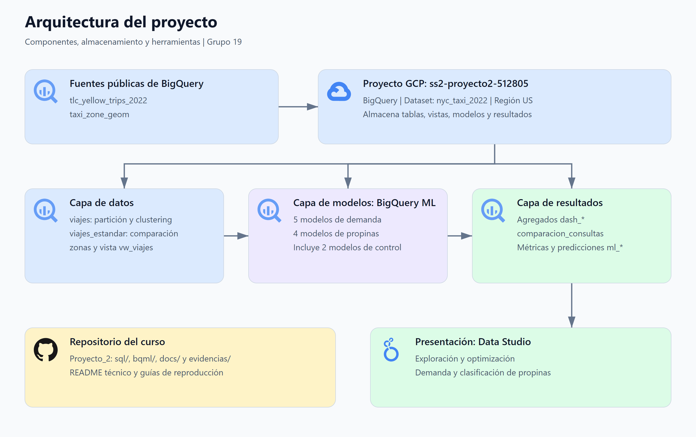

[Ver arquitectura en SVG](docs/imagenes/arquitectura.svg).

### 3.2 Objetos del proyecto

| Objeto | Tipo | Script | Propósito |
|---|---|---|---|
| `zonas` | Tabla (265 filas) | `sql/00` | Nombre, borough y polígono por zona |
| `viajes` | Tabla particionada y con clustering (35.3 M filas, 4.3 GB) | `sql/02` | Base de todo el análisis |
| `viajes_estandar` | Tabla | `sql/02` | Mismos viajes sin optimizar, solo para comparar costos |
| `vw_viajes` | Vista | `sql/02` | Variables de calendario, zona, pago y propina |
| `comparacion_consultas` | Tabla | `sql/04` | Métricas de las consultas comparadas |
| `dash_*` | 5 tablas (55 a 2,572 filas) | `sql/05` | Agregados del informe exploratorio |
| `ml_demanda_horaria`, `ml_propinas` | Tablas | `bqml/01` | Datasets limpios de los modelos |
| `reg_demanda_*`, `clf_propina_*` | 9 modelos | `bqml/02`, `bqml/03` | Modelos de BigQuery ML |
| `ml_*` | Tablas | `bqml/04`, `bqml/05` | Métricas y predicciones para el informe |

## 4. Ejecución

Los scripts se ejecutan en este orden: `sql/00` → `sql/05`, luego `bqml/01` → `bqml/05`. No
dependen del ID del proyecto: escriben `nyc_taxi_2022.<tabla>` y BigQuery usa el proyecto activo.
La [guía de ejecución](docs/GUIA_EJECUCION.md) explica qué archivos se corren completos y cuáles
bloque por bloque, cómo desactivar la caché y la solución de problemas. Antes de repetir el
entrenamiento, leer la [sección 11](#11-uso-de-recursos-y-costos).

## 5. Transformaciones

### 5.1 Normalización de tipos

| Campos | Origen → final | Motivo |
|---|---|---|
| Montos y distancia | `NUMERIC` → `FLOAT64` | 8 bytes por valor en lugar de 16. Cada consulta lee la mitad de bytes en esas columnas, y es el tipo que esperan BigQuery ML y las funciones estadísticas. |
| `vendor_id`, `rate_code`, `payment_type` | `STRING` → `INT64` | Son códigos numéricos. `rate_code` viene como `'1.0'`, por eso se convierte primero a `FLOAT64` y luego a `INT64`. |
| Zonas | `STRING` → `STRING` normalizado | Son categorías: BigQuery ML les aplica one-hot. Además coinciden con `zonas.zone_id`. |
| Fechas | `TIMESTAMP` → `DATETIME` | Hora local de Nueva York sin zona horaria, como la publica la TLC. |

### 5.2 Variables derivadas

| Variable | Definición | Uso |
|---|---|---|
| `trip_id` | `FARM_FINGERPRINT` de la llave del viaje | Eliminar duplicados y hacer muestreo determinístico |
| `pickup_date` | `DATE(pickup_datetime)` | Columna de partición |
| `duracion_min` | Minutos entre recogida y llegada | Limpieza, análisis y modelo de propinas |
| `velocidad_mph` | Distancia / horas de viaje | Limpieza (máximo 80 mph) y congestión |
| `hora_recogida`, `dia_semana`, `mes`, `es_fin_semana` | Extraídas de `pickup_datetime` | Patrones temporales |
| `zona_*`, `borough_*` | JOIN con `zonas` | Análisis geográfico |
| `es_aeropuerto` | Origen o destino en las zonas 1 (Newark), 132 (JFK) o 138 (LaGuardia) | Segmento de alto valor |
| `pct_propina` | Propina / (total − propina) | Propina sobre lo cobrado, la misma base que usa la pantalla de pago |
| `tipo_pago`, `tipo_tarifa` | Etiquetas del diccionario TLC | Distribuciones categóricas |

## 6. Optimización: partición y clustering

### 6.1 Decisiones de diseño

| Técnica | Implementación | Justificación |
|---|---|---|
| Partición por fecha | `PARTITION BY DATE_TRUNC(pickup_date, MONTH)` | Resultan 11 particiones de 296 a 439 MB. Una partición diaria daría 334 particiones de pocos MB, demasiado pequeñas para que el clustering descarte bloques dentro de ellas. |
| Clustering por ubicación | `CLUSTER BY pickup_location_id, dropoff_location_id` | Dentro de cada mes, los viajes quedan ordenados por zona de origen y luego de destino. Así, un filtro por zona lee solo los bloques de esa zona. El origen va primero porque es el filtro más frecuente. |
| Filtro de partición obligatorio | `require_partition_filter = TRUE` | Una consulta sin filtro de fecha falla en lugar de recorrer la tabla completa. |
| Tipos compactos | `FLOAT64` e `INT64` en lugar de `NUMERIC` y `STRING` | Menos bytes por columna leída. |
| Selección de columnas | La comparación y las consultas exploratorias seleccionan las columnas necesarias; S0 muestra `SELECT *` como contraste y hay usos de `*` en vistas, CTE y llamadas de ML | Evitar columnas innecesarias reduce la lectura; `LIMIT` no garantiza reducir los bytes. |
| Agregados para el informe | Tablas `dash_*` y `ml_*` | El informe lee tablas pequeñas en lugar de recorrer `viajes` en cada interacción. |

### 6.2 Metodología de comparación

La misma consulta se ejecutó sobre tres tablas:

- la **tabla pública**: sin optimizar y con tipos `NUMERIC`;
- **`viajes_estandar`**: mismos viajes y tipos que `viajes`, sin partición ni clustering;
- **`viajes`**: la tabla optimizada.

Entre `viajes_estandar` y `viajes` solo cambia la organización física, así que la diferencia mide
el efecto de la partición y del clustering. Cada escenario aísla una técnica:

| Escenario | Filtro | Qué aísla |
|---|---|---|
| S1 | Solo fecha (junio) | Partición |
| S2 | Solo zona (JFK, todo el período) | Clustering: el filtro de fecha cubre todo el período, así que no hay poda de particiones |
| S3 | Fecha y zona (JFK en junio) | Efecto combinado, incluida la tabla pública |

Las consultas se corrieron con la caché desactivada. Las métricas se tomaron de
`INFORMATION_SCHEMA.JOBS_BY_USER` (bloques R1 y R2 de `sql/04`) y se guardaron en
`comparacion_consultas`.

### 6.3 Resultados

| Escenario | Tabla | MB procesados | Tiempo de slot (ms) | Duración (ms) | Reducción de bytes frente a la estándar |
|---|---|---|---|---|---|
| S1 partición | `viajes_estandar` | 539.13 | 7,591 | 682 | — |
| S1 partición | `viajes` | **52.82** | 138 | 191 | **90.2 %** |
| S2 clustering | `viajes_estandar` | 863.02 | 4,032 | 347 | — |
| S2 clustering | `viajes` | **146.13** | 734 | 496 | **83.1 %** |
| S3 combinado | Tabla pública | 1,715.41 | 7,073 | 522 | +51.5 % (lee más que la estándar) |
| S3 combinado | `viajes_estandar` | 1,132.58 | 8,417 | 413 | — |
| S3 combinado | `viajes` | **11.94** | 54 | 221 | **98.9 %** (99.3 % frente a la pública) |

Cómo leer estos resultados:

- **Partición (S1):** junio es 1 de 11 meses, y la consulta lee ~10 % de los bytes. El tiempo de
  slot baja de 7.6 s a 0.14 s.
- **Clustering (S2):** el validador estimaba el mismo máximo para ambas tablas (863 MB), porque no
  puede anticipar qué bloques descartará el clustering. Al ejecutar, la tabla optimizada procesó
  146 MB. La evidencia del clustering está en los bytes procesados reales.
- **Origen frente a tabla derivada (S3):** la tabla pública lee un 51.5 % más que la estándar.
  Esta comparación combina diferencias de tipos, columnas y registros eliminados por la limpieza;
  no permite atribuir toda la diferencia a una sola causa. Con la tabla optimizada, la consulta
  pasa de 1.7 GB a 12 MB. Para aislar partición y clustering se comparan `viajes_estandar` y
  `viajes`, que contienen los mismos viajes y tipos en las columnas consultadas.
- **`SELECT *` (S0):** `SELECT * ... LIMIT 10` sobre la tabla pública procesaría 6.97 GB; con solo
  tres columnas, 996.84 MB. Ambas devuelven 10 filas, porque `LIMIT` no reduce la lectura.
- **Duraciones:** son de menos de un segundo y varían entre ejecuciones. Los bytes procesados y el
  tiempo de slot son las métricas estables.

## 7. Análisis exploratorio y hallazgos

Consultas en `sql/03_analisis_exploratorio.sql`, sobre los 35.3 millones de viajes limpios.

**Descriptivo (E1).** Un viaje típico (mediana) recorre **1.93 millas en 12.4 minutos** y cuesta
**USD 10.00 de tarifa y USD 15.96 en total**. Las medias son más altas (3.56 mi, USD 21.36)
porque los viajes a aeropuertos alargan la cola: el percentil 95 es de 15.3 millas. La velocidad
mediana es de 10.4 mph.

**Categórico.**
- **Pago (E2).** El 76.9 % paga con tarjeta y el 19.4 % en efectivo. Con tarjeta, el 96.4 % deja
  propina (USD 3.38 en promedio). En efectivo la propina registrada siempre es 0, porque no se
  captura. El 3.3 % sin código de pago (`payment_type` 0) registra propina en el 90.8 % de los
  casos, lo que sugiere pagos electrónicos sin clasificar.
- **Tarifa (E3).** El 92.2 % usa la tarifa estándar. La tarifa fija de JFK (3.6 %) cobra
  exactamente USD 52.00 por viajes de 18.2 millas en promedio.
- **Pasajeros (E4).** El 71.5 % viaja solo y el 14.8 % en pareja.

**Temporal.**
- **Tendencia (E5, E8).** Enero es el mes más bajo (2.41 M viajes) y la demanda crece +21 % en
  febrero y +22 % en marzo. Se mantiene en ~3.5 M de abril a junio, baja en verano (−10.7 % en
  julio), toca su máximo en octubre (3.57 M) y cae −11.7 % en noviembre. Parte de esa caída se
  debe a la falla de captura del 14 al 20 de noviembre (~235 mil viajes sin registrar). El ticket
  promedio sube de USD 19.01 en enero a USD 22.60 en septiembre.
- **Hora y día (E6, E7).** En días laborales el pico es a las **18 h**, con el 7.4 % de sus viajes.
  Las 7–9 h concentran el 12.7 % de los viajes laborales, frente al 6.7 % en fin de semana. En fin
  de semana, la madrugada (0–3 h) concentra el **13.6 %** de los viajes, frente al 4.0 % en días
  laborales: es la vida nocturna.
- **Días atípicos (E9, E19, E20).** Las caídas más fuertes son:
  - 18-sep, −95.6 %: falla de captura;
  - 29-ene, −58.4 %: ventisca;
  - 4-jul, −28.7 %; Thanksgiving (24-nov), −28.1 %; MLK, −23.6 %; Memorial Day, −22.0 %; Labor
    Day, −21.5 %: feriados;
  - 14-nov, −20.6 %: falla del proveedor 1.

  Los feriados restan entre 20 % y 29 % de la demanda, lo que justifica la variable `es_feriado`.

**Geográfico.**
- **Concentración (E10, E11).** El **83.3 %** de todos los viajes empieza y termina en Manhattan,
  y Manhattan origina el 89.7 %. Las zonas con más recogidas son Upper East Side South (4.7 %),
  **JFK** (4.7 %), Upper East Side North (4.2 %) y Midtown Center (4.0 %). De las 10 primeras,
  todas son de Manhattan excepto JFK.
- **Aeropuertos (E12).** Los viajes que tocan un aeropuerto son el **9.9 %** del total pero generan
  el **26.7 % del ingreso**. JFK: 5.8 % de los viajes, 17.1 % del ingreso, ticket de USD 63.21
  frente a USD 17.37 sin aeropuerto, y el 59.8 % con tarifa fija.
- **Rutas (E17).** En Manhattan, las rutas de mayor ingreso son viajes cortos y masivos entre Upper
  East Side South y North (233 mil viajes, ticket de USD 11.87). En Queens, las de mayor ingreso
  salen de JFK: JFK → Times Square suma USD 5.2 M con un ticket de USD 71.66.

**Económico y propinas.**
- **Propina con tarjeta (E13–E15).** La propina ronda el 18–20 % de lo cobrado y es estable.
  - Por distancia: el % baja de 19.9 % (menos de 1 mi) a 17.7 % (10+ mi), pero el porcentaje de
    viajes **sin propina** sube de 2.9 % a 6.4 %.
  - Por proveedor: con VeriFone (2) el 3.0 % no deja propina; con Creative Mobile (1), el 5.1 %.
  - Por hora: el máximo sin propina es a las 4 h (8.6 %) y el mínimo entre las 18 y 21 h (3.0 %).
- **Congestión (E16).** En viajes internos de Manhattan en días laborales, la velocidad mediana cae
  a **7.9 mph entre las 11 y las 14 h**: el mediodía es tan lento como la hora pico. A las 4 h sube
  a 15.7 mph, y una milla toma 8.5 minutos al mediodía frente a 4.4 a las 5 h.
- **Correlaciones (E18).** Distancia–tarifa 0.95, duración–tarifa 0.85, distancia–duración 0.81 y
  tarifa–propina (tarjeta) 0.74.

## 8. Modelos de BigQuery ML

### 8.1 Problema A: pronóstico de demanda horaria (regresión)

**Propósito.** Al cierre de cada día, pronosticar cuántos viajes iniciarán en cada borough durante
cada hora del día siguiente, para planificar la oferta de taxis.

**Unidad de análisis.** Una hora en un borough: Manhattan, Queens, Brooklyn o Bronx. Son 32,064
filas. La grilla está completa: las horas sin viajes valen 0, así que `LAG(viajes, 24)` es
exactamente la misma hora del día anterior. El control A.2 verifica 0 rezagos desalineados en
31,968 comparaciones.

| Rol | Variable | Descripción | Correlación con el objetivo (entrenamiento) |
|---|---|---|---|
| **Salida (objetivo)** | `viajes` | Viajes que inician en el borough durante la hora | — |
| Entrada | `borough` | Borough de origen | — |
| Entrada | `hora_dia`, `dia_semana`, `es_fin_semana` | Calendario | — |
| Entrada | `es_feriado` | Feriados federales de enero a noviembre y Año Nuevo | — |
| Entrada | `perfil_horario` | Cruce borough × tipo de día × hora (solo modelos lineales) | — |
| Entrada | `viajes_lag_24h`, `viajes_lag_48h`, `viajes_lag_168h` | Misma hora 1, 2 y 7 días antes | 0.970, 0.937, 0.989 |
| Entrada | `prom_misma_hora_7d` | Promedio de la misma hora en los 7 días previos | 0.973 |
| Entrada | `prom_mismo_dia_hora_4sem` | Promedio del mismo día y hora en las 4 semanas previas | 0.991 |
| Entrada | `viajes_dia_anterior` | Total del día anterior | 0.832 |
| Excluida | Rezagos menores a 24 h | No existen al cierre del día anterior: serían fuga | — |
| Excluida | Mes y fecha | El modelo extrapolaría a meses nunca vistos; el nivel reciente ya entra por los rezagos | — |

**Split temporal** (`data_split_method = 'CUSTOM'` con la columna `es_eval`):

| Conjunto | Fechas | Filas | Uso |
|---|---|---|---|
| Descartado | 1 al 28 de enero | 2,688 | Sin historia suficiente para el promedio de 4 semanas |
| Entrenamiento | 29 de enero al 31 de agosto | 20,640 | Ajuste |
| Validación | 1 de septiembre al 31 de octubre | 5,856 (132 sin dato) | Parada temprana y selección del modelo |
| Prueba | 1 al 30 de noviembre | 2,880 (672 estimadas, no evaluadas) | Estimación final y pronóstico rodante |

| Modelo | Algoritmo | Hiperparámetros | Iteraciones |
|---|---|---|---|
| `reg_demanda_lineal_v1` | `LINEAR_REG` | Gradiente por lotes, máximo 10 iteraciones, L2 = 0, sin parada temprana | 10 |
| `reg_demanda_lineal_v2` | `LINEAR_REG` | Máximo 40 iteraciones, L2 = 1.0, parada temprana (`min_rel_progress` 0.005) | 6 |
| `reg_demanda_boosted_v1` | `BOOSTED_TREE_REGRESSOR` | Máximo 50 rondas, `learn_rate` 0.3, profundidad 6 | 13 |
| `reg_demanda_boosted_v2` | `BOOSTED_TREE_REGRESSOR` | Máximo 150 rondas, `learn_rate` 0.1, profundidad 8, `subsample` 0.8, `colsample_bytree` 0.8, L2 1.0, `min_tree_child_weight` 5 | 47 |
| `reg_demanda_lineal_aleatorio` | `LINEAR_REG` | Igual que v2, con split `RANDOM` y `data_split_eval_fraction` 0.2 (demostración, 8.4) | 9 |
| Baseline ingenuo | Regla | Viajes de la misma hora 7 días antes | — |

**Resultados** (`bqml/04` consulta 8a). Todas las series se evalúan sobre las mismas horas de
noviembre:

| Modelo | RMSE validación | RMSE prueba | MAE validación | MAE prueba | R² validación | R² prueba |
|---|---|---|---|---|---|---|
| **`reg_demanda_boosted_v2`** | **223.97** | 309.44 | 93.97 | 115.25 | 0.9883 | 0.9779 |
| `reg_demanda_boosted_v1` | 232.38 | 308.60 | 94.91 | 118.10 | 0.9874 | 0.9780 |
| `reg_demanda_lineal_v1` | 280.89 | 332.52 | 129.19 | 140.92 | 0.9816 | 0.9744 |
| `reg_demanda_lineal_v2` | 286.25 | 343.37 | 136.50 | 150.15 | 0.9809 | 0.9728 |
| Baseline ingenuo | 316.49 | 495.11 | 117.93 | 172.78 | 0.9767 | 0.9433 |

Las métricas son RMSE y MAE, en viajes por hora, y R². El RMSE penaliza los errores grandes, que
son los costosos al planificar la flota (por ejemplo, un feriado mal pronosticado). Como
referencia, en entrenamiento hay en promedio 1,115 viajes por hora y borough.

**Selección: `reg_demanda_boosted_v2`.** Tiene el menor RMSE de validación (223.97), un 3.6 %
mejor que la v1. En noviembre:

- reduce el RMSE un **37.5 %** frente al baseline (309 contra 495) y el MAE un 33 %;
- explica el **97.8 %** de la variación.

La v1 queda prácticamente empatada en prueba (308.60), pero el modelo se elige con validación, no
con prueba.

Comparación de hiperparámetros:

- **Árboles frente a modelos lineales.** Los árboles ganan porque capturan interacciones que el
  modelo lineal solo ve a través de `perfil_horario`. Por ejemplo, el efecto de un feriado depende
  de la hora y del borough.
- **Los dos modelos lineales.** La v2, con L2 = 1.0 y parada temprana, se detuvo en 6 iteraciones
  y quedó algo peor que la v1. Con 20 mil filas y pocas variables numéricas, el modelo no sobreajusta,
  así que la regularización no aporta.
- **Los dos modelos de árboles.** La v2 converge en 47 rondas con `learn_rate` 0.1, frente a 13 de
  la v1. Mejora la validación un 3.6 %.

**Variables más importantes** (ganancia en `reg_demanda_boosted_v2`):

1. `prom_mismo_dia_hora_4sem`;
2. `viajes_lag_168h`;
3. `viajes_lag_24h`;
4. `es_feriado`.

La demanda se explica sobre todo por su patrón semanal reciente. En el modelo lineal, los pesos
estandarizados más altos son los mismos: 347, 344 y 305.

### 8.2 Problema B: viajes con tarjeta sin propina (clasificación)

**Propósito.** Estimar, en el momento del pago y antes de que el pasajero elija la propina, la
probabilidad de que no deje propina. Sirve para identificar los contextos con menos propina, como
rutas, tarifas o la pantalla de pago de cada proveedor.

**Población.** Viajes pagados con tarjeta: en efectivo la propina no se registra. Se toma una
muestra determinística del 3 % por hash de `trip_id`: 734,235 viajes de enero a octubre y 72,459
de noviembre. Las clases están muy desbalanceadas: solo el **3.59 %** de los viajes de
entrenamiento y el **3.47 %** de los de prueba terminan sin propina.

| Rol | Variable | Justificación (tasa sin propina en entrenamiento) |
|---|---|---|
| **Salida (objetivo)** | `sin_propina` (1 = propina 0, clase positiva) | — |
| Entrada | `codigo_tarifa` | Tarifa 99 (desconocida): 100 %; negociada: 15.1 %; estándar: 3.2 % |
| Entrada | `borough_origen`, `borough_destino`, `zona_origen`, `zona_destino` | Bronx: 83.9 %; Brooklyn: 27.0 %; Queens: 5.9 %; Manhattan: 3.2 % |
| Entrada | `proveedor` | Proveedor 1: 5.05 %; proveedor 2: 2.98 % (pantallas de pago distintas) |
| Entrada | `es_aeropuerto` | 4.58 % contra 3.49 % |
| Entrada | `hora_dia`, `dia_semana`, `es_fin_semana` | Fin de semana: 4.07 %; entre semana: 3.42 % |
| Entrada | `pasajeros`, `distancia_mi`, `duracion_min`, `velocidad_mph`, `tarifa`, `peajes`, `tarifa_por_milla` | Lo que el pasajero sabe antes de elegir la propina |
| Excluida | `tip_amount`, `pct_propina` | Definen la etiqueta |
| Excluida | `total_amount` | Incluye la propina: es fuga (ver 8.4) |
| Excluida | `payment_type` | Constante después del filtro |

**Split.** Enero a octubre, con `data_split_method = 'RANDOM'` y `data_split_eval_fraction = 0.2`.
El split aleatorio de BigQuery ML es determinístico, así que los modelos se comparan sobre las
mismas filas. Noviembre queda como prueba temporal.

| Modelo | Algoritmo | Hiperparámetros | Iteraciones |
|---|---|---|---|
| `clf_propina_logistica_v1` | `LOGISTIC_REG` | Máximo 15 iteraciones, L2 = 0, sin pesos de clase | 6 |
| `clf_propina_logistica_v2` | `LOGISTIC_REG` | Máximo 30 iteraciones, L2 = 0.5, `auto_class_weights` | 4 |
| `clf_propina_boosted` | `BOOSTED_TREE_CLASSIFIER` | Máximo 60 rondas, `learn_rate` 0.2, profundidad 8, `subsample` 0.8, `colsample_bytree` 0.8, `min_tree_child_weight` 10, `auto_class_weights` | 7 |
| `clf_propina_con_fuga` | `LOGISTIC_REG` | Solo `tarifa`, `peajes` y el total con propina (demostración, 8.4) | 10 |

**Resultados** (`bqml/04` consulta 8c; prueba = noviembre; umbral 0.5):

| Modelo | ROC-AUC evaluación | ROC-AUC prueba | Precisión | Recall | F1 | Log loss |
|---|---|---|---|---|---|---|
| **`clf_propina_logistica_v2`** | **0.6881** | 0.6879 | 0.082 | 0.407 | 0.137 | 0.578 |
| `clf_propina_logistica_v1` | 0.6847 | 0.6831 | 0.954 | 0.099 | 0.179 | 0.135 |
| `clf_propina_boosted` | 0.6705 | 0.6691 | 0.069 | 0.444 | 0.120 | 0.617 |
| `clf_propina_con_fuga` (no válido) | 0.8372 | 0.8276 | 0.429 | 0.004 | 0.007 | 0.141 |

Por qué estas métricas:

- **ROC-AUC** mide qué tan bien ordena el modelo los viajes por riesgo a través de distintos
  umbrales. Es el criterio de selección, pero con clases desbalanceadas debe interpretarse junto
  con precisión, recall y F1 de la clase minoritaria.
- **Precisión y recall** de la clase "sin propina" dicen cuántas alertas aciertan y cuántos casos
  reales se detectan.
- **Accuracy** no sirve aquí: un modelo que nunca predice "sin propina" ya acierta el 96.5 %.

**Efecto de los hiperparámetros.**

- **Pesos de clase.** Sin pesos (v1), el modelo casi nunca predice la clase minoritaria. Con umbral
  0.5 marca solo 260 viajes y acierta el 95 % de ellos, sobre todo los de tarifa 99, pero detecta
  apenas el 10 % de los casos. Con `auto_class_weights` (v2), el recall sube a 41 % a costa de la
  precisión, y las probabilidades quedan desplazadas hacia arriba: el log loss sube de 0.135 a
  0.578.
- **Árboles frente a logística.** Los árboles no superaron a la logística. Probablemente se debe a
  que la etiqueta depende de pocas categorías fuertes, como la tarifa y el borough de origen, que la
  logística con one-hot captura bien. Además, el árbol se detuvo en 7 rondas por parada temprana.

**Umbral de decisión** (índice de Youden sobre el conjunto de evaluación, no sobre noviembre):

| Modelo | Umbral | Precisión | Recall | F1 |
|---|---|---|---|---|
| Logística v2 | 0.467 | 0.067 | 0.518 | 0.118 |
| Logística v1 | 0.035 | 0.067 | 0.488 | 0.117 |
| Boosted | 0.469 | 0.057 | 0.584 | 0.104 |

Matriz de confusión de la logística v2 en noviembre con umbral 0.5:

| | Predicho: con propina | Predicho: sin propina |
|---|---|---|
| **Real: con propina** | 58,517 | 11,431 |
| **Real: sin propina** | 1,489 | 1,022 |

**Variables más importantes.**

- **En el modelo de árboles** (ganancia): `codigo_tarifa` (2,619) domina, seguida de
  `borough_origen` (312), `proveedor` (141) y `borough_destino` (104).
- **En la logística v2** (pesos estandarizados):
  - la tarifa 99 suma +2.74 y la negociada +0.80;
  - los viajes que salen del Bronx o Staten Island suman entre +1.1 y +1.6;
  - el proveedor 1 suma +0.11 frente a −0.08 del proveedor 2;
  - el fin de semana suma +0.07;
  - el decil de distancia más corto suma +0.11.

**Selección: `clf_propina_logistica_v2`.** Tiene el mayor ROC-AUC de evaluación (0.688), apenas
por encima de la v1, y su ROC-AUC en noviembre es prácticamente igual. Eso indica que generaliza
en el tiempo.

El modelo es moderado: un AUC de 0.69 significa que ordena mejor que el azar, pero la propina
depende sobre todo del pasajero, que no está en los datos. Si se necesitan probabilidades
calibradas, por ejemplo para estimar el ingreso por propinas, conviene la v1 (log loss 0.135).
Los pesos de clase de la v2 desplazan sus probabilidades hacia arriba.

### 8.3 Ingeniería de características

| Variable | Modelo | Construcción | Justificación |
|---|---|---|---|
| Rezagos de 24 h, 48 h y 168 h | Demanda | `LAG` sobre la grilla horaria completa | Correlación de 0.94 a 0.99 con el objetivo. Son los rezagos más cortos disponibles al pronosticar el día siguiente. |
| Promedios móviles de 7 días y 4 semanas | Demanda | Ventanas `ROWS BETWEEN n PRECEDING AND 1 PRECEDING` | Suavizan el ruido de un día sin incluir el día actual. El de 4 semanas es la variable más importante del mejor modelo. |
| Total del día anterior | Demanda | Total diario unido a D − 1 | Nivel reciente: clima, eventos, temporada. |
| `es_feriado` | Demanda | Lista de feriados federales | Los feriados restan entre 20 % y 29 % de la demanda (E9). Es la 4.ª variable más importante. |
| `perfil_horario` | Demanda (lineal) | Cruce borough × tipo de día × hora | Interacción que un modelo lineal no aprende solo. |
| `hora_cat` | Propina (logística) | Hora como categoría en `TRANSFORM` | El efecto de la hora no es lineal: el máximo sin propina es a las 4 h. |
| `distancia_decil`, `duracion_decil` | Propina (logística) | `ML.QUANTILE_BUCKETIZE(..., 10)` | Relación no lineal: el decil más corto tiene peso positivo y los medios, negativo. |
| `log_tarifa` | Propina (logística) | `LN(1 + tarifa)` | Reduce la asimetría de la tarifa. |
| `ruta_borough` | Propina (logística) | Origen-destino a nivel borough | Pesos de −0.85 a +1.59: el origen fuera de Manhattan es la señal más fuerte después de la tarifa. |
| `pasajeros_imp` | Propina (logística) | `ML.IMPUTER(..., 'median')` | Completa los viajes sin dato de pasajeros sin descartarlos. |
| `con_peaje`, `es_aeropuerto`, `tarifa_por_milla` | Propina | Indicadores y cocientes | Marcan viajes largos, a aeropuertos o con tráfico lento. |

La cláusula `TRANSFORM` guarda la preparación dentro del modelo, de modo que `ML.EVALUATE` y
`ML.PREDICT` aplican exactamente las mismas transformaciones. Las estadísticas de imputación y de
deciles se calculan durante el entrenamiento, sin datos de noviembre.

### 8.4 Prevención de data leakage

| Riesgo | Control | Dónde |
|---|---|---|
| Entrenar con el futuro (demanda) | Split temporal `CUSTOM`; noviembre queda fuera de todo entrenamiento | `bqml/01`, `bqml/02` |
| Usar información que no existe al predecir | Solo rezagos de 24 h o más; las ventanas terminan en el día anterior | `bqml/01` |
| Rezagos desalineados | Grilla horaria completa; control A.2 con 0 rezagos incorrectos | `bqml/01` |
| Datos de captura incompleta | Horas sin datos como `NULL`; semana estimada fuera de la evaluación | `bqml/01`, `bqml/04` |
| Variables posteriores al evento (propina) | Se excluyen `total_amount`, `tip_amount` y `pct_propina` | `bqml/01`, `bqml/03` |
| Etiqueta mal definida | Solo pagos con tarjeta | `bqml/01` |
| Elegir con el conjunto de prueba | Modelo y umbral se eligen en evaluación; noviembre solo se reporta | `bqml/04`, `bqml/05` |
| Preprocesamiento con datos de prueba | `TRANSFORM` calcula imputación y deciles durante el entrenamiento | `bqml/03` |
| Resultados no reproducibles | Muestreo por hash de `trip_id` y split aleatorio determinístico | `bqml/01`, `bqml/03` |

**Uso de `data_split_eval_fraction` y del split personalizado.**

- **Propinas:** se usa `RANDOM` con `data_split_eval_fraction = 0.2`. Los viajes individuales son
  prácticamente independientes y ninguna variable identifica la fecha. La prueba temporal de
  noviembre lo confirma: el ROC-AUC es casi el mismo en evaluación y en prueba (0.688 contra 0.688).
- **Demanda:** se usa el split personalizado temporal. Las horas consecutivas están correlacionadas
  y los rezagos de una fila son los objetivos de otras.

Dos experimentos lo demuestran con números:

1. **Fuga por variable.** `clf_propina_con_fuga` usa solo tres variables, una de ellas el total
   cobrado, que incluye la propina. Obtiene un ROC-AUC de **0.84**, frente a **0.69** del mejor
   modelo válido con 14 variables. El total menos la tarifa y los peajes deja la propina más los
   recargos, así que el modelo reconstruye parte de la etiqueta. Es un modelo inútil en producción:
   ese dato no existe antes de que el pasajero elija la propina.
2. **Fuga por split.** Se compara el mismo modelo lineal con split aleatorio y con split temporal:

   | Split | RMSE reportado al entrenar | RMSE real en noviembre | Brecha |
   |---|---|---|---|
   | `RANDOM` 20 % | 277.11 | 336.54 | 21.4 % |
   | `CUSTOM` temporal | 286.25 | 343.37 | 20.0 % |

   El split aleatorio reporta un error menor porque evalúa sobre horas de días que el modelo ya
   vio, y es el que más se aleja del error real. La diferencia es moderada (1.4 puntos), porque las
   variables solo usan historia de 24 h o más y ninguna identifica la fecha, lo que limita lo que un
   modelo lineal puede "memorizar". Ambos subestiman el error de noviembre porque ese mes incluye
   Thanksgiving, un feriado más fuerte que los del entrenamiento. Por eso la estimación honesta es
   la del split temporal y la prueba se reporta aparte.

### 8.5 Predicciones sobre registros nuevos

**Pronóstico rodante de noviembre (rolling forecast).** Cada día de noviembre se pronostica con la
información real disponible hasta el día anterior, como si el modelo corriera cada noche: el origen
avanza un día a la vez y el horizonte es siempre el día siguiente. La tabla `ml_pronostico_demanda`
guarda por hora y borough los viajes reales, el baseline y las predicciones de los cuatro modelos.

| Serie | Error porcentual diario medio | Peor día |
|---|---|---|
| Boosted v1 | 6.82 % | 48.1 % |
| Boosted v2 | 7.17 % | 58.8 % (Thanksgiving) |
| Lineal v1 | 7.95 % | 51.4 % |
| Lineal v2 | 8.05 % | 54.8 % |
| Baseline semana anterior | 13.51 % | 93.5 % (Thanksgiving) |

El día más difícil es **Thanksgiving**, con 66,061 viajes reales, un 49 % menos que el jueves
anterior con datos completos (10-nov, 128,923):

- el modelo seleccionado pronosticó 104,878;
- el baseline pronosticó 127,806, porque copia la semana anterior.

La variable de feriado ayuda (el modelo baja su pronóstico 23 mil viajes respecto del baseline),
pero no alcanza la caída real. `es_feriado` trata a todos los feriados por igual, y la magnitud
de la caída depende del feriado y del día de la semana.

En la semana del 14 al 20 de noviembre, la serie real queda vacía porque el proveedor 1 no
reportó. Para no arrastrar ese hueco a los rezagos de la semana siguiente, la demanda de esos días
se estimó con los viajes del proveedor 2 por su proporción habitual en cada borough y hora, tomada
de las 4 semanas previas. Esas horas no se usan para evaluar.

**Propinas en noviembre.** `ml_pred_propina` guarda la probabilidad de "sin propina" de los 72,459
viajes de prueba con los tres modelos válidos. `ml_matriz_confusion` guarda las matrices con umbral
0.5 y con el umbral de Youden.

**Viajes hipotéticos** que no existen en el dataset (`ml_viajes_hipoteticos`):

| Escenario | P(sin propina), logística v2 | P(sin propina), boosted |
|---|---|---|
| Domingo 14 h, viaje corto en Upper East Side (1.1 mi) | 0.31 | 0.33 |
| Martes 8 h, JFK a Midtown con tarifa fija y peaje | 0.45 | 0.51 |
| Viernes 23 h, East Village a Williamsburg (3.2 mi) | 0.45 | 0.41 |

Los pesos de clase desplazan estas probabilidades hacia arriba (la tasa real es 3.5 %), así que se
leen como un orden de riesgo. El viaje corto dentro de Manhattan es el de menor riesgo; la tarifa
fija desde JFK y el viaje nocturno hacia Brooklyn, los de mayor riesgo. El orden coincide con el
análisis exploratorio.

## 9. Informe visual

Enlace: <https://datastudio.google.com/u/0/reporting/7e3040a1-201a-4595-bf1e-fa6a5c6af4a0/page/yY7BG>

| Página | Contenido |
|---|---|
| Exploración | Indicadores, serie diaria por borough, mapa de calor hora × día, top 10 de zonas, mapa coroplético de recogidas, mezcla de pagos por mes y matriz origen-destino |
| Optimización | Bytes procesados por consulta y escenario |
| Pronóstico de demanda | Real frente a baseline y modelos en noviembre (rolling forecast), métricas por modelo, error diario y convergencia por iteración |
| Propinas | Métricas por modelo, curva ROC, matriz de confusión, importancia de variables y tasa real frente a probabilidad pronosticada por día |

La construcción paso a paso está en [docs/GUIA_DASHBOARD.md](docs/GUIA_DASHBOARD.md). Las capturas
de sus cuatro páginas se incluyen a continuación. Se obtuvieron del informe compartido el
26 de octubre de 2026, sin iniciar sesión ni lanzar scripts de entrenamiento o consultas
manualmente. Las gráficas muestran los resultados cargados por el propio informe.

### 9.1 Exploración

Indicadores, serie temporal, mapa de calor, zonas, pagos y flujos entre boroughs.

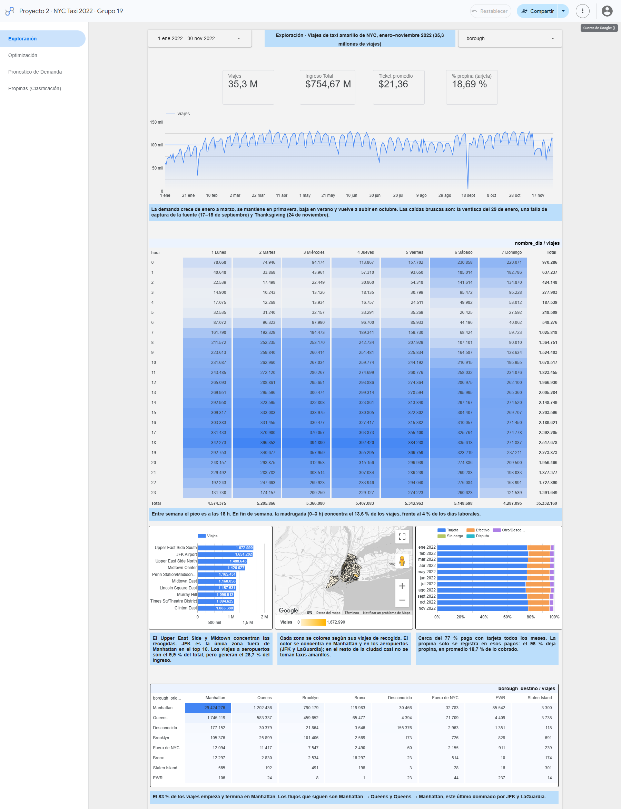

### 9.2 Optimización

Comparación de procesamiento y métricas de las consultas por escenario.

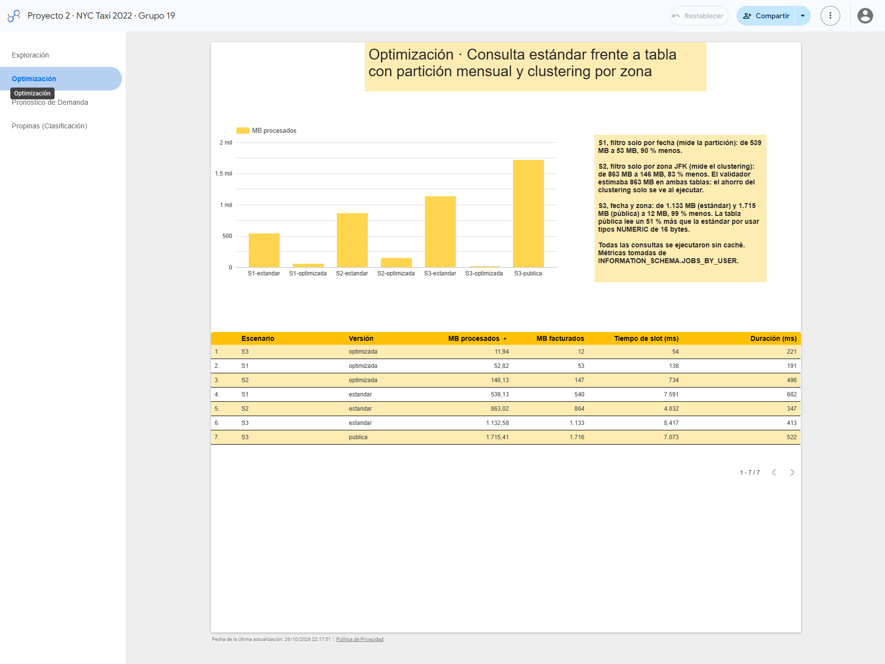

### 9.3 Pronóstico de demanda

Comparación de datos reales, baseline y predicciones de varios modelos en noviembre,
con métricas y error diario.

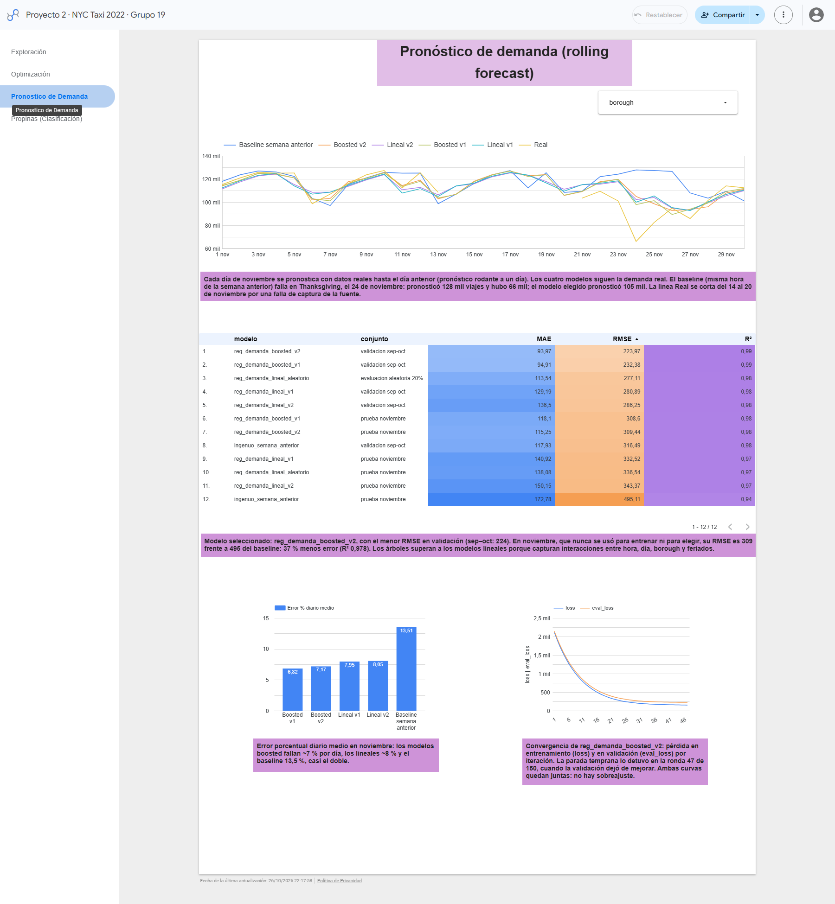

### 9.4 Clasificación de propinas

Evaluación de modelos, curva ROC, matriz de confusión e importancia de variables.

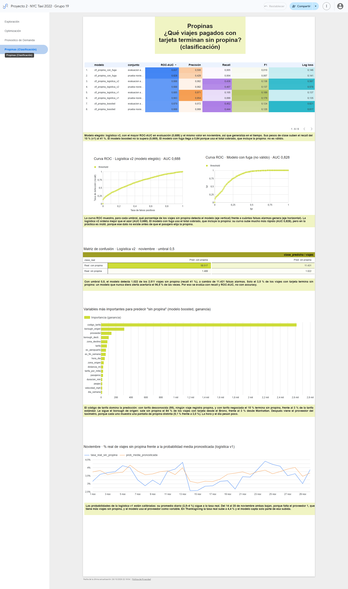

## 10. Estructura del repositorio

```text
Proyecto_2/
├── README.md                          documento técnico (este archivo)
├── enunciado/                         enunciado del proyecto
├── sql/
│   ├── 00_configuracion.sql           dataset y dimensión de zonas
│   ├── 01_exploracion_calidad.sql     volumen, esquema y calidad del dataset público
│   ├── 02_transformacion_tablas.sql   tabla limpia con partición y clustering, copia estándar, vista
│   ├── 03_analisis_exploratorio.sql   métricas, distribuciones, patrones y huecos de captura (E1–E20)
│   ├── 04_comparacion_rendimiento.sql consultas estándar frente a optimizadas (S0–S3, R1–R2)
│   └── 05_tablas_dashboard.sql        agregados para Data Studio
├── bqml/
│   ├── 01_preparacion_datos_ml.sql    datasets de demanda y propinas, controles de fuga
│   ├── 02_modelos_demanda.sql         5 modelos de regresión
│   ├── 03_modelos_propina.sql         4 modelos de clasificación
│   ├── 04_evaluacion_comparacion.sql  métricas, ROC, iteraciones, importancia y selección
│   └── 05_predicciones.sql            pronóstico rodante, predicciones y viajes hipotéticos
├── docs/
│   ├── GUIA_EJECUCION.md              orden de ejecución, configuración y solución de problemas
│   ├── GUIA_CALIFICACION.md           recorrido por la rúbrica, preguntas y evidencias
│   └── GUIA_DASHBOARD.md              construcción del informe en Data Studio
└── evidencias/
    └── README.md                      lista de capturas y criterio de la rúbrica de cada una
```

## 11. Uso de recursos y costos

Bytes facturados por todo el proyecto, según `INFORMATION_SCHEMA.JOBS_BY_USER`:

| Tipo | Trabajos | Facturado |
|---|---|---|
| Consultas y creación de tablas | ~100 | ~65 GB reportados en el README original; no implica cobertura por cuota gratuita |
| Entrenamiento de modelos lineales y logísticos | 6 | 0.3 GB |
| Entrenamiento de modelos boosted tree | 3 | **105.8 GB** (46.8 + 46.4 + 12.6) |

Prácticas aplicadas:

- `COUNT(*)` y `__TABLES__` responden con metadatos (0 B).
- La tabla pública se recorre una sola vez para crear `viajes`.
- `viajes_estandar` guarda solo las columnas de la comparación.
- Los modelos de propinas entrenan con una muestra del 3 %.
- El informe lee tablas agregadas pequeñas.

**Advertencia de costo.** En los modelos `BOOSTED_TREE_*`, BigQuery factura el cómputo del
entrenamiento, no el tamaño de la tabla. El de demanda entrenó con una tabla de 3 MB y facturó
46.4 GB, y la estimación previa del validador (~3 MB) no lo anticipa. Antes de reentrenar estos
modelos en una cuenta con facturación, conviene revisar la tarifa de BigQuery ML y configurar un
presupuesto con alertas.

Los totales anteriores provienen del reporte original y no constituyen una conciliación de
la factura de GCP. El usuario indicó que no dispone de cuota gratuita. Las ejecuciones
posteriores autorizadas para documentación se registran por separado en 16.3 y 16.4; no se
asume que estén incluidas en esos totales. El importe monetario definitivo se consulta en
Facturación de Google Cloud.

## 12. Limitaciones

- **Datos de origen.**
  - La tabla pública no tiene diciembre.
  - Tiene tres fallas de captura (sección 2.4). La del 10 de agosto, de un solo proveedor, quedó
    en el entrenamiento: es 1 de 215 días (~0.5 % de las filas). Corregirla exigía reentrenar los
    modelos de árboles con el costo de la sección 11, por eso se documenta en lugar de corregirse.
  - La demanda de la semana del 14 al 20 de noviembre es una estimación, solo se usa como insumo
    de los rezagos.
- **Propina en efectivo.** No se registra, por eso el problema B se limita a pagos con tarjeta. Un
  pasajero que paga con tarjeta y deja la propina en efectivo aparece como "sin propina".
- **Momento de la predicción.** En el problema B, la distancia y la duración solo se conocen al
  terminar el viaje. El modelo responde "al momento del pago", no "al subir al taxi".
- **Feriados.** El modelo de demanda subestima la caída de Thanksgiving: `es_feriado` es un solo
  indicador para todos los feriados, aunque cada uno afecta la demanda distinto.
- **Reentrenamiento.** Los modelos de demanda se entrenaron con enero–agosto. Reentrenar con
  enero–octubre antes de pronosticar noviembre probablemente mejoraría la prueba, pero repetiría el
  costo de los modelos de árboles.
- **Partición mensual.** Una consulta de un solo día lee el mes completo; es el costo de tener
  particiones de tamaño adecuado para el clustering.
- **Resolución geográfica.** La TLC publica zonas, no coordenadas.

## 13. Referencias

- Google Cloud. *Introduction to partitioned tables.* <https://cloud.google.com/bigquery/docs/partitioned-tables>
- Google Cloud. *Introduction to clustered tables.* <https://cloud.google.com/bigquery/docs/clustered-tables>
- Google Cloud. *The CREATE MODEL statement for generalized linear models.* <https://cloud.google.com/bigquery/docs/reference/standard-sql/bigqueryml-syntax-create-glm>
- Google Cloud. *The CREATE MODEL statement for boosted tree models.* <https://cloud.google.com/bigquery/docs/reference/standard-sql/bigqueryml-syntax-create-boosted-tree>
- Google Cloud. *The ML.EVALUATE function.* <https://cloud.google.com/bigquery/docs/reference/standard-sql/bigqueryml-syntax-evaluate>
- Google Cloud. *JOBS view (INFORMATION_SCHEMA).* <https://cloud.google.com/bigquery/docs/information-schema-jobs>
- NYC Taxi & Limousine Commission. *Data Dictionary – Yellow Taxi Trip Records.* <https://www.nyc.gov/assets/tlc/downloads/pdf/data_dictionary_trip_records_yellow.pdf>

## 14. Conclusiones

1. **La calidad del origen condiciona el análisis.** Los resultados reportados conservan
   35,332,160 viajes después de la limpieza. La ausencia de diciembre y los huecos de captura
   obligan a delimitar el período y distinguir una caída de demanda de registros faltantes.
2. **La organización física reduce la lectura.** La comparación reporta reducciones del 90.2 %
   con filtro mensual, 83.1 % con filtro por zona y 98.9 % al combinar ambos. La duración no
   mejora en todos los escenarios: en S2 sube de 347 a 496 ms. El beneficio demostrado por las
   cifras registradas se concentra en los bytes procesados y el tiempo de slot.
3. **Los patrones temporales y geográficos orientan la planificación.** Los hallazgos reportados
   muestran concentración en Manhattan, diferencias entre horarios laborales y fines de semana,
   y una participación de los aeropuertos en ingresos mayor que en cantidad de viajes. Estas
   asociaciones describen el dataset y no demuestran relaciones causales.
4. **El modelo de demanda se selecciona con validación.** `reg_demanda_boosted_v2` tiene el menor
   RMSE de validación registrado y reduce aproximadamente 37.5 % el RMSE de noviembre frente al
   baseline. Thanksgiving sigue siendo una limitación relevante; los datos estimados de la
   semana incompleta no se usan como objetivos de evaluación.
5. **La clasificación de propinas tiene utilidad limitada.** La logística v2 alcanza un ROC-AUC
   reportado de aproximadamente 0.688, pero su baja precisión exige cautela al interpretar
   alertas. Las salidas de los modelos con pesos de clase requieren calibración antes de
   tratarlas como probabilidades para estimar ingresos.
6. **La reproducibilidad necesita evidencias.** Los scripts y las guías permiten identificar
   cómo se obtiene cada resultado. Para cerrar la entrega deben adjuntarse las capturas
   solicitadas y respaldarse las cifras con resultados de BigQuery y del informe visual.

## 15. Correspondencia con el enunciado y la rúbrica

La siguiente matriz ubica cada requisito en la documentación y en su implementación. Una
referencia a un script acredita su presencia local; la ejecución y sus resultados requieren
las evidencias indicadas en la sección 16.

| Requisito | Documentación | Implementación o entregable |
|---|---|---|
| Nombre del proyecto y ambos integrantes | Encabezado | Este README |
| Dataset público, estructura, calidad y mínimo de 1 millón de registros (1.1) | Secciones 2 y 5 | [Exploración y calidad](sql/01_exploracion_calidad.sql), [transformaciones](sql/02_transformacion_tablas.sql) |
| Consultas SQL avanzadas y transformaciones comentadas (1.2) | Secciones 5 y 7 | [Análisis E1–E20](sql/03_analisis_exploratorio.sql) y scripts de `sql/` |
| Tablas derivadas, particiones y clustering (1.3) | Secciones 3 y 6.1 | [Creación de tablas y vista](sql/02_transformacion_tablas.sql) |
| Comparación estándar frente a optimizada y reducción de bytes (1.3 y 2.5) | Secciones 6.2 y 6.3 | [Escenarios S1–S3 y métricas R1–R2](sql/04_comparacion_rendimiento.sql) |
| Al menos dos modelos de BigQuery ML (1.4) | Secciones 8.1 y 8.2 | [Cinco modelos de demanda](bqml/02_modelos_demanda.sql), [cuatro modelos de propina](bqml/03_modelos_propina.sql); dos modelos son controles de demostración |
| Métricas, hiperparámetros y selección justificada (1.5) | Secciones 8.1 y 8.2 | [Evaluación y comparación](bqml/04_evaluacion_comparacion.sql) |
| Prevención de data leakage, `data_split_eval_fraction` y split personalizado (1.6) | Sección 8.4 | [Preparación de datos](bqml/01_preparacion_datos_ml.sql), scripts de modelos y evaluación |
| Hallazgos, patrones y tendencias (2.1) | Secciones 7 y 14 | [Consultas exploratorias](sql/03_analisis_exploratorio.sql) |
| Al menos tres visualizaciones exploratorias y resultados predictivos (2.2) | Secciones 9 y 8.5 | [Guía del dashboard](docs/GUIA_DASHBOARD.md), [tablas agregadas](sql/05_tablas_dashboard.sql) y enlace al informe |
| Ingeniería de características y justificación de variables (2.3) | Secciones 5.2 y 8.3 | Preparación de datos ML y cláusulas `TRANSFORM` de los modelos de propina |
| Variables de entrada, salida y objetivo (2.4) | Tablas de las secciones 8.1 y 8.2 | Consultas de entrenamiento e `input_label_cols` |
| Predicciones sobre nuevos registros y comparación de al menos dos modelos en rolling forecast | Sección 8.5 | [Predicciones](bqml/05_predicciones.sql): `ml_pronostico_demanda`, `ml_pred_propina` y escenarios hipotéticos |
| Capturas de consultas, conteos, optimización e informe | Sección 16 | [Inventario de evidencias](evidencias/README.md) |
| Repositorio organizado en `Proyecto_2` | Secciones 4 y 10 | [Guía de ejecución](docs/GUIA_EJECUCION.md), carpetas `sql/`, `bqml/`, `docs/` y `evidencias/` |

## 16. Estado de entrega y evidencias pendientes

| Elemento | Estado en la revisión local | Acción para completar la entrega |
|---|---|---|
| README técnico e integrantes | Presente | Mantener sincronizado con los resultados definitivos |
| Scripts SQL y BigQuery ML | Presentes: 6 de SQL y 6 de ML (incluido el control documental) | Conservar los comentarios y el orden de ejecución documentado |
| Guías de ejecución y dashboard | Presentes | Seguirlas para reproducir consultas y construir las visualizaciones |
| Cifras, métricas e iteraciones | Reportadas en el README previo; hay capturas de los resultados visibles en el dashboard | Adjuntar resultados directos de BigQuery que permitan contrastar los demás valores de las secciones 2, 6, 7, 8 y 11 |
| Capturas de BigQuery | Esquema, detalles, calidad, rendimiento, modelos, predicciones y controles incorporados | Consultar los resultados específicos sin respaldo en el inventario conciliado; los antiguos nombres 01–42 no son una lista obligatoria del enunciado |
| Informe visual | Abierto sin iniciar sesión; se observaron más de 3 visualizaciones exploratorias y comparación de varios modelos de demanda | Conservar acceso de lectura para la evaluación |
| Capturas del dashboard | Incorporadas: archivos 39 a 42, visibles en la sección 9 | Actualizarlas si cambia el informe |
| Tablas de resultados y predicciones | Capturas de vistas previas incorporadas | Completar escenarios hipotéticos y exportaciones si se requieren |

Para conservar la trazabilidad de la comparación, el respaldo debe incluir `job_id`, fecha de
ejecución, bytes procesados, bytes facturados, duración y estado de caché. La tabla
`comparacion_consultas` ya guarda los identificadores y las métricas; R1 filtra trabajos exitosos
sin caché. Para los modelos, adjuntar la evaluación, la configuración y las iteraciones, además
de las predicciones. Las capturas deben mostrar datos legibles y corresponder a los valores
publicados en este README.

La relación entre requisitos y archivos existentes se encuentra en
[evidencias/README.md](evidencias/README.md). El inventario identifica las capturas combinadas
que cubren varios puntos y separa los resultados numéricos o diagnósticos aún sin respaldo
adjunto. No se exige un archivo independiente por cada número de la propuesta inicial.

### 16.1 Capturas de la consola de BigQuery

Obtenidas el 27 de octubre de 2026 desde la sesión de Brave autorizada. Se consultaron
metadatos, evaluaciones existentes y vistas previas de tablas; no se ejecutaron consultas SQL
ni entrenamientos. Las vistas previas muestran filas almacenadas, no reemplazan los controles
agregados de calidad o de separación de datos. Las evaluaciones del modelo corresponden a su
conjunto de evaluación; las tablas de métricas distinguen evaluación y prueba.

<details>
<summary>Dataset y optimización</summary>

**Detalles de la tabla pública**

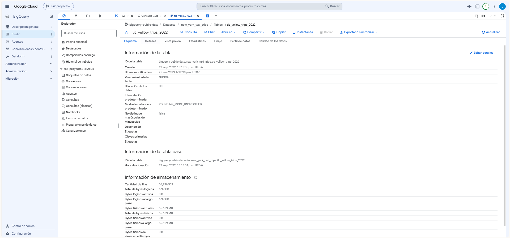

**Esquema de origen**

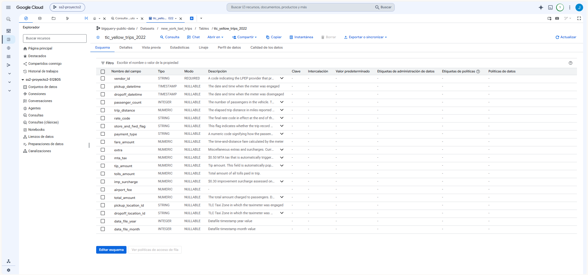

**Esquema de viajes limpios**

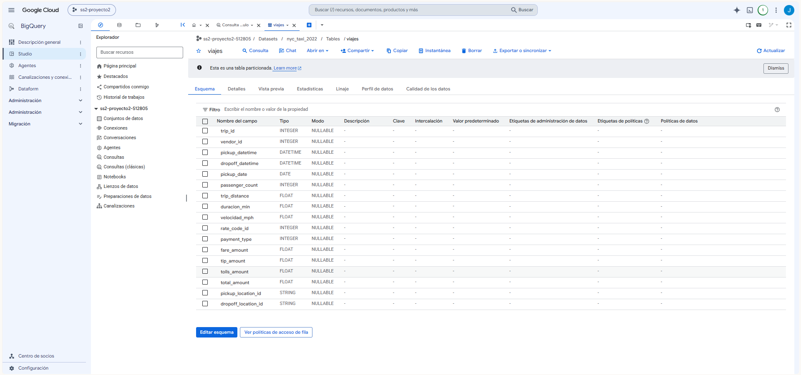

**Particiones, clustering y cantidad de filas**

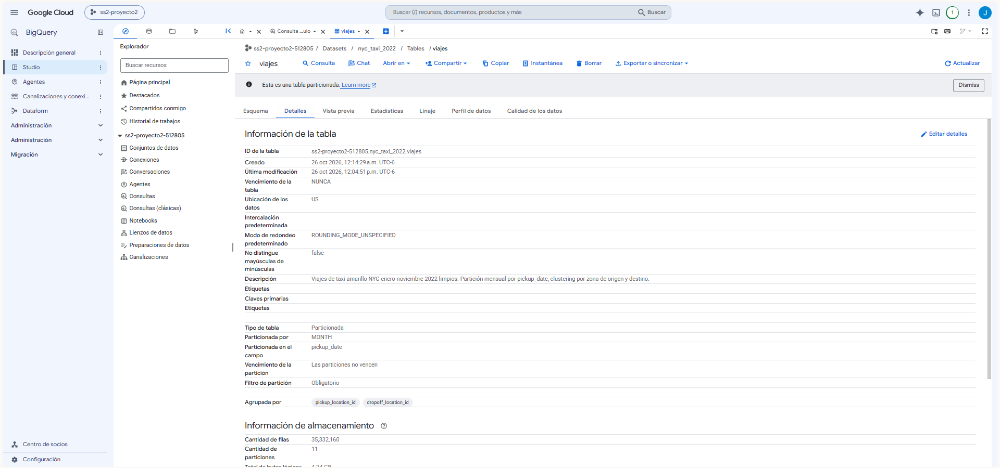

**Métricas almacenadas de comparación**

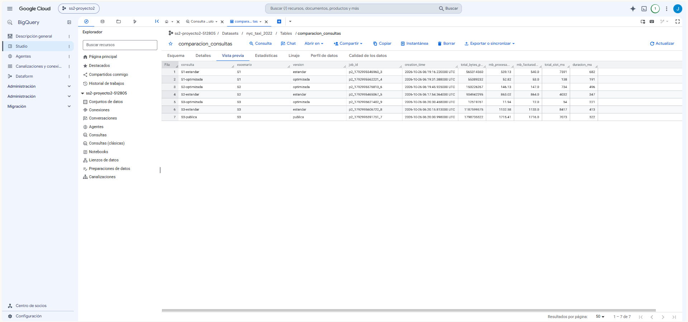

</details>

<details>
<summary>Modelos y evaluación</summary>

**Entrenamiento de regresión lineal**

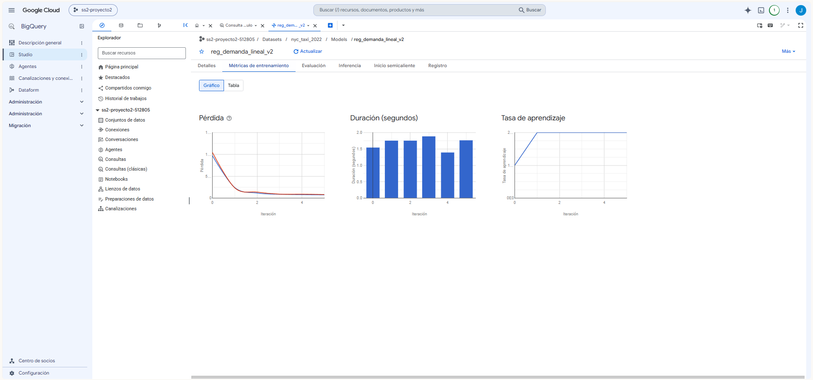

**Hiperparámetros y split personalizado**

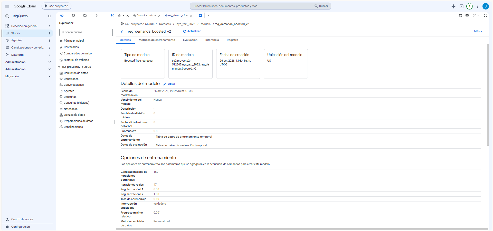

**Entrenamiento boosted de demanda**

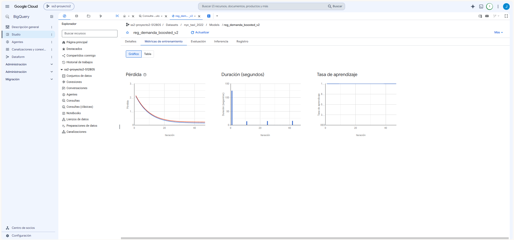

**Evaluación boosted de demanda**

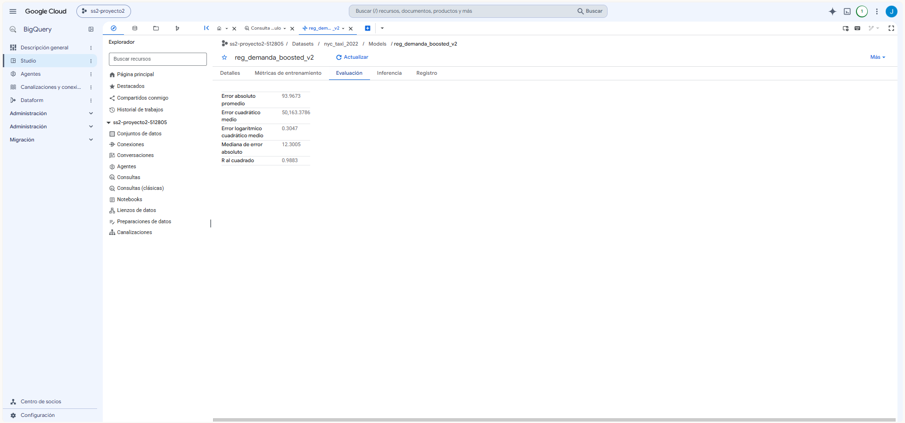

**Configuración del clasificador**


**Evaluación del clasificador**

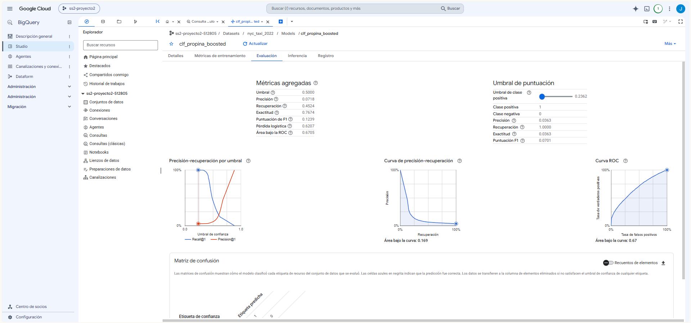

**Comparación de regresión**


**Comparación de clasificación**

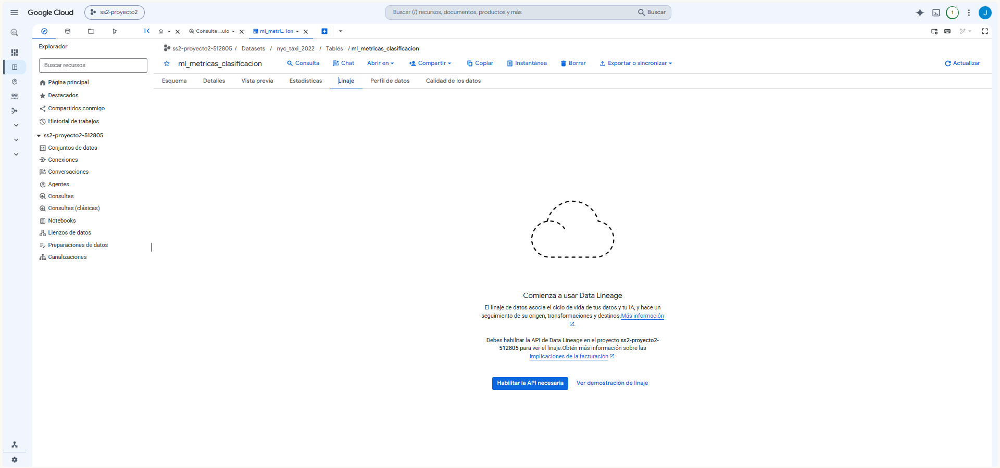

</details>

<details>
<summary>Predicciones almacenadas</summary>

**Predicciones de demanda**

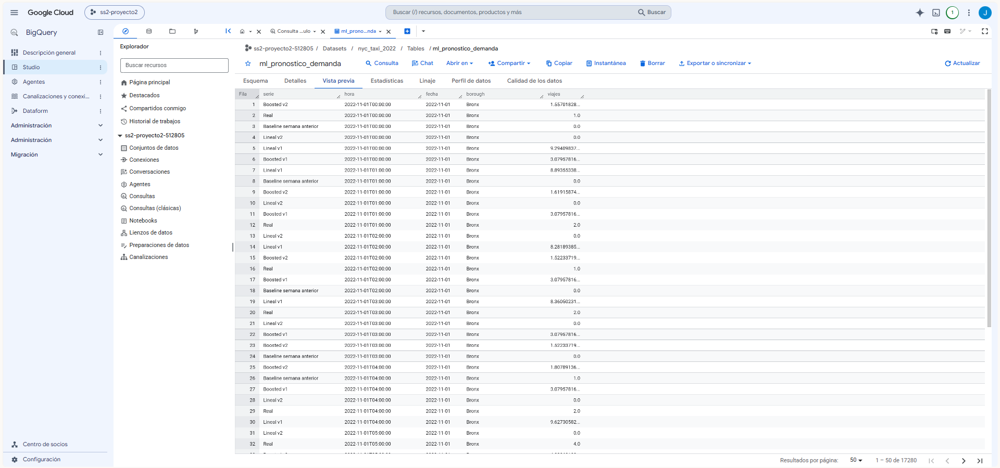

**Predicciones de propinas**

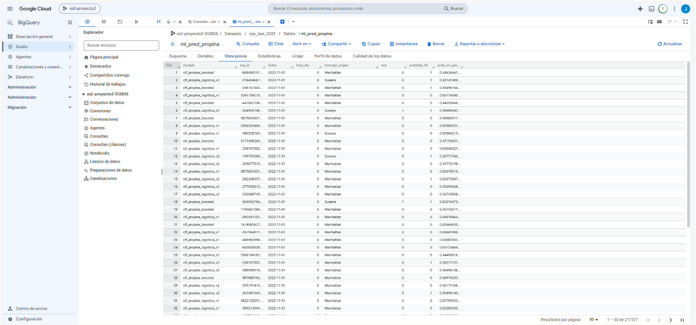

</details>

### 16.2 Trabajos anteriores de optimización

Se recuperaron del historial los siete trabajos de S1 a S3, sin volver a ejecutar SQL.
Las capturas muestran el SQL y las estadísticas del trabajo original. Las tablas temporales
de resultados figuran como vencidas; estas capturas acreditan el procesamiento registrado,
no una nueva ejecución ni la disponibilidad actual de sus resultados.

<details>
<summary>Ver trabajos de partición, clustering y optimización combinada</summary>

**S1: tabla estándar**

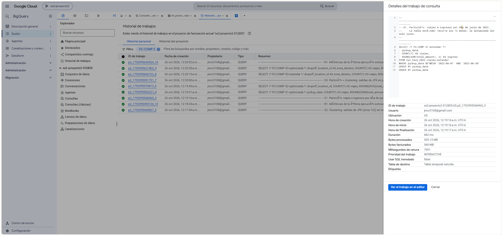

**S1: tabla optimizada**

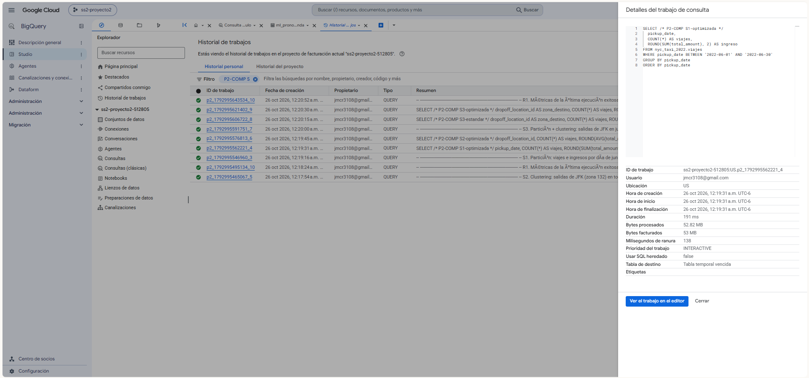

**S2: tabla estándar**

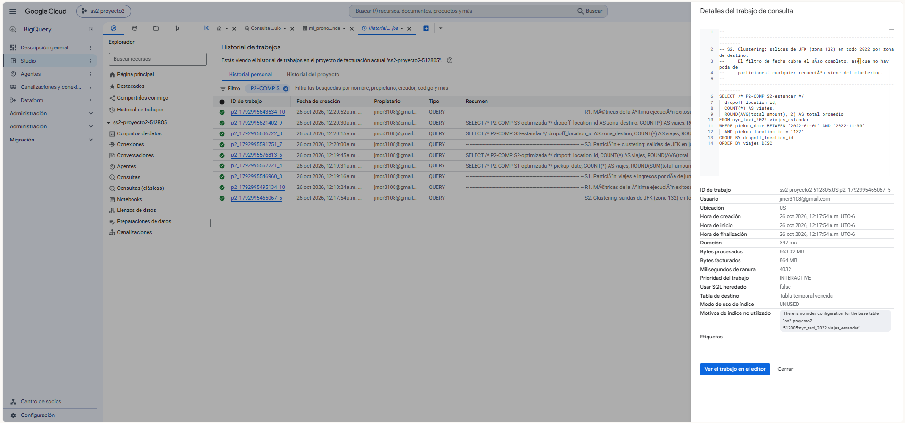

**S2: tabla optimizada**

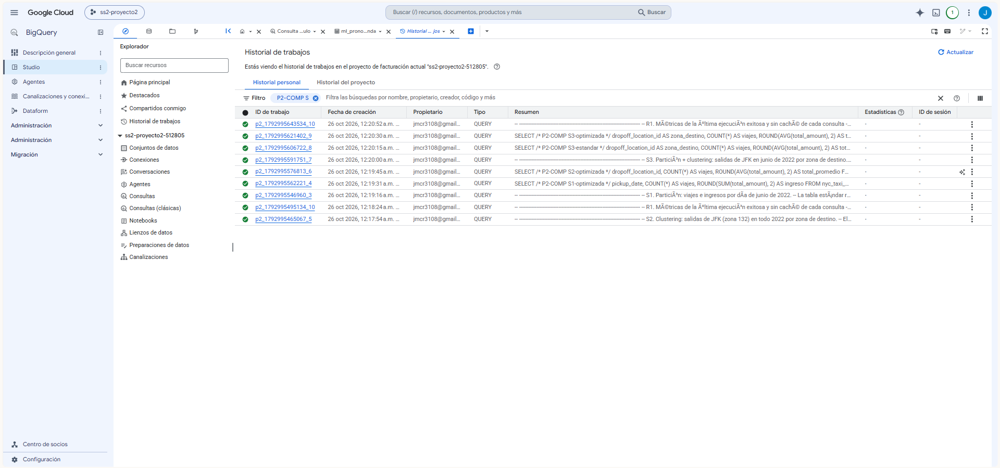

**S3: tabla pública**

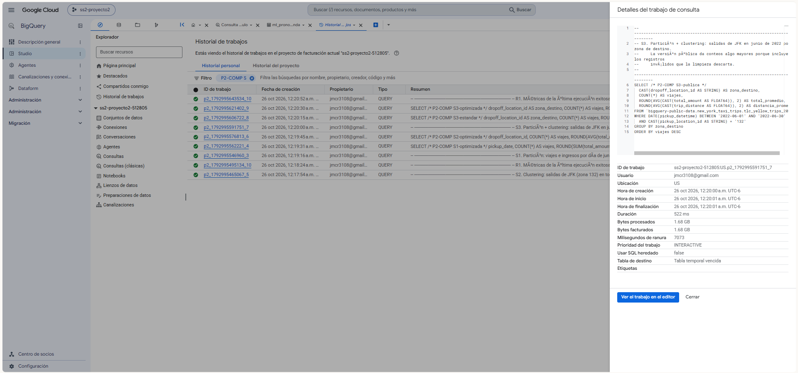

**S3: tabla estándar**

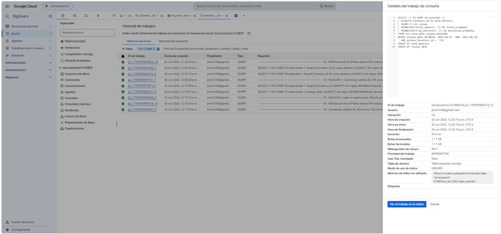

**S3: tabla optimizada**


</details>

### 16.3 Control de calidad ejecutado con autorización

El 27 de octubre de 2026 a las 21:27 (Guatemala) se ejecutó únicamente el bloque 5
de `sql/01_exploracion_calidad.sql`, previa autorización del usuario. Los 13 conteos
obtenidos coinciden con las reglas de calidad reportadas en la sección 2.4.
No se reentrenaron modelos ni se ejecutaron los archivos completos.

La información del trabajo indica **3.13 GB procesados**, **3.13 GB facturados**
y una duración de **1,984 ms**. Los bytes facturados son la métrica de consumo
de BigQuery; no acreditan por sí solos un cargo monetario, que depende de la
cuota gratuita y de la facturación de la cuenta.

**Resultados de calidad**

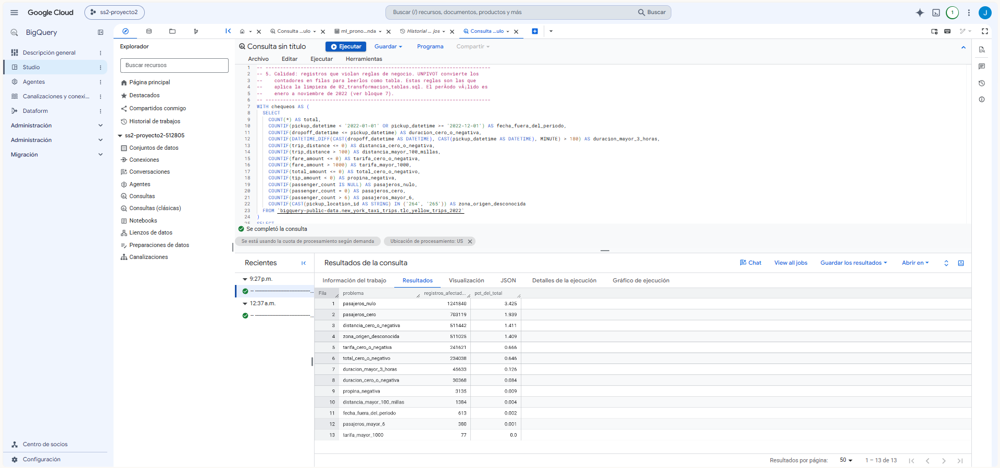

**Información del trabajo**

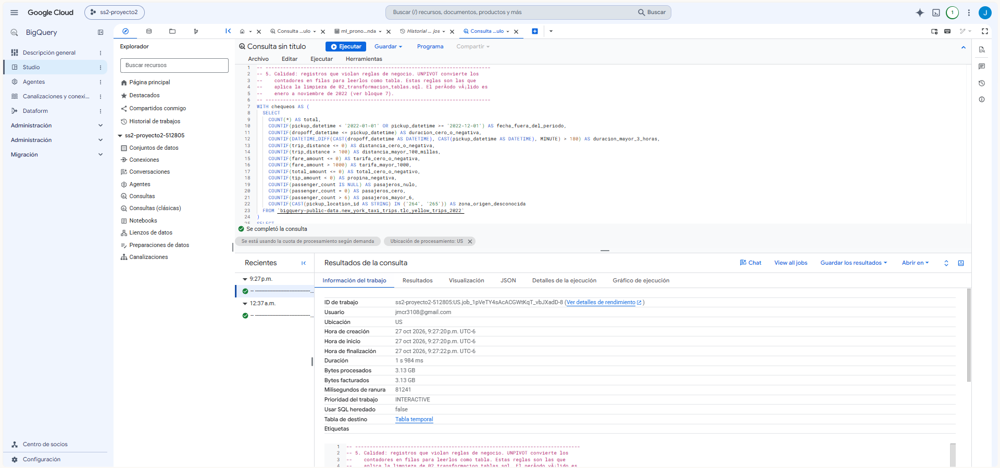

### 16.4 Conteos por conjunto y controles de fuga

El 27 de octubre de 2026 a las 21:33 (Guatemala) se ejecutó, con autorización del
usuario, [bqml/06_controles_documentacion.sql](bqml/06_controles_documentacion.sql).
Agrupa cinco controles de solo lectura sobre tablas existentes; no crea tablas ni entrena
modelos. Devuelve 13 filas. La comparación de fuga consulta métricas ya almacenadas,
no vuelve a evaluar ni entrenar los modelos.

**Consumo observado:** 18.94 MB procesados, 40 MB facturados y 607 ms de duración.
La diferencia entre lectura y facturación corresponde a los mínimos por tabla.

**Demanda por conjunto**

| Conjunto | Filas | Desde | Hasta | Sin dato | Estimadas |
|---|---:|---|---|---:|---:|
| descartado | 2,688 | 2022-01-01 | 2022-01-28 | 0 | 0 |
| entrenamiento | 20,640 | 2022-01-29 | 2022-08-31 | 0 | 0 |
| prueba | 2,880 | 2022-11-01 | 2022-11-30 | 0 | 672 |
| validacion | 5,856 | 2022-09-01 | 2022-10-31 | 132 | 0 |

**Rezagos:** 31,968 filas comparadas y **0 rezagos incorrectos** para el control de 24 horas.
Este control verifica la alineación del rezago; por sí solo no demuestra ausencia de toda
fuga de información. Se complementa con las decisiones descritas en la sección 8.4.

**Propinas por conjunto**

| Conjunto | Viajes | Sin propina | Porcentaje sin propina |
|---|---:|---:|---:|
| entrenamiento | 734,235 | 26,387 | 3.59 % |
| prueba | 72,459 | 2,511 | 3.47 % |

El conjunto denominado `entrenamiento` de propinas contiene enero-octubre; BigQuery ML
separa internamente un 20 % para evaluación. Estas cifras no son un conteo separado del
split interno. Noviembre permanece como prueba temporal.

**Comparaciones de fuga:** se confirmaron los valores reportados en 8.4: el modelo lineal
con split aleatorio tiene RMSE 277.11 en evaluación y 336.54 en noviembre; el temporal,
286.25 y 343.37. El clasificador de demostración con variable de fuga registra AUC
0.8372 en evaluación, frente a 0.6881 de la logística v2 válida. La brecha entre
evaluación y prueba también puede reflejar cambios temporales: no prueba por sí sola
fuga de datos. El modelo con fuga no se selecciona como modelo válido.

Resultados completos: [TSV copiado de BigQuery](evidencias/controles_documentacion.tsv) y
[JSON estructurado a partir del TSV](evidencias/controles_documentacion.json).

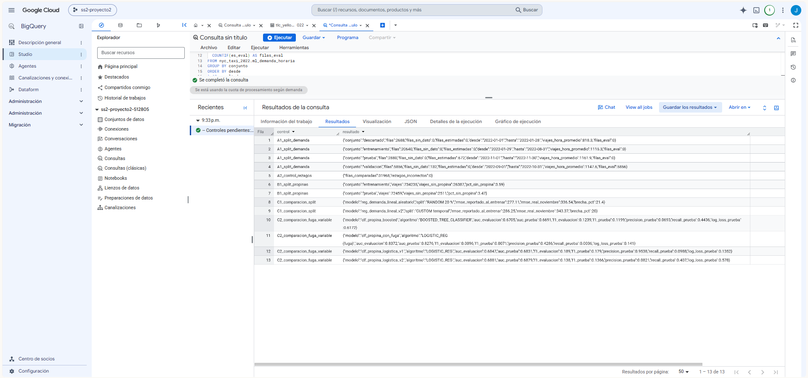

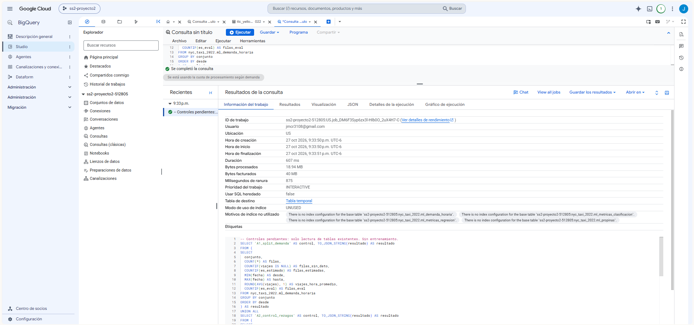

### 16.5 Revisión final frente al enunciado

Se contrastaron nuevamente las secciones 3.2, 3.4, 9.1 y 9.4 del enunciado con los archivos
locales. Están presentes el README con ambos integrantes, los scripts comentados, evidencias
de volumen y optimización, modelos y comparaciones, controles de separación de datos,
predicciones y el enlace al informe visual. Las capturas del informe muestran más de tres
visualizaciones exploratorias y la comparación de varios modelos en rolling forecast.
No falta un apartado técnico obligatorio del README.

La lista de respaldos específicos del inventario sigue vigente para cifras o diagnósticos
que no aparecen en las evidencias adjuntas. No equivale a una exigencia de nuevas secciones,
42 imágenes o un informe PDF separado. La revisión documental tampoco garantiza el puntaje
de la evaluación ni sustituye la demostración de funcionamiento.

Antes de entregar en GitHub, verificar que los archivos locales estén incluidos en la versión
publicada y que el enlace del dashboard mantenga acceso de lectura. Esta revisión no publicó
cambios ni volvió a abrir GCP para comprobar su estado actual.
